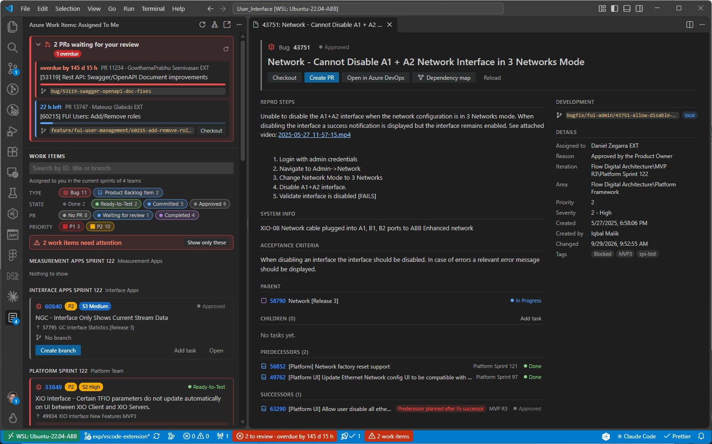

# Totalflow X devtools for Azure Devops (VS Code extension)

Brings the Azure DevOps work of the current sprint into VS Code: your Backlog Items and Bugs, their tasks, branches, pull requests and CI runs, and the problems the team agreed to avoid.



## Features

- **[Your work items](#usage)**: the Backlog Items and Bugs assigned to you in the current iteration of all your teams, as cards with their priority, severity, state, parent, branch and pull requests. Filter them by type, state, PR state and priority, or search them.
- **[Branches and pull requests](#usage)** that follow the team conventions:
  - Branches: `<feature|bugfix>/<module>/<id>-<short-name>`, e.g. `feature/fui-admin/5641-network-restart-button`. Creating one links it to the work item and moves it to Committed.
  - PR titles: `[<ids>] <Feature Name>: <description>`, e.g. `[123,554] FUI Administration: Show the network configuration`.
- **[Current work item](#work-item-of-the-current-branch)** in the status bar, also when you check out a colleague's branch to review it.
- **[My pull requests](#my-pull-requests)** in the sidebar: reviewers and votes, unresolved comments, conflicts, CI, auto-complete, and the next step before the merge, from the branch policies.
- **[Compact rows](#layouts)** that unfold into the full card.
- **[Work item editing](#usage)**: change states, add tasks, and see the full details (description, acceptance criteria, effort, tags, parent, children) in an editor tab.
- **[Alerts](#alerts)** for the work items that break the team rules (Done with open tasks, missing PR task, blocking tags, empty required fields…), in the cards, the activity bar badge and the status bar. **[Integrated in Build](#integrated-in-build)** can be filled in one click from the last release of the deploy image.
- **[Track board](#4-track-board)**: your Backlog Items and Bugs of the sprint in six columns, one per station of the track (To start, Branch · Draft, CI, Review, Ready to be merged, Done), with the PRs you review under them, a side drawer with the details and actions of a card and a summary when you hover it.
- **[Sprint timeline](#5-sprint-timeline)**: one row per work item on a working-days axis, by station (branch, pull request, CI, review, ready to be merged, needs you); click a row for its PRs with their lifecycle and events, plus the reviews you owe with their deadline and the history of develop.
- **[Dependencies](#6-dependency-map)**: predecessors and successors in the Work Item Details panel, and an interactive map by iteration that highlights the risky ones.
- **[CI pipelines](#ci-pipelines)**: live state of the runs validating your pull requests, in the cards and the status bar, with a notification when they finish. A loud **[alarm when develop is broken](#when-develop-is-broken)**.
- **[Leftover worktrees](#leftover-worktrees)**: a Worktrees view that tells which worktrees can be removed (PR merged or abandoned, review over, work item closed, branch deleted), a Summary row, a one-time notification and a cleanup picker.
- **[Pull request notifications](#pull-request-notifications)** when your PRs get comments or votes, or are merged.
- **[Reviews](#pull-requests-waiting-for-my-review)**: the PRs waiting for your review at the top of the sidebar and in the status bar, with the time left before the 24 hours run out, orange when due soon and red when overdue, one-click checkout of their branch, plus notifications, reminders, a daily digest, and notifications when your review comments are answered or resolved.
- **[Fun](#fun)** (opt-in): confetti when your PRs are merged, your green CI streak, a clean-board badge, a sprint countdown and a sprint wrap-up.

## Install

```sh
npm install
npm run package
code --install-extension vscode-azdo-workitems-0.1.0.vsix
```

To debug it, run the launch configuration **Run Azure Work Items Extension** (F5).

## 1. General rules

What the extension reads, the team rules it enforces and the actions it offers, whatever view shows them.

### Which work items

Organization, project and repository are detected from the `origin` remote.

By default the view lists your work items in the current iteration of **every team you belong to**. Teams sharing the same sprint are merged; when your teams are in different sprints, the items are grouped by iteration. Each group can be collapsed (click its name) to keep open only the iterations you are interested in; a collapsed group still shows how many work items it has and how many need attention. Use **Select Teams** in the view menu to limit the list to some teams (select none to go back to all of them). **Open Iteration Board** asks which team's board to open when there are several.

### Actions on work items and pull requests

Card actions:

- **Create branch**: pick the module, adjust the short name. The name is `<feature|bugfix>/<module>/<id>-<short name>`, except for the `devops` module: `devops/<id>-<short name>`. The branch is created from `origin/develop` (without switching to it; the module picker has a first row **Base: origin/develop · change…** to start from another branch instead, see below), published and linked to the work item's _Development_ section; then a notification offers to **Checkout** it or **Open in a worktree** (or just stay where you are). Product Backlog Items and Bugs in New / Approved / ReOpened / To Do are moved to **Committed** (`totalflowx.branches.workItemStateOnCreate`).
- **State** (the coloured state of a card or a nested task): pick the new state among the ones allowed for that work item type. **Done** of a Bug is marked _testers only_ and asks before moving it: developers stop Bugs at Ready to Test.
- **Add task** (Backlog Items and Bugs): creates a Task under the work item, in the same iteration and area and assigned to the same person. Tasks are never shown as cards of their own nor in the filters: they are always nested in the card of their Backlog Item / Bug, where they can be managed (and their state changed).
- **Work item ID** (in the header of a card or a compact row): opens the **Work Item Details panel** (its parent above the title, priority and severity next to the ID; for Backlog Items and Bugs a **state bar** and the **track**, see below) (an editor tab, one per work item): description, acceptance criteria / repro steps (with their images), assignee, effort, tags, parent, children, branch and PRs, with the same actions and an **Open in Azure DevOps** button. When the description links to Figma, **Figma design** opens it in the [Figma extension for VS Code](https://marketplace.visualstudio.com/items?itemName=figma.figma-vscode-extension) if it is installed, or in the browser; the button next to it always opens the browser. The Figma extension opens the file but not the linked frame; the browser opens the exact frame. Prototypes, FigJam and Figma Make links open in the browser.
- **Checkout**: switches to the work item branch (creating the local branch when it only exists in the remote). Only on cards with a single branch: with several, each branch row has its own Checkout. See [Worktrees](#worktrees) for checking it out without touching your current changes.
- **Base branch** (optional): the first row of the module picker shows the base. Picking it lists `origin/develop` (team default), the remote branches of the work item with the status of their PR (a completed PR gets a warning icon: its changes are probably already in `develop`) and **Other branch…** (all remote branches, filterable); Esc keeps the previous base. The branch starts from `origin/<base>`, also when created from a task. A base other than the default is remembered in the local git config of the repository (`branch.<name>.totalflowxBase`, per machine; nothing is sent to Azure DevOps).
- **Delete branch** (any work item or task, whatever its state): the team deletes the branches once their PR is merged, so a branch is offered for deletion when a PR from it is **completed**, the branch still exists (in Azure DevOps and/or locally) and no other PR from it is still active (abandoned PRs do not count; `develop`, `main`, `master`, `develop-*`, `release-*`, `release/*` and `hotfix-*` are never offered). It is shown as _not deleted_ on its branch row, which gets its own **trash** icon button ("Delete the branch <name>", red); the card gets a **Delete branch** button only when exactly one branch is deletable. Task rows offer **Delete branch <name>** in the picker of their pill (tasks of other developers do not). The command asks Azure DevOps again first, then confirms telling what is deleted (Azure DevOps branch, local branch, worktree; it warns about commits that were not pushed), switches to `develop` when the branch is checked out, and prunes the `origin/…` ref. Finished (Done, Ready to Test…) and **Removed** work items get no **Create branch**, **Checkout** or **Create PR** (only **Delete branch** when it applies). Existence in Azure DevOps is only asked for branches with a completed PR (cached for 10 minutes). When one of your PRs is completed and its branch still exists, the notification that offers to set the PR task to Done also offers **Delete branch** (one notification, not two). Also in the command palette: **Delete Branch of a Completed PR** (lists them all).
- **Create PR** (when the branch has no active PR; also available from the command palette for the current branch): pick extra work items to link (the ones already using the same branch are pre-selected), the feature name and the description. The branch is pushed and the PR targets `develop`, optionally as draft. When the branch was created from another base (see **Base branch**) and that branch still exists with no completed PR, it asks whether to target it or `develop`; the placeholder of the draft question shows `branch → target`. Then **PR task** asks what stands for "this PR is in review" (Backlog Items and Bugs have no such state): **Create task "PR: <description>"** under the work item (default), reuse an open task of the work item that has no active PR (e.g. "PID update"), or **No PR task**. The task is linked to the PR (not part of its title) and moves to **In Progress** when the PR is created published; a draft leaves it as it is. If the task cannot be created or moved, a warning says so and the PR is created anyway.
- **Create PR from a task**: the picker of a task row (click its pill) offers **Create PR from <branch>** for each branch of the task in this repository that has no PR (or only an abandoned one); branches with an active, draft or completed PR get none. A task with no such branch keeps **Create PR with this task** when it has no active PR (not offered for finished work items). It creates the PR of the parent work item with that task as its PR task (the "PR task" question is skipped). Source branch: the one of the item chosen in the picker, skipping any question; otherwise the branches linked to the task come first; among them (or among the branches of the work item when the task has none) the current one if it is one, else the only one in this repository, else you pick one; with none, it asks you to create a branch first.
- **Create branch from a task**: the picker of a task row (click its pill) offers **Create branch for this task** when the task is open, has no linked branch and its work item is not finished. It runs **Create branch** for the parent work item (same predecessors check and module picker) but the branch is named `<feature|bugfix>/<module>/<parent id>-<task name>` (the short name is proposed from the task title), several branches per work item being expected. The branch is linked to the task as well as to the parent, so the task knows its branch, and the task moves to **In Progress** when it was not started (the parent moves as usual).
- **Publish** (a draft PR of My Pull Requests) also moves the PR's open tasks to **In Progress**. PRs you published elsewhere (in Azure DevOps, or created published outside the extension) get the same: after each refresh of the list, the tasks linked to your published PRs (active, not draft) that are not In Progress move to **In Progress** and a notification says which ones. Only your own PRs, only the tasks of your work items (yours and your colleagues' tasks under them), and Done / Removed tasks are left alone (the alert and its **Fix** button cover them). Each task is moved once per session, so moving it back by hand sticks. Turn it off with `totalflowx.pullRequestTasks.startWhenPublished`.

### Alerts

Backlog Items and Bugs with problems the team agreed to avoid are flagged in red, with the list of problems in their card. A banner at the top of the view counts them (**Show only these** hides the rest), the activity bar icon shows a badge (see the [Summary view](#summary-view)) and the status bar shows them even when the view is closed.

The filters apply to work items with alerts too: when they hide some, the banner tells how many ("2 work items need attention (1 hidden by filters)"), and **Show only these** shows every work item with alerts, whatever the State, PR and Priority filters. To always show them instead, turn on `totalflowx.filter.alwaysShowAlerts`.

| Problem                                                                                                                                                                                                          | Applies to             |
| ---------------------------------------------------------------------------------------------------------------------------------------------------------------------------------------------------------------- | ---------------------- |
| Done / Ready to Test with tasks not done                                                                                                                                                                         | Backlog Items and Bugs |
| A published PR (not abandoned) has no PR task (each PR has its own, linked to it)                                                                                                                                | Backlog Items and Bugs |
| The PR is published (active, not draft) but the PR task is not In Progress                                                                                                                                       | Backlog Items and Bugs |
| The PR is completed but the PR task is not Done                                                                                                                                                                  | Backlog Items and Bugs |
| Effort or Effort in days is empty                                                                                                                                                                                | Backlog Items          |
| Integrated in Build is empty while Ready to Test                                                                                                                                                                 | Bugs                   |
| Integrated in Build has a value while the Bug is not Ready to Test nor Done (it was reopened: the build did not fix it)                                                                                          | Bugs                   |
| The branch of an open task (this repository) is not linked to the work item ("Branch … of task … is not linked to this work item")                                                                               | Backlog Items and Bugs |
| The PR of an open task is not linked to the work item ("PR … of task … is not linked to this work item"; abandoned PRs are ignored)                                                                              | Backlog Items and Bugs |
| A duplicate and its original (**Duplicate Of** link) are not planned in the same iteration ("Not planned with its original #…")                                                                                  | Backlog Items and Bugs |
| A duplicate and its original are not in the same state ("Is Committed but its original #… is Done")                                                                                                              | Backlog Items and Bugs |
| Work started (Committed, In Progress) but no task: the tasks are created when the work starts                                                                                                                    | Backlog Items and Bugs |
| A stretched item with more than one stretch tag (`totalflowx.alerts.stretchTags`); with `totalflowx.alerts.stretchTitlePrefix` set (empty by default), also the prefix without a tag or a tag without the prefix | Backlog Items and Bugs |
| A work item whose iteration is not in the sprint plan of any team owning its area (it never shows on their sprint board; silent when the teams could not be read) | Backlog Items and Bugs |

The PR task of a PR is the child task linked to that PR, whatever its title (completed PRs without a task are not reported: they are history; drafts are not checked). Only for PRs without any linked task, an unlinked task whose title contains "PR" or "Pull Request" is used, once (work items from before the tasks were linked). **Fix** next to an alert about a single task opens its state picker. **Link branch** next to a "branch not linked" alert asks for confirmation and adds that branch to the Development section of the work item (the alert covers every branch of every open task of the work item, not only the checked-out one; finished work items and Done / Removed tasks are not checked; Create branch for a task already links both, so it appears for branches linked by hand). **Link PR** next to a "PR not linked" alert does the same for the PR of a task (any repository; Create PR already links both, so it appears for PRs linked by hand). The duplicate alerts show on both sides of the pair (the original too, when it is in your list), and **Open** next to them opens the Work Item Details panel of the other work item: which one to move is your call. Tags, required fields, the work item types and the PR task pattern can be changed in the `totalflowx.alerts.*` settings.

#### Integrated in Build

When a Bug is Ready to Test, "Integrated in Build" must tell testers in which release the fix ships: the version of the **last published** `rmc.image.deploy` package (feed `bison_deployimage_rmc`) followed by `+` (the release after that one), e.g. `0.24.63+`.

- **Fill** next to the "Integrated in Build is empty" alert looks the version up and proposes the value, ready to confirm or edit.
- Moving a Bug to Ready to Test with the state picker of the extension proposes it right away when the field is empty (Escape skips it).
- A Bug that goes back from Ready to Test (or Done) to another state was reopened: the fix is not in that build. The alert "Is … but "Integrated in Build" is still …" shows until the field is emptied; **Clear** next to it asks for confirmation and empties it, so a new value is proposed when the Bug is Ready to Test again.

The feed, package, suffix, field and states can be changed in the `totalflowx.integrationBuild.*` settings. Fields can be named as in the work item form ("Integrated in Build"), as in the API ("Integration Build") or by reference name.

### Worktrees

Every **Checkout** (work items, PRs to review, My Pull Requests, details) can open the branch in a [git worktree](https://git-scm.com/docs/git-worktree) instead, so you do not have to stash your changes:

- When you have uncommitted changes, **Checkout** asks: **Open in a worktree** (recommended), **Stash and checkout**, **Checkout anyway** or Cancel. Without changes it checks out right away.
- The **…** next to Checkout (sidebar: branch rows, the card's Checkout button and the Checkout buttons of the PR boxes; also in the Work Item Details panel) opens the native picker, which always offers **Checkout here** and **Open in a worktree**. **Open in a worktree** in the task pill's picker and in the branch rows' picker creates the worktree when the branch has none, and opens it when it exists.
- Worktrees are created next to the repository, in `<repository>.worktrees/<branch>` (e.g. `User_Interface.worktrees/feature/fui-admin/5641-network-restart-button`), and open in a new window. From a worktree window too, they go next to the main repository (the folder with the real `.git`), never inside the current worktree. The `.env.local` files (at the root and in `apps/*`, `packages/*`, `tools/*`) are copied into it, and the new window runs `npm ci` in a terminal.
- A branch that already has a worktree adds a `⧉` to its badge (tooltip: the worktree folder), and its picker offers **Open worktree** and **Remove worktree** instead.
- **Remove Worktrees…** (view menus or command palette) lists all the worktrees of the repository, the [removable ones](#leftover-worktrees) first, to remove several at once. Removing a worktree keeps its branch; a worktree with uncommitted changes is only removed after confirming that they will be lost, and locked ones are skipped. Close the VS Code window of a worktree before removing it.
- **Delete branch** also removes the worktree of the branch (asking first when it has uncommitted changes).

- **Status bar order**, left to right: the develop alarm (only while broken), main / worktree, the current work item, CI, reviews, my PRs that need me, and `$(warning) 2 to fix` (work items that break a team rule; click it to open the Work tab; hidden at 0). Calm items have plain colours; the reviews item turns yellow when one is due soon and red when one is overdue, CI turns red when a run failed.
- **Main folder or worktree** in the status bar: `$(repo) main` in the original folder (the one with the `.git` directory; click it to show the Worktrees view), `$(list-tree) worktree` with a highlighted background in a worktree (hover it for a tree of the folders from the main one down to the worktree, `~` for your home folder; click it to open the main folder in a new window). It reads local git only (`totalflowx.worktrees.showInStatusBar`, on by default).

`totalflowx.checkout.mode` sets what **Checkout** does: `ask` (default), `branch` (always in place) or `worktree` (always in a worktree).

#### Leftover worktrees

Worktrees of merged PRs and finished reviews are easy to forget. The extension remembers what each worktree it creates is for (the work item, task, your PR or the PR you review) and tells you when it is no longer needed:

- **Can be removed** when its PR was merged or abandoned (or, for a worktree created from one of your PRs, the PR is no longer active), the review is over (the PR is no longer active for you), its branch was deleted in the remote (after a fetch that prunes), its work item or task is Done / Removed, or its folder is gone.
- **Idle** when its branch has had no commit for `totalflowx.worktrees.idleDays` (14), or you approved the PR it was opened to review.
- **In use** otherwise. Worktrees created outside the extension are recognised by their branch (your PRs, your reviews, the work items of the list).

Where it shows:

- The **Worktrees** view (below Summary, collapsed by default) groups them (Can be removed, Idle, In use). Each row shows the branch, why it can go (or what it is for), the age of its last commit and a ● when it has uncommitted changes. Inline buttons open the work item / PR, open the worktree in a new window, or remove it. The title bar has **Clean Up Worktrees…** and Refresh.
- The **Summary** view shows **N worktrees to clean up** (click it to clean up). It never counts in the activity bar badge (`totalflowx.worktrees.showInSummary`).
- A notification, once, when a worktree becomes removable: **Remove Worktree** or **Show Worktrees** (several at once: one notification with **Clean Up…**; `totalflowx.worktrees.notifyWhenStale`). When one of your PRs is merged, the [merge notification](#pull-request-notifications)'s **Delete branch** already removes its worktree, so no second notification is shown.
- **Clean Up Worktrees…** lists the removable ones (pre-selected) and the idle ones; **Remove Worktrees…** lists all of them in the same order, with the reason of each. Removing still asks first, keeps the branch and warns about uncommitted changes.

It costs no request to Azure DevOps: it reuses what the sidebar, My Pull Requests and the reviews already fetched, and reads local git (`git for-each-ref`, and `git status` in each worktree every few minutes).

### CI pipelines

Next to the state of each active pull request, the card shows the last run of each pipeline validating it (the builds of `refs/pull/<id>/merge`): queued, running with its elapsed time, succeeded, failed or canceled. Clicking a run opens it in Azure DevOps.

The runs of the PRs of your work items and of all your pull requests are followed. While a run is queued or running, only the runs are refreshed every 15 seconds (`totalflowx.pipelines.pollIntervalSeconds`); when none is, new runs (re-runs, new pushes) are looked for every minute (`totalflowx.pipelines.idlePollIntervalSeconds`, 0 to turn it off). A notification tells you when a run finishes (`totalflowx.pipelines.notifyOnFinish`). It names the pull request by its id and title and ends with the work items linked to it (`Work items: #1234, #5678`); click one to open its Work Item Details panel.

The status bar summarizes the runs of your pull requests even when the view is closed, as `CI` followed by a count per state by severity, e.g. `CI  ❌ 1  ↻ 1  ✅ 2` (order: failed, partially succeeded, running, queued, succeeded).

The colour of the item tells how the **checked out branch** is doing (its pull request's last runs, or the runs you queued by hand on it): red background when failed, orange when partially succeeded, and the text in blue while running, light blue while queued, green when succeeded, grey when canceled. A branch without runs (e.g. develop) leaves the item uncoloured; the tooltip says it (`Current branch: ❌ failed`). The text colours can be changed with `workbench.colorCustomizations` (`totalflowx.ci.runningForeground`, `queuedForeground`, `succeededForeground`, `canceledForeground`). Canceled runs only show in the tooltip (unless they are all there is). Hover it to see the totals and one block per pull request: its link and title, then each run indented below it with its pipeline and result (failed tests or coverage under the run). The pull request of the checked out branch comes first, marked ★ **Current branch**. The same colour icons are used in the item, the tooltip and the picker: ❌ failed, ⚠️ partially succeeded, a spinner while running, ⏳ queued, ✅ succeeded, 🚫 canceled. Click it to pick a run and open it (`totalflowx.pipelines.showInStatusBar`).

Besides your pull requests, the item also follows, from the last 24 hours (`totalflowx.pipelines.branchRunsHours`, 0 to turn it off):

- **AFTER MERGE**: the runs started on the target branch (e.g. develop) by the merge of one of your pull requests, whoever completed it;
- **RUNS WITHOUT A PULL REQUEST**: the runs you queued by hand on a branch, by branch.

They have their own sections at the end of the tooltip and count in the item, and you are notified when they finish ("Merge of PR 13837 "Fix login" into develop failed: …", "Run on exp/x passed").

#### Why a run failed

A failed run tells why: **N tests failed** (hover it for the failing tests and their error; click it to open the **Tests** tab of the run), or **Failed at <step>** when another step failed (lint, build, PR title…). Steps that only publish results are not taken as the cause.

#### Code coverage

Successful runs show how many tests ran and the coverage of the code tested by the run (the PR pipeline runs the tests affected by the PR), e.g. `95 tests · 87% ▲ +3.2%`:

- coloured by level: red below 60%, orange below 80%, green from 80%, gold with a trophy from 95% (`totalflowx.coverage.minimum` / `.target` / `.excellent`);
- `▲` in green when the coverage went up since the previous run of the PR; a decrease is shown without red;
- click it to open the **Code Coverage** report of the run in Azure DevOps;
- hover (or focus) it to see the files below the target, least covered first; click one to open it and add the missing tests;
- your **personal best** and your **streak** of PRs at or above the target are kept, and celebrated in the notification when a run of your PRs ends ("PR 13713 "Fix login" passed: 95 tests, coverage 100% 🏆. New personal best!").

When a run fails, the notification says why ("PR 13770 "Fix login" failed: 1 test failed (Other User Without Changes Sees Snackbar)").

### Fun

Small celebrations, **off by default**: turn them on with `totalflowx.fun.enabled`. Everything stays on your machine and nothing is compared with anybody.

- **Merged PRs**: confetti falls over the sidebar (when it is open) and the notification becomes `🚀 PR 13931 shipped: Fix the header. Your 3rd this sprint!`, with easter eggs for round or palindromic PR numbers (`🪞 PR 13931 reads the same backwards!`) and milestones (`🏅 That makes 25 merged pull requests!`).
- **Fast approvals**: the first approval of a PR within an hour of publishing it gets `⚡ First approval 40 min after publishing.` (within 15 minutes: `⚡ Lightning review`).
- **Green streak**: from 3 green CI runs in a row, the CI status bar item shows `$(flame) 7` (the tooltip tells your best), the run notification says `🔥 7 green runs in a row.`, and the failure that ends it says `💔 That ends a streak of 7 green runs.` Your own runs only: your PRs, your manual runs and the runs after your merges. Canceled runs do not count; a re-run of the failed jobs replaces the failure.
- **Coverage gain**: `🎯 +1.8 pts of coverage over your previous PR.` in the notification of a successful run.
- **Clean board ✨**: a row of the Summary view when none of your work items breaks a team rule (it never counts in the badge).
- **Sprint countdown**: `🌱 6 days left` before the sprint line of the list (in each group header when your teams are in different sprints), `🏃` with 2 working days left or less, `🔥 Last day` on the last one. Working days follow `totalflowx.reviews.workingDays`.
- **Sprint Wrap-up**: on the last day of the sprint you are offered your recap: PRs merged, opened and reviewed, work items done, CI green rate and best streak, quickest merge, longest ride, fastest first approval, and whether you reviewed more than you opened (🤝 Net giver). Open it any time with **Totalflow X: Show Sprint Wrap-up**. It counts what the extension saw since this version was installed, also while the fun features are off.

**Sounds** (`totalflowx.fun.sounds`, off by default, needs `totalflowx.fun.enabled` too): a short, quiet rising chime when one of your PRs is merged, a ding when your green streak sets a new record, and a low "bonk" when a failure ends a streak. The sidebar plays them, so only while it is open and visible; nothing is played for comments or votes.

Animations (confetti included) respect the system's reduced-motion setting. More card animations for the work item you are working on are in `totalflowx.workingOn.animation` (see [Work items you are working on](#work-items-you-are-working-on)).

### Diagnostics

- **Show Azure DevOps Usage** (command palette) opens a report of the requests made to Azure DevOps since the extension started and in the last hour: requests per feature (sidebar, CI runs, My Pull Requests, Waiting for your review, PR notifications, dependency map, Track board, Sprint timeline, Whole team view, Work Item Details panel, status bar, commands), requests per minute (averages, busiest minute, the last 15 minutes), and errors and throttling (by status, the last errors, throttled responses with Azure DevOps' rate-limit headers).
- **Show Request Log** opens the **Totalflow X** output channel. With `totalflowx.diagnostics.logRequests` on, it logs one line per request: time, method, status, duration, feature and URL (never headers, tokens or bodies). Off by default; the counters of the report cost nothing noticeable either way. Errors (for example a failed git command, with the command and what git printed) are always written to the same channel, whatever that setting says; the error notification has a **Show Output** button.

## 2. Sidebar

### Usage

Open the **Totalflow X** container in the activity bar: its **Assigned to Me** view (the list under the **My Work Items** heading) lists only the work items assigned to you (the line under the search box and the view title tell from which sprints and teams). The first time, VS Code asks you to sign in with your Microsoft account.

The view has three **tabs**, under a **sprint strip** (the sprint, the working days left and one segment per working day, the ones already over filled; with teams in different sprints, the one that ends first). The alarm of a [broken develop](#when-develop-is-broken) stays above the tabs, whatever the tab:

- **Now**: everything that needs you, one row each, by who waits on whom: **Review** (a pull request waiting for your review, the most urgent first), **Unblock** (one of your pull requests needs you: a reviewer sent it back, conflicts, failed CI, unresolved comments, a team rule), **Fix** (a work item breaks a team rule), **Ship** (one of your pull requests is ready to merge and you complete it) and **Clean** (worktrees and branches that can go). Click a row to unfold it in place, with the same card and buttons as in the other tabs. Below, the work items you are working on, with their **track**. The count of the tab is the number of rows (the Clean one excluded), plus 1 while develop is broken.
- **Work**: the search, the filters and the list of your work items, as described below.
- **PRs**: [Waiting for your review](#pull-requests-waiting-for-my-review) and [My pull requests](#my-pull-requests). The count tells how many pull requests wait for your review, then how many of yours are active.

The **track** of a Backlog Item or Bug shows the six stations its work goes through: Branch, PR, CI, Review, Ready to be merged and Done (Ready to Test for Bugs: only testers move them to Done). Each one is green when passed, blue while someone else (or the CI) has it, orange when it needs you, red when it breaks a team rule, grey when not reached; the line under it names the station to look at. A draft PR is the active station (you review it before publishing it); CI starts when the PR is published; peers may review while it runs. Large cards show it under the title, compact rows as six small segments before the other signals (hover them for each station).

Each work item is a card with:

- ID (opens the work item in Azure DevOps), **Priority** (`P1`–`P4`) and, for Bugs, **Severity** (`S1 Critical` … `S4 Low`), coloured from red (most urgent) to grey; the type is shown by the icon. And the state
- Title
- Parent: ID and title of the parent (click it to open its Work Item Details panel), unless the card is nested in its parent's card. Children (e.g. Tasks) are nested at the bottom of the parent card
- Branches: every branch of the work item: the ones named after it (`local`, `current` when checked out, or `remote` when it only exists in the remote), the ones linked in its Development section (`linked`) and the source branches of its active PRs. The branches of other repositories are faded and in italics (hover them to see the repository). Each row is compact so the name keeps the width (cut with … when long; hover for the full name): **one badge** (`current`, `local`, `remote`, `linked`, or `not deleted`; a `⧉` is added when another worktree has the branch, e.g. `local ⧉`, and the badge turns into a blue outline; hover it for the full explanation, including the worktree folder), then the **Checkout** icon button (**Open worktree** icon when another worktree has the branch) with its **…** (more actions), and a red **trash** button when the PR is merged. The **…** opens the same native **picker** as the task pill: **Checkout here** and **Open in a worktree** (**Open worktree** and **Remove worktree** when another worktree has the branch) and, when the PR is merged, a red **Delete branch <name>**. It is only there for the branches of this repository that have something to do (with several branches, the card has no **Checkout** of its own: it would be ambiguous). The Work Item Details panel opens the same picker from its **…** buttons (without the Delete item: its trash button is there); its other buttons (Create PR) act on the main one
- Bugs fixed by a Backlog Item (the Backlog Item is a predecessor of the Bug): the Backlog Item shows **Fixes N bugs** with their IDs, and the Bug shows **Fixed by** with the Backlog Item's ID, each followed by a dot with its state (click an ID to open its Work Item Details panel; done ones are faded). The Work Item Details panel marks these links in its Predecessors / Successors lists
- Duplicates (a work item linked **Duplicate Of** another one): the duplicate shows **Duplicate of** with the original's ID and a dot with its state (its iteration in the tooltip), and its card is toned down (dashed left bar, faded title; back to normal on hover, and never while it has an alert), since the work is tracked on the original. The original shows **Duplicated by** with the IDs of its duplicates. In the compact rows a copy icon shows the original's ID (on a duplicate) or the number of duplicates (on an original). The **Dups** filter row (only when some card is a duplicate) hides the duplicates (`totalflowx.filter.hiddenDuplicates`)
- Pull requests linked to the work item with their status (the PRs of other repositories are faded and in italics; hover them to see the repository). Only the PRs of this repository decide whether **Create PR** is offered: Draft, In review, Approved, Waiting for author, Rejected, Conflicts, Completed, Abandoned

Cards are sorted by state: Done, Ready to Test, In review, Committed, In Progress, Approved, ReOpened, New, To Do (`totalflowx.workItems.stateOrder`). Done and Ready to Test are shown in green, In review, Committed and In Progress in blue.

**In review** is a derived state: Azure DevOps has no such state for Backlog Items and Bugs, so a Committed work item shows **In review** when its only open tasks are In Progress PR tasks (title matching `totalflowx.alerts.pullRequestTaskPattern` or linked to a PR) and every other task is Done (Removed tasks are ignored). It is display only: the State filter, the sort, the card, the Work Item Details panel, the status bar and the Dependency Map (for your own work items) show it, but nothing changes in Azure DevOps and the alerts, task rules and **Change state** keep using the real state (hover the state to see it). Turn it off with `totalflowx.workItems.showInReviewState`.

Within each state, cards are sorted by priority, then severity. The filter chips are folded by default: the funnel button next to the search box shows them (its badge counts the values hidden by the filters, and the "hidden by filters" note at the end of the list opens them too). Use the **Type**, **State**, **PR** and **Priority** chips to filter the cards (coloured like the cards; the hidden values are grey and dashed) (by default only Product Backlog Items and Bugs, hiding Done / Removed / Closed), and the search box to find them by ID, title or branch. The PR filter uses the main PR of each work item (the active one, or the most recent), or `No PR`.

#### Layouts

In the **Work** tab every work item is a compact row that unfolds into the full card in place:

- **Compact row**: two lines per work item. The first one has the type, ID, title and state; the second one only the signals that apply: priority / severity, branch (`current`, or `not deleted` for finished work items), main PR state, CI state of the main PR, task progress (`☑ 2/3`) and alerts (`⚠ 2`). Hover a signal for details. Click a row to expand it into the large card, with its buttons and tasks; click its header to fold it back.
- **Full card** (unfolded, and the work items of the Now tab): described below.

Unfolding / folding a compact row (work items and both PR boxes), expanding / collapsing the **Waiting for your review** and **My Pull Requests** boxes, and opening / closing the **Tasks** of a card (one, or all with **Expand / Collapse all tasks**) are animated (a box grows or shrinks, the rest slides); each card morphs from one form to the other in about 0.2 s and the rest of the view slides to its new place. Nothing moves when the system asks for reduced motion.

**Look**: by default the sidebar uses the colours and font of your VS Code theme. Set `totalflowx.appearance.look` to `totalflow` for the palette and fonts of the Totalflow X design (IBM Plex Sans, IBM Plex Mono and Space Grotesk, bundled with the extension under the SIL Open Font License), in a dark or light variant following your theme. High contrast themes always keep their own colours.

Hovering (or focusing with the keyboard) a work item card or a PR tile does not change its background, so the text keeps its contrast: by default the whole border takes the colour of the tile's left bar and a soft shadow lifts the tile (`totalflowx.appearance.hoverStyle`; see the settings table for `tint` and `accent`).

#### Tasks

The tasks of a card are folded under a `Tasks` line with a slim segmented line (To do, In progress, Done, left to right): each segment is as wide as its share of the tasks, in the colour of its state (grey To do, blue In progress, green Done), and carries its count in a small circle on the line (`totalflowx.tasks.countStyle`: `filled` by default, or `outlined`); the Removed ones are not counted. Hover it for the numbers in words. Compact rows show the same counts as `to do/in progress/done` (e.g. `2/1/3`), each number in the colour of its state. Tasks assigned to other developers are listed too, with their initials. Each task shows **one pill** with its branches and PRs: a branch icon (highlighted when it is the checked out branch, blue when local, grey when only in Azure DevOps, dimmed when **deleted** or in **another repository**; Development links outlive branches, so existence is asked to Azure DevOps and cached for 10 minutes) and a PR icon (coloured by the state of the most relevant PR), each with a count when there are several. A task with nothing linked, when a branch or PR can be created or a branch linked, shows a dim **+** pill; finished tasks with nothing linked show none. Hover the pill for the details of every branch (name, state, repository, its PR) and PR (state, repository, author, target branch, reviewers, CI): a card under the pill, up to 360 px wide and always inside the view, that ends with a muted **Click for actions** hint when there is something to do. After you click the pill, its card stays hidden until the pointer leaves it. Like every popover of the view (this card, the coverage details, the open predecessors and the history of a PR), it waits a short delay on hover (`totalflowx.popovers.hoverDelay`, 500 ms by default, 0 shows it at once) and then fades in; keyboard focus shows it at once (you can Tab into the files of the coverage popover), **Esc** closes it, and it always stays inside the view, however narrow the sidebar is. Click it (or press Enter / Space) to pick an action in VS Code's own **picker** (the list at the top of the window, with the room, keyboard and theme of any VS Code list; Esc closes it), titled `Task 123 · title`, with a section per kind: **Checkout** and **Open in a worktree** per branch that exists in this repository, **Delete branch** when its PR is merged (it still asks for confirmation), **Open PR** per PR, **Create branch for this task** and **Create PR from <branch>** (per branch without PR; **Create PR with this task** when the task has no usable branch). A last **Link** section links an existing branch to an open task of an open work item: **Link to <branch>** per branch of the work item that the task does not have, and **Link another branch…**, which lists the branches of the remote (the work item's first). After a confirmation the branch is added to the Development section of the task, and of its work item when it does not have it yet. Each item has an icon per kind of action, the same in every picker (Checkout, Open in a worktree, Remove worktree, Delete branch, PRs, Create…); the icon colours (blue, orange, red, green, yellow) are applied when your VS Code version and theme draw them. Branches that only inform (checked out, deleted, in another repository) are shown on the hover card, not in the picker. A card whose alerts are about its tasks shows them unfolded. The **Expand all tasks** / **Collapse all tasks** buttons next to the **My Work Items** title fold or unfold every card.

### Work items you are working on

The work items of the checked-out branch are highlighted: a tinted card with an accent border and a **● Working on** badge (in compact rows too). You may work on several at once:

- **Worktrees**: the work items of branches checked out in other worktrees are marked **⧉ In worktree**, in the blue of "working here" with a lighter touch (dashed border, outline badge, no tint; purple is kept for completed PRs) (`totalflowx.workingOn.showWorktrees`).
- **Linked work items**: besides the work item whose ID is in the branch name, the ones linked to the PR of the branch, to the branch itself (Development links) or to a **task** whose branch is the checked-out one are highlighted too (`totalflowx.workingOn.includeLinkedWorkItems`).
- **Task rows**: in a card's task list, the row of the task whose branch is checked out here has a light blue tint and a bold title; a task whose branch is checked out in another worktree has a thin dashed blue outline (`totalflowx.workingOn.showWorktrees`). Rows keep their height and do not animate; screen readers hear "Checked out here" / "Checked out in a worktree".
- **Never hidden**: they ignore the State / PR / Priority filters and stay visible in a collapsed iteration group; the Type filter and the search still apply (`totalflowx.workingOn.ignoreFilters`).
- **Working on section**: they are listed, as full cards with their track, under the queue of the **Now** tab, this window's first.
- **Animation** (optional, only for the card "here"; "In worktree" cards stay still): `totalflowx.workingOn.animation` = `none` (default), `borderLight` (a soft band travels down the thick left border), `runningBorder` (a short bright segment runs around the card border, as thick as the left border on that side), `glow` (a soft blue halo breathes), `stripes` (diagonal stripes slide inside the badge), `rainbow` (the thick left border cycles through the rainbow), `neon` (a neon outline that flickers now and then) or `retro` (faint CRT scanlines roll down the card). `totalflowx.workingOn.pulseBadge` (on by default) makes a halo expand from the **Working on** badge (and from the dot of the compact row) and fade out every 2 s; it combines with any animation. Nothing moves when the system asks for reduced motion.

Turn any of these settings off to keep only the highlight. The status bar item of the current work item has **Show in sidebar**, which scrolls to its card and makes it flash.

### My pull requests

The **My Pull Requests** box, above your work items, lists the pull requests you created, in all the repositories of the project: the active ones (drafts included; **Hide drafts** in its header, or `totalflowx.myPullRequests.showDrafts`) and, faded, the ones completed in the chosen period (last 24 hours by default). Each card shows:

- the PR, its status, the target branch when it is not `develop`, and its linked work items (click one to open its Work Item Details panel);
- how long it has been published, counting working days only like the reviewers' time (since its creation, in calendar time, for drafts). Hover it, or focus it with the keyboard, to see the history of the PR: creation, publication, pushes, reviewers added, votes, comments, auto-complete, completion;
- the reviewers with their votes (required ones marked);
- unresolved comments, conflicts, CI runs (only when the PR has some) and an **Auto-complete** pill;
- warnings when auto-complete will **not delete the branch** (team rule: branches are deleted after merging), or will merge into `develop` with another merge type than **squash** (team rule: one commit per PR on develop), and, in red, when it will **complete a linked Bug**: "Auto-complete shouldn't complete the linked Bug: Only testers have that prerogative.";
- muted cautions, which never keep the PR from being ready: open for more than 5 working days (`totalflowx.myPullRequests.maxOpenDays`) or changing more than 30 files (`totalflowx.myPullRequests.maxFilesChanged`): the team keeps PRs small and branches short-lived;
- **N commits behind develop**, with a **Restart merge** button (after a confirmation). Being behind is not a problem by itself, but Azure DevOps only finds the conflicts with the new commits of develop when it merges the PR again; Restart merge asks it to, and the conflicts show on the card if there are some. Costs one request per PR after a push, then at most every 10 minutes;
- on active PRs that target a branch other than `develop`, a warning when that branch no longer exists or its PR (yours) was completed, with a **Retarget to develop** button (after a confirmation: the branch may need a rebase because the base was probably squash-merged). It uses the PRs already polled; no extra requests
- on published PRs, warnings when they break the team rules: a title not following `[<IDs>] <Feature Name>: <description>`, no description, fewer than 2 required reviewers (people, not groups; `totalflowx.myPullRequests.minimumRequiredReviewers`), or no Backlog Item / Bug linked;
- **Next**: what still blocks the merge, from the blocking branch policies of the PR, e.g. `1 more approval needed · Choose an allowed merge strategy`, `Approval of Kamil Borecki EXT, Krzysztof Siwak EXT missing` (required reviewers who have not approved yet), `No approvals yet`, `Fix the warnings` (only the warnings are left), or `Ready to merge` / `Will complete automatically` (never shown while the PR has warnings).
- **Sent back by a reviewer**: a reviewer who voted **Waiting for author** (or **Rejected**) means you have to act, even when the branch policies are satisfied (they do not count those votes). The card gets a warning ("Paulina is waiting for you: address their comments, then ask for a new review"; Rejected is an error), the Next line says `Address the feedback of …`, the PR is never **Ready to merge**, and it counts in the Summary's "pull requests with warnings". The status badge is solid amber (Waiting for author) or red (Rejected) so it reads on any tile.

**Build notes**: changes testers should know about must be explained in one of the build notes files, one per feature: `build-notes/*-notes.md` (e.g. `pid-notes.md`; `_template.md` does not count); a PR without such changes must be tagged `no-build-notes` instead. A published PR of this repository that does neither gets a warning, with an **Add tag no-build-notes** button (after a confirmation). The tag comes with the PR list at no cost, and whether the PR changes a notes file takes one request per PR, repeated only after a new push. **Create PR** checks it too, with local git: when the branch changes none of the notes files, it asks whether it has changes for testers, and either lets you pick the notes file to open (listed with the feature name of its first heading) or creates the PR with the tag (`totalflowx.buildNotes.enabled`, `directory`, `fileSuffix`, `skipTag`).

PRs that nothing stops from being merged (published, every blocking policy satisfied, approvals included, **every required reviewer has approved** even when the target branch has no branch policies, at least one approval from someone other than the author, no conflicts and no warnings) are highlighted in green (**Ready to merge**). When a PR breaks a rule that only someone else may act on (e.g. auto-complete would complete a Bug), its **Next** line is red with a warning icon, even when it says _Will complete automatically_.

Completed PRs also show how long they took and where the time went. The row says "completed 3 h ago · took 1 d 6 h" (working days only, creation to completion; `totalflowx.reviews.workingDays`). The expanded card draws a **mini timeline**: a bar with rounded ends and one coloured band per phase (**Draft** grey, **In review** blue, **Waiting for author** orange, **Ready to merge** green), dots for the events (published, pushes, approvals, "waiting for the author", rejections, auto-complete), the creation and completion dates at both ends and a legend with each phase and its duration. Hover a band or a dot for the dates or the event. With at least two completed PRs listed, the box header summarises them, e.g. "Completed PRs: median 1 d 2 h, mostly waiting for review". It is computed from the comments already fetched: no extra requests.

The selector in the box options (**Completed: hidden / 24 h / 7 days / 30 days**, saved in `totalflowx.myPullRequests.completedPeriod`) sets how far back the completed PRs are listed; the latest 50 completed PRs are fetched. When hidden, the box says how many were completed in the last 24 hours.

Both PR boxes have their own layout button: **compact** rows (2 lines: PR, title and state; then the main signals) by default, or the **large** cards; click a compact row to unfold it (`totalflowx.reviews.layout`, `totalflowx.myPullRequests.layout`).

Buttons: **Open PR**, **Checkout** (PRs of the repository open in VS Code), **Publish** for drafts (after a confirmation: reviewers are notified) and **Complete…** for the PRs ready to merge without auto-complete (the author completes the PR). Complete… lists everything in one confirmation, then squash-merges the PR, deletes its branch and moves its work items: **Backlog Items to Done**, **Bugs to Ready to Test** with **Integrated in Build** set (asked first, proposed like **Fill**; developers never complete Bugs, only testers do) and the PR tasks to Done. A Backlog Item or Bug that still has other open tasks or another active PR stays as it is (the confirmation says why). PRs are checked every 2 minutes (`totalflowx.myPullRequests.pollIntervalSeconds`, or the refresh button of the box). The box and the _Waiting for your review_ one can be collapsed. Both boxes are tinted by what they hold, so you can tell even when collapsed: _My Pull Requests_ is orange when a PR needs you, blue when it only has active PRs, and plain when there are none (completed PRs do not count); _Waiting for your review_ is red when a required review is overdue, orange when anything is waiting, and plain when nothing is.

**Attention effect**: a tile of **My Pull Requests** (compact or large) whose active, published PR needs you gets an effect on its background, drawn behind the text and kept faint so the text stays readable. A PR needs you when a reviewer voted **Waiting for author** or **Rejected**, it has **conflicts**, a **failed** (or partially succeeded) CI run, **unresolved comments**, or any **team-rule warning** shown on its tile (title format, required reviewers, linked work item, description, build notes, auto-complete without deleting the branch, retarget...). Drafts and completed PRs never get it, and neither do the tiles of **Waiting for your review**. It stops as soon as the condition is gone. Choose it with `totalflowx.myPullRequests.attentionEffect`: `pulse` (default; the orange background breathes, about 2.4 s per breath), `none`, `static` (a steady faint orange tint), `waves` (diagonal orange bands drift slowly), `shimmer` (an orange light sweeps from left to right every few seconds), `ripple` (rings expand from the state bar and fade), `rainbow` (a slow multicolour gradient; the only one that is not orange) or `breathe` (an orange glow along the inside edges grows and fades). With reduced motion in the system every animated effect shows the `static` tint instead.

**In the status bar**, a second item counts your active, published PRs that need you, even when the sidebar is closed: `$(git-pull-request) 2 need you`, and `$(git-merge) 1 ready` (or `1 ready to merge` alone) for those nothing stops from being merged. A PR needs you when it is **Rejected** or **Waiting for author** (with who), has **conflicts**, a **failed** (or partially succeeded) CI run, or **unresolved comments**. The item is red when a PR is rejected, has conflicts or failed CI, yellow when it is only waiting for you or has unresolved comments, and default when it is only ready PRs. Hover it for one line per PR with its reasons; click it to show the list. It is hidden when nothing needs you (`totalflowx.myPullRequests.showInStatusBar`, on by default).

### Pull requests waiting for my review

No PR should wait for its reviewers more than 24 hours **of working time**: only working days count (Monday to Friday by default, `totalflowx.reviews.workingDays`; all 24 hours of a working day count), so a PR published on Friday at 15:00 is due on Monday at 15:00. Days off and public holidays are not taken into account. The extension makes sure you do not miss the PRs where you are a **required reviewer** and have not voted yet.

**In the sidebar**, a section at the top of _Assigned to Me_ lists them, most urgent first. Each card shows the time left before the 24 hours run out ("18 h left", "5 h left", "overdue by 3 h"), the PR, its author, and a labelled bar of the time waited out of the limit with the due time (`⏱ 19 h of 24 h · due today 14:30`). The last 6 hours are marked on the bar, which turns orange when the PR is due soon and red with stripes once it is overdue; a card pulses once when it changes level. Each card also shows what you need to review it: the PR status, the target branch when it is not `develop`, the linked work items (click one to open its Work Item Details panel), the reviewers and their votes (you first), unresolved comments, conflicts, CI runs (failed tests, coverage), auto-complete and how many files changed. Hover the time left to see the history of the PR. It also tells you:

- **Your approval completes it**, in green, when your vote is the last approval the PR needs;
- **Auto-complete is set: your approval may merge it right away**, or the red error when auto-complete would complete a linked Bug (only testers complete Bugs);
- how many of **your comments are still open**, and whether someone replied since your last comment;
- **N team rules not met — remind the author** (title, description, required reviewers, linked Backlog Item / Bug; hover it for the list);
- **Verify the acceptance criteria of #…**: the Backlog Items and Bugs of the PR (required reviewers verify them); click one to open its Work Item Details panel. Checking out the branch of the PR opens these panels too, in this window or in the window of the worktree (`totalflowx.reviews.openAcceptanceCriteria`, on by default).

Click the title to open the PR in Azure DevOps, or **Checkout** to review it locally: the branch of the PR is fetched and checked out (and pulled when your local copy of it is behind). **Checkout** is also offered by the notifications, and by **Check Out a Pull Request Waiting for My Review** in the command palette. It is only available for the PRs of the repository open in VS Code.

| Colour | When                                                                                                                      |
| ------ | ------------------------------------------------------------------------------------------------------------------------- |
| Blue   | Time left                                                                                                                 |
| Orange | Due soon: less than 6 hours left (`totalflowx.reviews.dueSoonHours`)                                                      |
| Red    | Overdue: waiting more than 24 hours of working time (`totalflowx.reviews.maxWaitHours`, `totalflowx.reviews.workingDays`) |

The section takes the colour of the most urgent PR and counts the overdue and due soon ones. It can be collapsed; it opens again when a new PR arrives. The badge of the activity bar icon (carried by the [Summary view](#summary-view)) counts these PRs, together with the work items that need attention.

**In the status bar** (reviews), e.g. `2 to review · 4 h left` or `3 to review · 2 overdue · 1 due soon` (how many required reviews are overdue / due soon, then the time left of the most urgent PR when it is not overdue; hover to see by how much each one is overdue), in yellow when one is due soon and in red when one is overdue. Hover it to see each PR; click it to show the list (`totalflowx.reviews.showInStatusBar`).

**Notifications** (`totalflowx.reviews.notifications`):

- when you are added as reviewer of a PR (or a draft you review is published),
- when a PR is due soon ("PR 13958 by Jonas is due in 5 h: …", with **Checkout** and **Open PR**),
- when a PR is overdue, and again every 4 hours while it stays overdue (`totalflowx.reviews.remindOverdueEveryHours`, 0: only once),
- when someone **replies** to a comment you started on a PR you review, or **resolves** it (Resolved, Won't fix, Closed, By design). **Open Comment** opens the thread in the PR. PRs completed or abandoned with comments of yours still open are checked one last time, since authors often resolve the comments right before completing the PR,
- a daily digest the first time VS Code checks each day ("3 pull requests are waiting for your review: 1 overdue, 1 due soon"), instead of the other notifications of that check.

Requests received while VS Code was closed are notified when it starts.

Once you vote (approve, approve with suggestions, wait for author or reject) or decline, the PR leaves the list. Drafts and your own PRs are not listed. The waiting time counts from the publication of the PR: its creation or, when it was created as a draft, the moment it was published. PRs are checked every 2 minutes (`totalflowx.reviews.pollIntervalSeconds`, the refresh button of the section, or **Check Pull Requests Waiting for My Review**). **Show optional (N)** in the box (or `totalflowx.reviews.includeOptional`) also lists the PRs where you are an optional reviewer: they come after the required ones, below an "Optional" separator, faded, with an **Optional** badge (required ones have a solid **Required** badge). The overdue / due soon counters only count required reviews.

**Reviewed**: the selector _Reviewed: hidden / active / 24 h / 7 days / 30 days_ in the box header (`totalflowx.reviews.reviewedPeriod`, hidden by default) lists, below the waiting ones under a "Reviewed (N)" separator, the PRs of others you already voted on: dimmed, with your vote (Approved, Approved with suggestions, Waiting for the author, Rejected) and, for closed ones, _Completed / Abandoned … ago_. _active_ lists only the still-active PRs; the periods with a window also list those completed or abandoned within it (one extra request, at most every 10 minutes, only while such a period is selected). Each one is a foldable row like the PRs waiting (chevron, PR id, title, author, your vote, Completed / Abandoned): click it (or press Enter on the chevron) to unfold a card with its status, reviewers and votes, unresolved comments, linked work items, CI runs and files changed (no waiting-time bar), where the title opens the PR in Azure DevOps and, while the PR is active, the branch row keeps its **Checkout** / **Open worktree** buttons (to review it again after the author pushed, or to get back to the worktree of the review). Details are fetched only for the PRs you unfold (about 6 requests the first time; completed / abandoned ones are then kept for the session; active ones refresh at each check only while unfolded, about 4); folded rows cost nothing extra, also in the large layout, where they stay folded. They are informative only: they never count in the box counter, the overdue / due soon pills, the status bar, the activity bar badge, the Summary view or the notifications. The box is hidden when nothing is waiting and the period is _hidden_: set the period in the settings to see reviewed PRs then.

Only the PRs where you are a reviewer yourself are listed: when a group (e.g. a team) is the reviewer, the PR shows up once you are added to it, or once you vote for the group.

## 3. Work Item Details panel

The **Work Item Details panel** of a Backlog Item or a Bug shows:

- a **state bar** with the states it goes through: New, Approved, Committed, Done for Backlog Items (the derived _In review_ shown dashed next to Committed, display only); New, Approved, Committed, Ready to Test, Done for Bugs, where Ready to Test is _your finish line_ and Done is locked (_testers only_), and a Bug the testers reopened shows **ReOpened** in the Approved slot. Removed appears only when the work item is removed. Click a state to move the work item to it (Ready to Test still proposes Integrated in Build);
- its **track** as six columns (Branch, Pull request, CI, Review, Ready to be merged, Done / Ready to Test), each with a round marker (passed, needs you, broken, in flight, not reached) and notes under the name: where the branch is (and its worktree), the PR and how long ago it was published, tests and coverage with their change, the required approvals and who is missing, how the merge goes, and for Bugs the Integrated in Build (only for the work items of your list, whose branches and PRs are known);
- a **header** with the parent and the type and ID as a breadcrumb, the title, pills (priority, severity, Effort, tags, blocking tags in red), the sprint and the assignee, and the actions on the right: one prominent button (Create PR, Create branch, Checkout or Delete branch), the other branch actions, Figma and Reload;
- **Tasks** (Backlog Items and Bugs) with a progress bar, the assignee's initials, the state button of each task and **Add task**; other types keep the **Children** list;
- a side column with **Before completion** (what keeps it from being completed, in one list: its alerts (red), then its open predecessors with who to agree with (click one to open it), blocking tags, empty fields and conventions (orange); _Nothing in the way_ when the list is empty), **Development** (branches and PRs), **Dependencies** (predecessors and successors with their risk, and **Open dependency map**) and **Details** (fields, Integrated in Build for Bugs, and **Open in Azure DevOps**).

## 4. Track board

**Open Track Board** (the board button in the title of the sidebar, or the command palette) opens an editor tab with the work of the sprint by station of the track. In **Mine + my reviews** it only shows what the sidebar already knows, and updates when it does: it makes no request of its own. **Whole team** shows everybody's work (see below).

- **Header**: the sprint title your teams share ("Sprint 122" for "Platform Sprint 122", "UX Sprint 122"…; the dates when the numbers differ) and its days left (the sprint that ends first), in orange when 2 working days or fewer are left; with several teams a **"4 teams"** chip lists each team with its full iteration name on hover or focus ("4 teams · 1 with other dates" when a team is on other dates); the chips **Backlog Items** and **Bugs** choose the types shown (remembered by the tab); the **Completed** chip shows or hides the finished work items and the merged PRs (see Done below; `totalflowx.appearance.showCompleted`, on by default; the Sprint timeline always shows them).
- **Six columns**, from the track of each work item (the same stations and rules as the sidebar, so the board never disagrees with it): **To start** (New, Approved, ReOpened, with no branch yet), **Branch · Draft** (coding: a branch without a PR, or a draft PR; also a started work item without a branch), **CI** (published PR whose CI runs, failed or has not started), **Review** (the title says the review deadline of `totalflowx.reviews.maxWaitHours`), **Ready to be merged** (complete it, or auto-complete will) and **Done** (Ready to Test for Bugs). The finished work items are calm cards of the column (green accent, "Done Mon 20", no button), the most recently finished first; for a work item that is not finished, each PR you merged in the sprint (since its first day, or in the last 14 days when the dates are not known; abandoned ones never) is a faded card `#67145 · ✓ PR 14012`, "merged Mon 20", that belongs to the cards of that work item and opens its drawer. With **Completed** off, the merged PRs are not on the board and the finished work items fold into one dashed card at the end of the column ("3 Done this sprint", with their ids), except a finished work item that breaks a team rule: it keeps its red card, because a broken rule must stay visible. Removed work items and tasks are not shown. The count of a column is its work items, then its PRs to review ("2 · 3").
- **Cards of My work**: `#id · Bug · P1`, the title, one line about what is going on ("Draft PR 13966", "2 tests failed", "1 of 2 approvals", "Jonas waits · conflicts", "local branch · no PR", rules broken, the open predecessor or blocking tag), a short verb at the right when the work item is in the **Needs you** queue ("fix tests", "answer Jonas", "complete it"), the **zZ** badge of a forgotten work item and **● here** for the one you are working on. The border tells the state: orange needs you, red breaks a rule, blue is in flight, green passed or ready to complete. The most urgent card of the Needs you queue has a strong orange outline. One button when there is an obvious next step, using the same commands as the sidebar: **Create branch**, **Publish** (your draft PR) and **Complete…**.
- **Pull Requests you review**, under the columns: one card per PR, in **CI** (dashed, "CI running · clock started") or **Review**, with the time left (red "-3 h" when overdue, orange when due soon) and a bar of the share of the wait used; "Your approval completes it" when it does. PRs still in draft are not listed (the Reviews box does not list them either).
- **Drawer**: click a card (or Enter / Space) to open it on the right (a bottom sheet in a narrow tab; **Esc** or × closes it). It shows the type, priority and state, the title, the track with its station names, **Why <column>** (one sentence on why the card is there: "Current station: CI — 2 tests failed", "PR 13912 merged · 1 task open: back to coding", "Not started (Approved), no branch"), a **NEEDS YOU** box when the current station is yours (for a failed CI: the PR, the pipeline, "2 of 188 tests failed", the names of the failed tests, **Show tests** and **Open run**), the six **Stations** with their state and notes, every **Pull request** of the work item (the one the track follows is marked; CI, and for yours the reviewers, warnings and merge state), every **Task** (open ones marked; with a merged PR they are what keeps it out of Done; click an id to open it), the state, branches and zZ badge, and the **Before completion** checks (**Broken rules** for a finished one); empty sections are left out. The buttons are **Checkout**, **Open PR** and **All details** (the Work Item Details panel). A PR you review shows **Why Review / CI** ("In review, 5 h left"), its author, reviewers, CI, size, merge setting, the deadline, **Checkout** and **Open PR**.
- **Hover**: the card lifts (its border takes its state colour) and, after `totalflowx.popovers.hoverDelay`, a summary shows the title, the track with names, Next, PR, CI, Tasks and what it waits on; keyboard focus shows it at once and Esc closes it. The work items linked to the hovered one that are on the board (predecessors, the bugs it fixes, duplicates) get a dashed outline.
- **A work item with several open PRs gets one card per PR**: when 2 or more of its PRs are open at once (not merged, not abandoned; drafts count), each PR has its own card, in the column of that PR's track, headed `#67145 · PR 14021` with the PR's title, status, verb and Publish / Complete… button. The tasks not started are one compact card in **To start** (`tasks`, "5 tasks to do" and the first three titles), and each task In Progress with no PR is a card in **Branch · Draft** (`no PR yet`). Hovering one of these cards dashes the others of the work item; any of them opens the work item's drawer, which starts with **Why on N cards** ("5 PRs open, 1 task in progress without a PR, 5 tasks to do. Done when all 15 tasks are."), lists the open PRs and sums up the merged ones. The PRs merged in the sprint are faded cards of **Done** (see above). With 0 or 1 open PR nothing changes. The sidebar and the Work Item Details panel keep one track and add "+4 PRs · 5 tasks to do" to it.
- **Whole team** (the chip of the header, remembered and shared with the Sprint timeline): the same six columns, with one **swimlane per person** under them: **You** first (your own full cards, buttons and drawer, exactly as in Mine + my reviews), then the people you chose, by name. A lane says "7 items · 3 teams · 3 need you". The cards of the others are compact and **read-only**: a click opens the Work Item Details panel (or the PR in the browser for a PR card), hovering shows the track; actions stay with their owner. They carry the same signs as yours when they apply: the **zZ** badge, `CI ✕`, approvals `1/2`, `Jonas waits`, `your review 5 h` / `-3 h` (a PR you have to review is marked on its author's card, no separate row), `Ana's review -1 h` (someone else's late review), `⛓ your #66280 waits on it` and, when several teams are shown, a team badge (PLT, IA, UX…). A work item with several open PRs is split into one card per PR for everybody, and **Completed** works per lane (on: finished work items and merged PRs; off: one dashed "N Done this sprint" card per lane). Who is shown is up to you: the **People** button (for example "People 3 ▾") opens a picker with a filter box, a **Clear** link, the people you chose (checked, first) and the members of your teams (to tick one by one); ticking saves at once in the setting `totalflowx.teamView.people` (your user settings, also editable by hand: a list of `{ "id", "name", "uniqueName" }`). Teams are large and mixed, so you pick who works on what you follow. Without people chosen the board only shows your lane and a hint ("Pick the people to show with People ▾"), and asks Azure DevOps for nothing. The sprints read are those of the teams of the sidebar (`totalflowx.teams`, or all yours). There is no Unassigned lane. The column titles add every lane ("6 · 2 overdue" in Review) and a footer tells **FLOW** (where work piles up), **ASLEEP** (items without update) and **LOAD** (items per person). Items of other people have no team-rule marks (the alert rules are only evaluated for your own work), and the wait of a review counts from the PR's publication.
- **Requests of Whole team**: none in Mine + my reviews. In Whole team, only while the tab is open and visible, and only when the sidebar reloaded, you changed the people or pressed Refresh (never on a timer), and only if you chose some: one query for the work items of the people chosen in the sprints read, their batches and their tasks (one request per 200), one listing of all the active PRs of the project and one of the PRs completed since the sprint started, the CI runs of the active published PRs (kept by last commit once finished, 6 at a time at most), and a few thread reads for PRs that look overdue. The members of your teams for the picker are read once an hour (one request per team). Your own work items are not asked again. The usage report lists them under **Whole team view**.
- Left out for now: the PR history when hovering the time of a review.

## 5. Sprint timeline

**Open Sprint Timeline** (the calendar button in the title of the sidebar, or the command palette) opens an editor tab with the work of the sprint on a time axis. It tells **when**: **one row per work item**, drawn with the **states** it went through day by day (New, Approved, Committed, In review, Done / Ready to Test, ReOpened), and after the bar what it needs from you now ("needs you · CI failed in PR 14021"). A PR does not have stations: **click a row** and it expands to its PRs, each with its own **lifecycle** (implementation, draft, review, ready to merge, merged) and the **events** along it (pushes, CI runs, reviewers added, approvals, conflicts…), and to its tasks without a PR. It always shows the finished work items and the merged PRs (faded); the header has the same sprint title and teams chip as the Track board, a **Normal | Compact** switch for the row style of the view shown, and a **Legend** button (a click opens the legend under it; a second click, Esc or a click outside closes it). It starts in **Mine + my reviews**; the **Whole team** chip (shared with the Track board) adds the people you picked (see below). It draws from what the extension already has (no polling; see the request note at the end) and redraws when that changes or when the tab becomes visible again.

- **Header**: its buttons are icons (their name shows on hover): Mine + my reviews / Whole team, Normal / Compact rows, Legend, Collapse all, Refresh and, last, **View options**: switches to show **REVIEWED BY YOU**, to group the completed work items at the end (off: each in its place, in the order of the sidebar), to group the work items moved out of a past sprint at the end, and to show the **develop** bar. They are personal settings, the same for both views. The completed rows are dimmed unless you turn off **Dim completed rows** (`totalflowx.appearance.timelineDimCompleted`).
- **Sprint**: ‹ and › next to the title (or a click on the title, for a menu) go back to **the 4 previous sprints**. A past sprint shows **every work item that was in it**: the ones planned before it started, the ones added while it ran (their bar starts the day they joined), and, faded under **MOVED OUT DURING THE SPRINT**, the ones that left before it ended (their bar stops then, with where they went: "→ Sprint 124 · moved Th 22", "→ Ana Pérez · reassigned We 21"). A work item carried over to a later sprint says where it went after its bar ("→ Sprint 124"). It is drawn as history: no NOW line, no buttons, "ended Tue 27 Oct" instead of the days left, the reviews you did in its dates. It is read once when you open it (one query, the history of each work item that may have been in it, its work items and tasks, and one request per linked PR); Refresh reads it again. In Whole team a past sprint shows the people you chose the same way, as their work was when it ended (one more query for them, their tasks and their linked PRs).
- **Axis**: one column per working day of the sprint (`totalflowx.reviews.workingDays`; weekends skipped, a line before each week, today highlighted, the last day marked "end"), then **2 working days after the sprint**, hatched and labelled "AFTER THE SPRINT" with their dates in grey, so the text and the buttons after a bar always have room; and a **NOW** line at the current time. Once the sprint is over, what is still open keeps running up to NOW, faded under the hatch, with its text and buttons at the end of the sprint, and NOW fades behind them.
- **Row style**: **Normal** (two-line rows; PR rows with a line of marks above the bar: marks that would touch are spread sideways) or **Compact** (one-line rows of 30 px; PR rows with a thin bar and their task after the title), per view: `totalflowx.appearance.timelineDensityMine` (Normal by default) and `totalflowx.appearance.timelineDensityTeam` (Compact by default). The switch of the header changes the one of the view shown.
- **Work item rows** (label: first line the tag **PBI** (blue) or **BUG** (red), `#id` in the same colour (click it to open the Work Item Details panel), the state (`Committed · 6 PRs`) and `● here`; second line the title). The bar draws the **states of the work item**: **New** (hatched), **Approved**, **Committed**, **Done** (**Ready to Test** for a Bug, the finish line of developers) and **ReOpened**, read from its history in Azure DevOps (one request per work item, read again only when the work item changed). **In review** is not a state of Azure DevOps: it is drawn dashed from the publication of the first PR while the work item is Committed. Until the history arrives the bar is a guess from the dates of the work item (its left edge fades). After the bar, what the work item needs from you now ("needs you · CI failed in PR 14021") and the button of its card (**Complete…**, **Show tests**…). A finished work item ends its bar where it finished and says "✓ done We 21" ("✓ Ready to Test We 21" for a Bug). Hover a bar for its start and end.
- **Click a row to expand it** (or Enter on its label; the chevron says which): the **PR rows** (oldest first, merged ones among them as faded rows with "✓ merged Fr 16"), each with its pill (`PR 14021`, `draft PR …`, `✓ PR …` merged), its title and its linked task ("Task 67163 · Measurement update · In Progress", or "no linked task"); the bar has the phases **Implementation** (from the first commit or the activation of its Task, whichever came first: see `totalflowx.appearance.timelineCodingStart` below) → **Draft** → **Review** → **Ready to merge**, and **events** (at rest only the problems: ✕ when the latest CI run failed and ⚠ conflicts now; the rest shows when you hover or focus the row): push (a tick), CI runs (✓ green, ✕ red, a dashed square while it runs), reviewers added ("+2"), approvals (a green circle with the initials), "waits for the author" (amber) and rejections (red), auto-complete ("A"), comments ("💬3", the threads of a day) and ⚠ for **conflicts now** (Azure DevOps keeps no history of conflicts, so only an open PR that has them has the mark). **The first time you hover a PR row** its commits (white lines over the bar) and the history of its linked task are read (one request each, kept: a merged PR is never read again); the bar then starts with the task: "task to do" (hatched) from its creation, then "task in progress" from its activation. Every comment is its own dot and every reviewer added their own grey dashed initials; commits, pushes or comments within a few minutes of each other (a rebase and a forced push) are one mark: a thicker line, a bigger dot. Thin lines separate the days, clearer while the pointer is on the timeline. While that is read a soft light sweeps along the row. **Hover or focus a mark** for who, when and what ("Ana Ruiz approved · We 21 16:30 · 1 of 2 required approvals"). When the work item has several open PRs their buttons (Complete…, Show tests) are on their rows. Under the PRs: **each task without a PR** on its own row: the ones in progress (a bar from their activation, "In Progress since We 21 · no PR", with **Create PR** when the task row of the sidebar offers it), the ones to do (hatched from their creation) and the ones done (faded); click one to open the task, or, when the work item has no PR and no task, "No PRs or tasks yet".
- **Which rows start expanded**: your own work items that need you (CI failed, a reviewer waits for you, ready to complete…); the others start collapsed. Your own clicks are remembered per work item (they win over that default); **Collapse all** in the header closes every row (there is no "Expand all": opening a row reads the history of its PRs).
- **zZ**: a work item that breaks the "update daily" rule has a hatched amber span over the days without update. Click it for **ASLEEP · #id**: what is stale, the team rule and the buttons **Publish draft** (when you have a draft PR), **Update tasks** (opens the details) and **Open on board** (opens the Track board with that card selected).
- **DONE THIS SPRINT**: under MY WORK ITEMS, the finished work items as faded rows that expand like the others (their merged PRs under them). Always shown: the Completed chip is the Track board's only.
- **Not started**: a dashed outline over the row with the blocking tag and "⛓ waits on #id" for an open predecessor; its button (Create branch) sits inside the lane.
- **REVIEWS YOU OWE · 24 WORKING HOURS FROM PUBLISH**: from the publication of each PR to its deadline (`totalflowx.reviews.maxWaitHours`); the part past the deadline is hatched red ("overdue 3 h"), a review due soon is orange ("due Mon 10:00 · 5 h left"), with the **Checkout** button.
- **REVIEWED BY YOU · THIS SPRINT**: the PRs of others you voted on in the sprint, faded: from their publication to your vote (your initials, in the colour of the vote), then a thin line until they were merged ("✓ merged Mo 19") or now. Display only.
- **DEVELOP** (the name of `totalflowx.branches.baseBranch`): green and red spans of the runs of the base branch, a white tick for each merged PR that ran a pipeline (hover: "PR 13874 merged"), "PR 13874 → red" above a red span (the merge just before it), and "broken 37 min · after PR 13889" when it is broken now. It needs `pipelines.baseBranchAlert` (the runs come from it) and shows the latest 50 runs only, so the strip can start after the sprint did.
- **Requests**: a collapsed row costs nothing. Only while the tab is visible: unless `timelineCodingStart` is `taskActivated`, the first commit of each PR of yours drawn (`pullRequests/{id}/commits`, one request per PR; a merged PR once, an open one again after a push); the history of the states of each work item drawn (one request per work item, again only when it changed); the PRs you reviewed that are closed (one listing, at most every 10 minutes) and their threads (one request per PR, once); and, **when a row is expanded**, the history of its PRs: the whole history of their CI runs (one request per PR) and their threads (one request per PR; none for your own PRs, My Pull Requests already has them). While that is read a soft light sweeps along the PR row (no text); until it arrives the rows are drawn from what is already known and their unknown parts are faded. Closed PRs are read once; an open PR again when it gets a push or a vote, and its runs again (at most once a minute) while one is running. At most 6 requests at once. Left out for now: the "⛓ blocks #id" of a not started item (successors are not in the work item model).

### Whole team

With **Whole team** the timeline shows, under the same axis, **one section per person**: **You** first (your rows, buttons and the reviews you owe, exactly as before) and then the people you chose with the **People ▾** picker, the same one as on the Track board (same setting `totalflowx.teamView.people`, same hint when nobody is chosen). The header says "5 people shown · 16 open items"; each section has a header with the avatar, the name, "5 open · PLT IA" and a short sentence ("2 need you · 1 asleep", "waiting on reviewers", "your #66280 waits on Jonas", "Marta's PR waits on overdue reviews"). The rows of others are **the same rows as yours**, in the row style of the view (Compact by default), indented under their person with a thin rail in the colour of their avatar, and **read-only**: no buttons (the zZ span has no popover; `#id` opens the Work Item Details panel), no team-rule alerts and no test details ("CI failed"); they are **collapsed by default**: click one and it expands to its PRs and their lifecycle, whose history is then read (their threads and their CI history, two requests per PR); a PR opens in the browser. Tags and the finished work items work per person. After a bar: "your review 5 h" / "your review -3 h", "Ana's review -1 h", "Jonas waits". A footer lists the **ASLEEP** items with their owner. Their implementation starts at the activation of the task linked to the PR, else of the work item (the first commit is not read for everybody: it would cost a request per PR), and until the history of a PR is read its review is one approximate bar. The team data is the one of the Track board's Whole team view. The states of their work items are read like yours (one request per work item, again only when it changed).

## 6. Dependency map

Completing a work item whose predecessors are not completed should be avoided (unless agreed with whoever works on them). Starting it is always allowed. The cards make it visible:

- **`⛓ N open predecessors`** / **`⚠ N issues before completion`** (amber, only on open work items): everything that would keep the item from being completed. Hover or focus it for the details: each open predecessor with its state, **who it is assigned to** (to agree with them) and its iteration, the riskiest first (planned after this one, not scheduled, same iteration) and a link to the dependency map; the tags listed in `totalflowx.alerts.blockingTags` (e.g. Blocked); and, for Backlog Items, the empty **Acceptance criteria** and the empty fields of `totalflowx.alerts.requiredFields` (e.g. Effort, Effort in days); the **conventions** of Backlog Items: story points not on the scale 1, 2, 3, 5, 8, 13, 21 (`totalflowx.alerts.effortScale`) and a title that does not start with a team prefix such as `[Platform]`, `[Platform UI]` or `[PMUI]` (`totalflowx.alerts.titlePrefixes`: add your team's);. Click a predecessor, a missing field or a convention to open its Work Item Details panel. Work items without issues show nothing.
- **`zZ 5d`** (solid orange badge before the title): the work item is in progress but neither it nor its tasks were updated for that many working days; it seems forgotten (team rule: update status, tasks and effort daily; `totalflowx.alerts.staleAfterWorkingDays`, 1 by default, 0 turns it off). Hover it for the details. The border of its card **pulses in orange** every 2 seconds, together with the badge, so it is not forgotten for good; pointing at the card stops the pulse. Work items with alerts or that you are working on keep their own look (only the badge). `totalflowx.appearance.asleepPulse` turns the pulse off (with reduced motion in the system it is a steady orange border). It is not an issue before completion.
- The **Deps** filter row (**Incomplete predecessors** / **Complete predecessors**) shows or hides each group.

A predecessor is completed when it is Done, Ready to Test, Closed or Removed (`totalflowx.dependencies.completedStates`).

The details of a work item list its **Predecessors** (work items it depends on) and **Successors** (work items that depend on it), with the iteration each one is planned in. A warning is shown when a predecessor is planned in a later sprint period than its successor, in the same sprint period, or not scheduled in a sprint yet.

**Open Dependency Map** (view toolbar, or the _Dependency map_ button of the Work Item Details panel; not for Tasks) shows the dependencies of your work items in the current iterations:

- Iterations are read as `<Project>\<Release>\<Sprint>` (e.g. `Flow Digital Architecture\MVP R3\Platform Sprint 122`).
- One column per **sprint period** (sprints with the same dates, e.g. Sprint 122 · Sep 30 – Oct 13), ordered by date; the current one is highlighted. The sprints of each team are stacked inside it (Interface Apps Sprint 122, Platform Sprint 122…), always in the same team order.
- Work items still in the release (e.g. `…\MVP R3`) are in the release's own column, **not scheduled in a sprint yet**, after its sprints. Work items directly in the project (not planned in any release) are not shown; the toolbar tells how many. Tasks are never shown: they are part of their Backlog Item / Bug.
- Arrows go from the predecessor to the successor, coloured by risk: red when the predecessor is planned in a later sprint period than its successor, orange when both are in the same sprint period (even in different teams) or the predecessor is not scheduled in a sprint yet, blue when it is planned before, grey (dashed) when it is done.
- As in the sidebar, the border of a card has the colour of its state (green done or ready to test, blue in progress, grey not started, red removed) and its ID the colour of its type (Bug red, Backlog Item blue, Feature purple). Your work items show **Me** highlighted in blue. Hover a work item to highlight its direct dependencies; click it to highlight its whole chain (everything it depends on and everything that depends on it); double-click or **Details** to open its Work Item Details panel.
- Every card shows its **priority** (P1 critical … P4 very low) with the same pills as the sidebar. **P1 cards still to do glow in red** from behind: a soft red halo around an otherwise normal card (finished ones keep only their pill), which keeps its state border. When two work items are otherwise equally placed, the higher priority goes first.
- Done work items are always shown.
- Toolbar options (remembered): **Sort by state** groups the work items of each sprint by state, active work first (In Progress / Committed / Active, then not started, then Ready to Test / Done / Closed, then Removed); **Hide bugs** hides the Bugs and their arrows (the work item the map was opened for always stays; a work item left without any other dependency follows the next option); **Show work items without dependencies** places them in their sprint too (hidden otherwise).
- Inside each sprint the work items are ordered to keep the arrows as straight as possible: each card goes to the average height of what it is linked to, sweeping the map back and forth.
- Opened from the view toolbar, the map scrolls to the current sprint; opened from a Work Item Details panel, it selects that work item and scrolls to it.
- **+N** loads the dependencies of a work item not shown yet. Ctrl + wheel or the buttons zoom; drag the background to move around.

## 7. Status bar & notifications

### Work item of the current branch

The status bar shows the work item of the checked out branch with the icon of its type and its ID, e.g. `$(book) 66280`, coloured by type (Backlog Items / User Stories blue, Bugs red, Tasks yellow, Features purple, like the sidebar; the colours can be changed with `workbench.colorCustomizations`: `totalflowx.workItemType.backlogForeground`, `bugForeground`, `taskForeground`, `featureForeground`). Set `totalflowx.workingOn.statusBarLabel` to `idAndTitle` to see the title too (`$(book) 66280 Access point label shows the SSID`); the title is always in the tooltip. Click it to open its Work Item Details panel. The work item is found by the number in the branch name (`feature/<module>/<id>-<name>`); branches of colleagues that do not follow the convention exactly, like `feature/MA/60800_unit_config`, work too. Nothing is shown when the branch has no work item (`develop`, `release/…`).

When the work item is **not assigned to you**, e.g. you checked out a colleague's branch to review a PR, it is shown with an eye icon and the name of the **owner of the branch** (the person who created it in Azure DevOps): `$(eye) $(book) 60800 · Borislav Surovi EXT`. Hover it to see who the work item is assigned to, its state and the branch. When the branch was not pushed yet, the person the work item is assigned to is named instead.

It can be turned off with `totalflowx.workingOn.showInStatusBar`.

### Summary view

Below **Assigned to Me** (collapsed by default) the **Summary** view lists what needs your attention, one row per kind and only when there is something, with the count on the right: [develop is broken](#when-develop-is-broken) (first; click it for what broke it), **To review** (with how many are overdue / due soon), **Work items to fix**, **My PRs that need me**, **Ready to merge**, and failed CI runs. Click a row to show the tab that lists it (work items in Work, pull requests in PRs). When nothing needs attention it says so. Below them, in a muted colour, [Worktrees to clean up](#leftover-worktrees) (click it to clean up).

The Summary view also carries the **badge of the Totalflow X icon** in the activity bar (work items that need attention + pull requests waiting for your review + 1 while develop is broken), so the number shows from the moment VS Code starts, without opening the sidebar.

### When develop is broken

The base branch (`totalflowx.branches.baseBranch`, `develop`) must always be green. When the last run of one of its pipelines failed or partially succeeded, whoever's merge broke it, you can't miss it:

- a **red status bar item**, always the first one on the left, `🔥 develop broken · PR 13901 · 37m`, which stays until a new run of that pipeline succeeds (a spinner is added while a new run is going; a running, re-run or canceled run does not clear it). Hover it for each broken pipeline and what broke it; click it to open the failing run (or its failed tests), the pull request that broke it or the first run that failed (also **Totalflow X: Show What Broke the Base Branch**);
- a **modal dialog** once per break: "🔥 develop is broken", or "🔥 Your merge broke develop" when the merge was one of your pull requests (then it says "UI-CI failed after PR 13901 …: 3 tests failed in network-restart.spec.ts"), with **I'm on it**, **Show tests**, **Open run** and **Open PR**. It is shown once per break, not again after a reload or in a window opened later; the next failures of the same red streak do not show it again, a new break after a green run does;
- a pulsing **red banner** at the top of the sidebar, with each broken pipeline and what broke it (the first failure after the last green run, not the latest one). It has four shapes: **Your merge broke develop** (buttons I'm on it, Failed tests, Open run), **develop is broken** by somebody else's merge (Open PR, Failed tests, I'm on it, with "Avoid merging into develop until it is green."), several pipelines with different culprits (a block per pipeline, "you" in bold where it is your PR, "new run going" while a re-run is going; Show what broke it, I'm on it), and a run without a PR, scheduled or manual (`First failed run: scheduled, commit "…" · name`; Open run, I'm on it). **I'm on it** only tells _you_ and your other windows: nothing is written to Azure DevOps, so your colleagues do not see it. The banner then shrinks to its title and "You're on it" until the next break;
- the first **row of the Summary view** and **+1 on the activity bar badge**;
- a **siren** in the sidebar when it breaks, only while the sidebar is open (`totalflowx.pipelines.baseBranchAlarmSound`, on; independent from the fun sounds).

Every pipeline that runs on develop counts (merges, pushes, schedules, manual runs), except the ones listed in `totalflowx.pipelines.baseBranchIgnoredPipelines` and the ones without a run on develop for 14 days. It costs one request a minute with the CI polling. Turn it off with `totalflowx.pipelines.baseBranchAlert`.

### Pull request notifications

The extension checks the pull requests you created (every 2 minutes by default) and shows a notification when:

- someone else **comments** on one of them: a new comment on a file or on the PR, or a reply (to one of your comments or in another thread). Several comments in the same check are grouped;
- a comment is **reopened** (it was resolved, won't fix, closed or by design, and is active again);
- a person **joins or leaves the required reviewers** (added, removed, declined, made required or optional), saying who did it, e.g. "Szymon Kwasek EXT added themselves as a required reviewer of PR 13571";
- a reviewer **votes** (approved, approved with suggestions, waiting for the author, rejected);
- it is **merged**: a second notification offers to set its open PR tasks to **Done** (**Set Done** / **Open task**; when its branch still exists too, **Set Done + delete branch** / **Only set Done** / **Open task**; `taskDone` in the events setting). Not automatic: you may have more to do in the task.

Notifications about comments have **Open Comment**, which opens the PR at that thread. Choose the events with `totalflowx.myPullRequests.notifications` (`comments`, `reopened`, `reviewers`, `vote`, `merged`, `taskDone`).

Your own comments, votes and reviewer changes, system messages and vote resets are ignored. When more than 3 updates arrive at once, a single summary notification lists them. Updates that happened while VS Code was closed are notified when it starts. Run **Check My Pull Requests Now** from the command palette to check immediately.

## Settings

The settings are grouped by category under **Totalflow X devtools for Azure Devops** in the Settings editor. **Totalflow X: Open Settings** (also in the `...` menu of the view) opens them.

Personal choices (layouts, filters, the look of the cards, the fun features) are user settings: they follow you to every workspace and are ignored in a workspace's `.vscode/settings.json`. The team settings (connection, branch and PR naming, team rules) can be set in the workspace settings and committed, so the whole team shares them.

### Connection

| Setting                                                | Description                                                   |
| ------------------------------------------------------ | ------------------------------------------------------------- |
| `totalflowx.organization` / `.project` / `.repository` | Override what is detected from the remote                     |
| `totalflowx.remote`                                    | Git remote pointing to Azure DevOps (`origin`)                |
| `totalflowx.teams`                                     | Teams whose current iteration is listed (empty: all my teams) |
| `totalflowx.teamView.people`                           | People shown by the Whole team view of the Track board besides you: `[{ "id", "name", "uniqueName" }]`, written by the **People** picker |

### Work Items List

| Setting                                     | Description                                                                                     |
| ------------------------------------------- | ----------------------------------------------------------------------------------------------- |
| `totalflowx.filter.types`                   | Work item types shown (Type chips)                                                              |
| `totalflowx.filter.hiddenStates`            | States hidden (State chips)                                                                     |
| `totalflowx.filter.hiddenPullRequestStates` | PR states hidden (PR chips)                                                                     |
| `totalflowx.filter.hiddenPriorities`        | Priorities hidden (Priority chips)                                                              |
| `totalflowx.filter.hiddenPredecessorStates` | Work items hidden by the state of their predecessors (Predecessors chips)                       |
| `totalflowx.filter.hiddenDuplicates`        | `["Duplicates"]` hides the work items that duplicate another one (Dups chip)                    |
| `totalflowx.filter.alwaysShowAlerts`        | Show work items with alerts whatever the filters (off)                                          |
| `totalflowx.workItems.stateOrder`           | Order of the cards by state                                                                     |
| `totalflowx.workItems.showInReviewState`    | Show **In review** for Committed work items whose only open tasks are PR tasks in progress (on) |
| `totalflowx.dependencies.completedStates`   | States in which a predecessor counts as completed                                               |

### Working On

| Setting                                       | Description                                                               |
| --------------------------------------------- | ------------------------------------------------------------------------- |
| `totalflowx.workingOn.ignoreFilters`          | Never hide the work items you are working on (on)                         |
| `totalflowx.workingOn.showWorktrees`          | Also mark the work items checked out in another worktree (on)             |
| `totalflowx.workingOn.includeLinkedWorkItems` | Also mark the work items linked to the one of the checked out branch (on) |
| `totalflowx.workingOn.showInStatusBar`        | Show the work item of the current branch in the status bar                |
| `totalflowx.workingOn.statusBarLabel`         | Status bar item of the current work item: `id` (default) or `idAndTitle`  |

### Branches & Pull Request Creation

| Setting                                          | Description                                                            |
| ------------------------------------------------ | ---------------------------------------------------------------------- |
| `totalflowx.branches.baseBranch`                 | Base branch and PR target (`develop`)                                  |
| `totalflowx.checkout.mode`                       | What the Checkout buttons do: `ask` (default), `branch` or `worktree`  |
| `totalflowx.branches.typeByWorkItemType`         | Branch prefix per work item type (`Bug` → `bugfix`)                    |
| `totalflowx.branches.modules`                    | Catalog of branch modules                                              |
| `totalflowx.pullRequests.featureNames`           | Catalog of PR feature names                                            |
| `totalflowx.pullRequests.featureByModule`        | Feature name suggested for each branch module                          |
| `totalflowx.branches.linkToWorkItem`             | Publish and link new branches to the work item                         |
| `totalflowx.branches.workItemStateOnCreate`      | State set when a branch is created, per type                           |
| `totalflowx.pullRequestTasks.startWhenPublished` | Move the tasks of your published PRs to In Progress by themselves (on) |
| `totalflowx.worktrees.idleDays`                  | Days without commits before a worktree is listed as idle (14; 0: off)  |
| `totalflowx.worktrees.notifyWhenStale`           | Notify once when a worktree can be removed (on)                        |
| `totalflowx.worktrees.showInSummary`             | "N worktrees to clean up" row in the Summary view (on)                 |
| `totalflowx.worktrees.showInStatusBar`           | Show "main" / "worktree" (highlighted) in the status bar (on)          |

Modules and feature names added with **Add new…** are saved to the workspace settings (`.vscode/settings.json`), so they can be committed and shared.

### My Pull Requests

| Setting                                              | Description                                                                 |
| ---------------------------------------------------- | --------------------------------------------------------------------------- |
| `totalflowx.myPullRequests.layout`                   | Layout of the "My Pull Requests" box (`compact` or `large`)                 |
| `totalflowx.myPullRequests.showDrafts`               | List your draft PRs (on)                                                    |
| `totalflowx.myPullRequests.completedPeriod`          | How far back your completed PRs are listed (`day`)                          |
| `totalflowx.myPullRequests.showInStatusBar`          | Show how many of your PRs need you in the status bar (on)                   |
| `totalflowx.myPullRequests.notifications`            | PR events notified (`comments`, `vote`, `merged`, `taskDone`…); empty: none |
| `totalflowx.myPullRequests.minimumRequiredReviewers` | Team rule: required reviewers a published PR should have (2)                |
| `totalflowx.myPullRequests.maxOpenDays`              | Team rule: working days a published PR may stay open before a caution (5)   |
| `totalflowx.myPullRequests.maxFilesChanged`          | Team rule: files a PR may change before a caution (30)                      |

### Reviews

| Setting                                      | Description                                                            |
| -------------------------------------------- | ---------------------------------------------------------------------- |
| `totalflowx.reviews.layout`                  | Layout of the "Waiting for your review" box                            |
| `totalflowx.reviews.includeOptional`         | Also list the PRs where you are an optional reviewer (off)             |
| `totalflowx.reviews.reviewedPeriod`          | Also list, dimmed, the PRs you already reviewed (`hidden`)             |
| `totalflowx.reviews.showInStatusBar`         | Show how many PRs wait for your review in the status bar (on)          |
| `totalflowx.reviews.openAcceptanceCriteria`  | Open the Work Item Details panels when checking out a review (on)      |
| `totalflowx.reviews.notifications`           | Notifications about the PRs you review (requested, due soon, overdue…) |
| `totalflowx.reviews.maxWaitHours`            | Team rule: maximum wait for reviewers, in working hours (24)           |
| `totalflowx.reviews.workingDays`             | Days on which the waiting time counts (Monday to Friday)               |
| `totalflowx.reviews.dueSoonHours`            | Hours before the maximum wait when a PR is due soon (6)                |
| `totalflowx.reviews.remindOverdueEveryHours` | How often an overdue PR is notified again (4; 0: once)                 |

### CI & Coverage

| Setting                                           | Description                                                  |
| ------------------------------------------------- | ------------------------------------------------------------ |
| `totalflowx.pipelines.showInStatusBar`            | Show the CI runs of your PRs in the status bar (on)          |
| `totalflowx.pipelines.notifyOnFinish`             | Notify when a CI run of your PRs finishes (on)               |
| `totalflowx.coverage.*`                           | Coverage levels: minimum (60), target (80), excellent (95)   |
| `totalflowx.pipelines.baseBranchAlert`            | [Alarm when develop is broken](#when-develop-is-broken) (on) |
| `totalflowx.pipelines.baseBranchIgnoredPipelines` | Pipelines that never raise that alarm (none)                 |
| `totalflowx.pipelines.baseBranchAlarmSound`       | Siren when develop breaks, sidebar open only (on)            |

### Team Rules

| Setting                         | Description                                                                                                                                             |
| ------------------------------- | ------------------------------------------------------------------------------------------------------------------------------------------------------- |
| `totalflowx.alerts.*`           | Alert rules: tags, required fields, types, PR task pattern, title prefixes, story point scale, stretch tags and optional title prefix, not-updated icon |
| `totalflowx.buildNotes.*`       | Build notes rule: on/off, folder, file suffix, skip tag                                                                                                 |
| `totalflowx.integrationBuild.*` | Field, feed, package and suffix used to fill Integrated in Build                                                                                        |

### Appearance

| Setting                                     | Description                                                                                                                                                                                                     |
| ------------------------------------------- | --------------------------------------------------------------------------------------------------------------------------------------------------------------------------------------------------------------- |
| `totalflowx.appearance.asleepPulse`         | The cards of forgotten work items (zZ badge) pulse in orange (on)                                                                                                                                               |
| `totalflowx.appearance.hoverStyle`          | Hover of cards and PR tiles: `border` (default), `tint` or `accent`                                                                                                                                             |
| `totalflowx.appearance.look`                | `theme` (default): the colours and font of your theme; `totalflow`: the palette and fonts of the design (dark or light after your theme; high contrast themes keep theirs)                                      |
| `totalflowx.popovers.hoverDelay`            | Delay of the popovers (task card, coverage, predecessors, PR history) on hover (ms, 0-3000, 500)                                                                                                                |
| `totalflowx.tasks.countStyle`               | Counts on the Tasks bar of large cards: `filled` (default) or `outlined`                                                                                                                                        |
| `totalflowx.workingOn.animation`            | Animation of the card of the work item you are working on (`none`)                                                                                                                                              |
| `totalflowx.workingOn.pulseBadge`           | Halo around the "Working on" badge (on)                                                                                                                                                                         |
| `totalflowx.myPullRequests.attentionEffect` | Effect of the tiles that need you: `pulse` by default, `none`, `static`, `waves`, `shimmer`, `ripple`, `rainbow`, `breathe`                                                                                     |
| `totalflowx.fun.enabled`                    | Celebrations, green streak, clean board, sprint countdown and the offer of the Sprint Wrap-up (off)                                                                                                             |
| `totalflowx.fun.sounds`                     | Short sounds with the celebrations: merged PR, streak record, broken streak (off; needs `fun.enabled`)                                                                                                          |
| `totalflowx.appearance.showCompleted`       | Finished work items and merged PRs on the Track board (on); its **Completed** button changes it (the Sprint timeline always shows them)                                                                         |
| `totalflowx.appearance.timelineCodingStart` | Where the implementation of a PR starts on the Sprint timeline: `earliest` (default: the earlier of the first commit of the PR and the activation of its Task), `firstCommit` or `taskActivated` (makes no request) |
| `totalflowx.appearance.timelineDensityMine` | Row style of the Sprint timeline in Mine + my reviews: `normal` (default) or `compact`; the **Normal \| Compact** switch of its header changes it |
| `totalflowx.appearance.timelineDensityTeam` | Row style of the Sprint timeline in Whole team: `normal` or `compact` (default); the **Normal \| Compact** switch of its header changes it |
| `totalflowx.appearance.timelineShowReviewed` | Sprint timeline: show REVIEWED BY YOU (default on); a switch of **View options** |
| `totalflowx.appearance.timelineGroupDone` | Sprint timeline: the completed work items grouped at the end in DONE THIS SPRINT (default on); off, each in its place; a switch of **View options** |
| `totalflowx.appearance.timelineGroupMovedOut` | Sprint timeline, past sprints: the work items moved out grouped at the end (default on); a switch of **View options** |
| `totalflowx.appearance.timelineShowDevelop` | Sprint timeline: show the bar of the protected branch (default on); a switch of **View options** |
| `totalflowx.appearance.timelineDimCompleted` | Sprint timeline: dim the rows of the completed work items, merged PRs, done tasks and reviewed PRs (default on) |

### Advanced

How often Azure DevOps is polled, and diagnostics. The defaults keep the number of requests low; lower intervals cost more requests.

| Setting                                                      | Description                                                                    |
| ------------------------------------------------------------ | ------------------------------------------------------------------------------ |
| `totalflowx.pipelines.pollIntervalSeconds`                   | Refresh of a CI run while it is queued or running (15 s)                       |
| `totalflowx.pipelines.idlePollIntervalSeconds`               | Check for new CI runs when none is running (60 s)                              |
| `totalflowx.pipelines.branchRunsHours`                       | Hours back to show your manual and post-merge runs (24; 0: off)                |
| `totalflowx.myPullRequests.pollIntervalSeconds`              | How often your PRs are checked for the "My Pull Requests" box (120 s, min. 30) |
| `totalflowx.myPullRequests.notificationsPollIntervalSeconds` | How often your PRs are checked for notifications (120 s, min. 30)              |
| `totalflowx.reviews.pollIntervalSeconds`                     | How often the PRs waiting for your review are checked (120 s, min. 30)         |
| `totalflowx.diagnostics.logRequests`                         | Log every request in the **Totalflow X** output channel (off)                  |

## Contributing

Start with [AGENTS.md](AGENTS.md) (architecture, conventions, how to verify a change, safety rules), then [docs/DECISIONS.md](docs/DECISIONS.md) (why things are the way they are, including the team rules) and [docs/AZURE_DEVOPS.md](docs/AZURE_DEVOPS.md) (what we learned about the Azure DevOps API). They are written for developers and AI agents alike.

The exact rules that decide which states are shown and which actions are unlocked (with decision tables, IDs, code and tests) are in [docs/RULES.md](docs/RULES.md).
