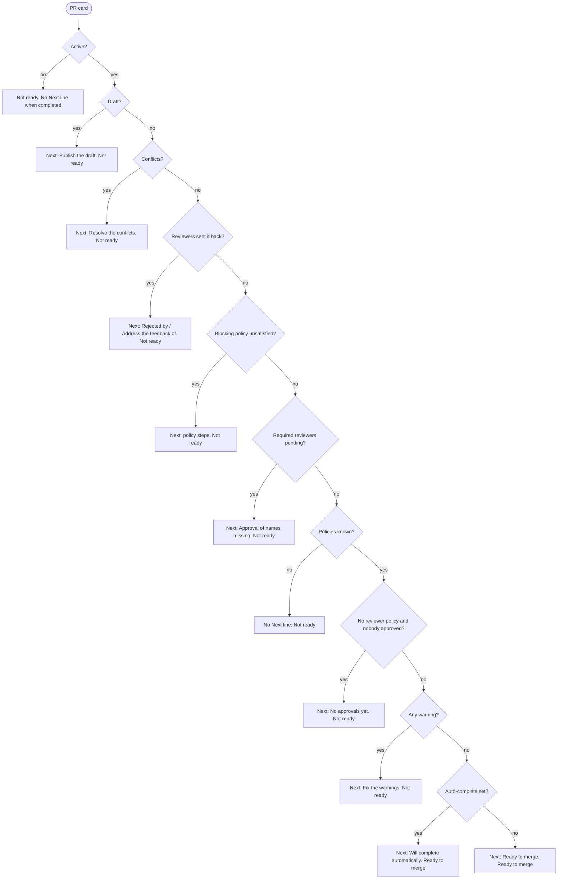
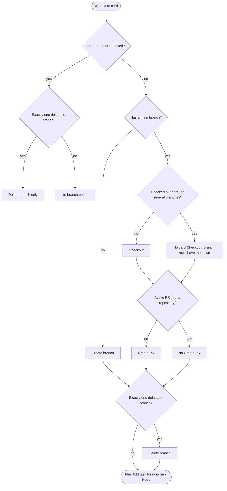

# Decision rules

The exact rules that decide **which states are shown** and **which options and actions are unlocked** in the extension. This is the reference for humans and AI agents: _what_ the code does. [DECISIONS.md](DECISIONS.md) keeps the _why_.

## How to maintain this document

- Every rule has a stable **ID** (`PR-READY-6`). IDs are never reused; a rule that goes away is deleted from the table and from the code, never renumbered silently (append new rows at the end of their table, even if the order of evaluation then differs from the numbering: the _Order_ line of each table says how rows combine).
- Changing a rule means, **in the same change**: update its row here, update the `// Rule <ID>` comment at its code site, and add or change a test. Say which tests cover it in the _Test_ column; `none` means untested (a known debt, listed in [Rules without tests](#rules-without-tests)).
- [`src/rulesDoc.test.ts`](../src/rulesDoc.test.ts) enforces the link: every `Rule <ID>` written in `src/**` (non-test files) must exist in a table here, and every ID defined in a table here must be referenced by a code comment. Comment forms: `// Rule PR-READY-6`, `// Rules PR-READY-6, PR-READY-7`, or a range `// Rules PR-STATUS-1..9`. `GAP-n` rows and the IDs in `rules-exempt` below are not checked.
- _Order_ of a table: **first match wins** (rows are evaluated top to bottom, the first whose condition holds decides) or **all apply** (every row whose condition holds contributes).
- _Code_ is `file:function` under `src/`. _Test_ is `file › test name` (shortened).

<!-- rules-exempt: -->

## Contents

1. [Glossary and primitives](#1-glossary-and-primitives)
2. [Pull request: status, Ready to merge, Next, warnings](#2-pull-request-status-ready-to-merge-next-warnings)
3. [Reviews box](#3-reviews-box-prs-waiting-for-your-review)
4. [My Pull Requests](#4-my-pull-requests)
5. [Work item cards, branches, worktrees](#5-work-item-cards-branches-worktrees)
6. [Tasks](#6-tasks)
7. [Flows](#7-flows)
8. [Alerts](#8-alerts-team-rules-of-the-work-items)
9. [Working on, signals, filters, sorting, dependencies, summary](#9-working-on-signals-filters-sorting-dependencies-summary)
10. [Thresholds and settings](#10-thresholds-and-settings)
11. [Diagrams](#11-diagrams)
12. [Open questions / known gaps](#12-open-questions--known-gaps)

---

## 1. Glossary and primitives

- **Author**: `createdBy` of the PR. Reviewers that are the author are left out of most reviewer logic.
- **Group** (`isContainer`): a team added as reviewer. Groups vote through their members, so most rules count people, not groups.
- **Required / optional**: `isRequired` flag of a reviewer in the PR.
- **This repository / other repository**: the repository open in VS Code (compared by id, see PRIM-1) vs any other.
- **Blocking policy**: a branch policy evaluation with `isBlocking`, enabled and not deleted. **Satisfied** = status `approved` or `notApplicable`.
- **Vote values** (Azure DevOps): 10 approved, 5 approved with suggestions, 0 no vote, -5 waiting for the author, -10 rejected; `hasDeclined` is a separate flag.

### State categories (work items and tasks)

Order: **first match wins**. A state name is compared normalised (STATE-1).

| ID      | Condition                                                                                       | Result                                                                                                                           | Code                              | Test                                                               |
| ------- | ----------------------------------------------------------------------------------------------- | -------------------------------------------------------------------------------------------------------------------------------- | --------------------------------- | ------------------------------------------------------------------ |
| STATE-1 | Comparing two state names                                                                       | Equal after lower-casing and removing everything but letters and doubled letters ("Ready-to-Test" = "Ready to Test", "Commited") | states.ts:normalizeState          | states.test.ts › matches state names ignoring case, separators…    |
| STATE-2 | State is Done, Ready to Test, Closed, Resolved or Completed                                     | category `done` (finished)                                                                                                       | states.ts:stateCategory           | states.test.ts › isClosedState (Rule STATE-7)                      |
| STATE-3 | State is Committed, In Progress or Active                                                       | category `in-progress`                                                                                                           | states.ts:stateCategory           | workItemLinks.test.ts (state buttons use it) – partial             |
| STATE-4 | State is Removed                                                                                | category `removed`                                                                                                               | states.ts:stateCategory           | states.test.ts › isClosedState (Rule STATE-7)                      |
| STATE-5 | Any other state (New, Approved, To Do, unknown…)                                                | category `proposed`                                                                                                              | states.ts:stateCategory           | none                                                               |
| STATE-6 | Is the item "finished"? (`isFinishedState`)                                                     | true when category is `done`                                                                                                     | states.ts:isFinishedState         | none                                                               |
| STATE-7 | Is the item "closed"? (`isClosedState`)                                                         | true when category is `done` or `removed`. Closed work items get no new branch, checkout or PR; only cleanup remains             | states.ts:isClosedState           | states.test.ts › isClosedState (Rule STATE-7)                      |
| STATE-8 | State is New, Approved or To Do (`isNotStartedState`)                                           | "not started": can be moved to a started state; "ready to start" requires it                                                     | states.ts:isNotStartedState       | predecessors.test.ts › isReadyToStart                              |
| STATE-9 | A branch is created for a work item of type T in state S, setting `stateOnBranchCreated[T]` = X | Move to X only when S is not started and S ≠ X; otherwise untouched (never backwards)                                            | states.ts:stateAfterBranchCreated | states.test.ts › moves to Committed only the items not started yet |

### Vote values

Order: **first match wins** (`voteKind`).

| ID     | Condition     | Result                                    | Code                       | Test                                                    |
| ------ | ------------- | ----------------------------------------- | -------------------------- | ------------------------------------------------------- |
| VOTE-1 | `hasDeclined` | `declined`                                | myPullRequests.ts:voteKind | myPullRequests.test.ts › helpers › interprets the votes |
| VOTE-2 | vote >= 10    | `approved`                                | myPullRequests.ts:voteKind | same                                                    |
| VOTE-3 | vote >= 5     | `suggestions` (approved with suggestions) | myPullRequests.ts:voteKind | same                                                    |
| VOTE-4 | vote <= -10   | `rejected`                                | myPullRequests.ts:voteKind | same                                                    |
| VOTE-5 | vote <= -5    | `waiting` (waiting for author)            | myPullRequests.ts:voteKind | same                                                    |
| VOTE-6 | otherwise (0) | `none`                                    | myPullRequests.ts:voteKind | same                                                    |

### Primitives used everywhere

Order: **all apply**.

| ID     | Condition                                               | Result                                                                                                                                                                                                          | Code                                                | Test                                                                                                |
| ------ | ------------------------------------------------------- | --------------------------------------------------------------------------------------------------------------------------------------------------------------------------------------------------------------- | --------------------------------------------------- | --------------------------------------------------------------------------------------------------- |
| PRIM-1 | A PR or branch is compared with the open repository     | "Other repository" only when the local repository id is known and the ids differ (case-insensitive). Unknown local repository: nothing is flagged. Some places compare repository **names** instead, see GAP-13 | pullRequestModel.ts:isOtherRepository               | taskPullRequests.test.ts › flags the PRs of another repository, ignoring the case of the ids        |
| PRIM-2 | Time waited by a PR / review                            | Working time only: whole local days listed in `reviews.workingDays` (default Mon-Fri) count 24 h; an empty list counts every day. Drafts use calendar time on the card                                          | workingTime.ts:workingMsBetween, addWorkingMs       | workingTime.test.ts › (all)                                                                         |
| PRIM-3 | Listing the reviewers of a card                         | The author is left out; the user's own chip first (reviews), then required before optional, people before groups                                                                                                | myPullRequests.ts:reviewerModels                    | taskPullRequests.test.ts › lists the reviewers with their votes, required first, without the author |
| PRIM-4 | A rule needs the people who approved / sent the PR back | Groups are ignored when a person can be named; a group is only named/counted in the specific fallbacks written in PR-REVIEWERS-\*                                                                               | myPullRequests.ts:countApprovals, feedbackReviewers | myPullRequests.test.ts › names the people who sent the PR back, not the group                       |

---

## 2. Pull request: status, Ready to merge, Next, warnings

Applies to the cards of **My Pull Requests** (section 4); the status pill also appears in the Reviews box, task popovers and work item cards.

### PR-STATUS: the status pill (`pullRequestStatus`)

Order: **first match wins**. Independent of the policy-based Ready/Next (see GAP-18).

| ID          | Condition                                                                                        | Result (label, tone)                  | Code                               | Test                                                           |
| ----------- | ------------------------------------------------------------------------------------------------ | ------------------------------------- | ---------------------------------- | -------------------------------------------------------------- |
| PR-STATUS-1 | status = completed                                                                               | Completed, `completed`                | workItemLinks.ts:pullRequestStatus | workItemLinks.test.ts › pullRequestStatus (it.each: Completed) |
| PR-STATUS-2 | status = abandoned                                                                               | Abandoned, `abandoned`                | same                               | same (Abandoned)                                               |
| PR-STATUS-3 | draft                                                                                            | Draft, `draft`                        | same                               | same (Draft)                                                   |
| PR-STATUS-4 | mergeStatus = conflicts                                                                          | Conflicts, `rejected`                 | same                               | same (Conflicts)                                               |
| PR-STATUS-5 | any reviewer (author, group, declined included) has vote -10                                     | Rejected, `rejected`                  | same                               | same (Rejected)                                                |
| PR-STATUS-6 | any reviewer has vote -5                                                                         | Waiting for author, `waiting`         | same                               | same (Waiting for author)                                      |
| PR-STATUS-7 | no required reviewer (group/declined/author included) has vote < 5, and any reviewer has vote 10 | Approved, `approved`                  | same                               | same (Approved; In review when a required one is at 0)         |
| PR-STATUS-8 | same requirement, and any reviewer has vote 5                                                    | Approved with suggestions, `approved` | same                               | same (Approved with suggestions)                               |
| PR-STATUS-9 | otherwise                                                                                        | In review, `review`                   | same                               | same (In review)                                               |

### PR-POLICY: branch policies

Order: **all apply**.

| ID          | Condition                                               | Result                                                                                                                                     | Code                                                   | Test                                                                                                   |
| ----------- | ------------------------------------------------------- | ------------------------------------------------------------------------------------------------------------------------------------------ | ------------------------------------------------------ | ------------------------------------------------------------------------------------------------------ |
| PR-POLICY-1 | A policy evaluation is disabled or deleted              | It does not exist for the PR (dropped)                                                                                                     | myPullRequests.ts:toPolicyEvaluation                   | myPullRequests.test.ts › helpers › ignores disabled policies and flattens the others                   |
| PR-POLICY-2 | Evaluation status is `approved` or `notApplicable`      | Satisfied. Any other status (queued, running, rejected, broken) of a **blocking** policy is "unsatisfied"                                  | myPullRequests.ts:SATISFIED_STATUSES                   | myPullRequests.test.ts › nextStep › ignores the policies that are optional, approved or not applicable |
| PR-POLICY-3 | Policies could not be fetched (`evaluations` undefined) | Unknown: no Ready, no "Ready/Completes" Next line, `approvalCompletes` false, first-approval check skipped. Nothing tells the user (GAP-1) | pullRequestExtras.ts:fetch, myPullRequests.ts:nextStep | myPullRequests.test.ts › nextStep › knows less when the policies could not be fetched                  |

### PR-REVIEWERS: who counts

| ID             | Condition / subject                                                                                                                                                                        | Result                                                                                                                                                                            | Code                                       | Test                                                                                                                                                                             |
| -------------- | ------------------------------------------------------------------------------------------------------------------------------------------------------------------------------------------ | --------------------------------------------------------------------------------------------------------------------------------------------------------------------------------- | ------------------------------------------ | -------------------------------------------------------------------------------------------------------------------------------------------------------------------------------- |
| PR-REVIEWERS-1 | `pendingRequiredReviewers`: required, not the author, not declined, vote < 5 and vote > -5 (those who sent it back are named by feedback steps)                                            | Pending **people** are returned. If no required person is pending: required **groups** pending are returned only when nobody (other than the author) has approved yet; else empty | myPullRequests.ts:pendingRequiredReviewers | myPullRequests.test.ts › required reviewers (Rules PR-REVIEWERS-1..2, PR-READY-6..7, PR-NEXT-5) › lists the pending required people; a required group only while nobody approved |
| PR-REVIEWERS-2 | `lacksFirstApproval`: policies known, no blocking "Minimum number of reviewers"/"Required reviewers" policy exists, and no person other than the author approved (vote >= 5, not declined) | true: nothing else would ever ask for an approval                                                                                                                                 | myPullRequests.ts:lacksFirstApproval       | myPullRequests.test.ts › says "No approvals yet" when nobody approved and no policy asks for reviewers                                                                           |
| PR-REVIEWERS-3 | `feedbackReviewers`: reviewers other than the author with vote <= -10 (rejected) or -10 < vote <= -5 (waiting)                                                                             | Names the people; names the group only when no member is listed with that vote                                                                                                    | myPullRequests.ts:feedbackReviewers        | myPullRequests.test.ts › reviewer feedback › names the people who sent the PR back, not the group / names the group when no member…                                              |
| PR-REVIEWERS-4 | `countApprovals(creatorVoteCounts)`: people (not groups), not declined, vote >= 5, and the author only when the policy has `creatorVoteCounts`                                             | Number of approvals used by "N more approvals needed" and `approvalCompletes`                                                                                                     | myPullRequests.ts:countApprovals           | myPullRequests.test.ts › nextStep › counts the author when the policy allows it                                                                                                  |
| PR-REVIEWERS-5 | `countRequiredReviewers`: required, not a group, not declined, not the author                                                                                                              | Number compared with `minimumRequiredReviewers` by PR-WARN-7                                                                                                                      | myPullRequests.ts:countRequiredReviewers   | myPullRequests.test.ts › team rules › counts only the required people: not groups, the author nor those who declined                                                             |

### PR-READY: the "Ready to merge" badge (`isReadyToMerge`)

Order: **all apply** (if any of rows 1-8 holds the PR is not ready). The badge also sets the `ready-to-merge` look of the tile, the "ready" compact signal and the Summary row.

| ID         | Condition                                                              | Result                                              | Code                             | Test                                                                                                                           |
| ---------- | ---------------------------------------------------------------------- | --------------------------------------------------- | -------------------------------- | ------------------------------------------------------------------------------------------------------------------------------ |
| PR-READY-1 | status ≠ active                                                        | not ready                                           | myPullRequests.ts:isReadyToMerge | myPullRequests.test.ts › isReadyToMerge › is false with any warning, conflicts, draft, completed or unknown policies           |
| PR-READY-2 | draft                                                                  | not ready                                           | same                             | same                                                                                                                           |
| PR-READY-3 | mergeStatus = conflicts                                                | not ready                                           | same                             | same                                                                                                                           |
| PR-READY-4 | at least one warning (any severity, retarget and build-notes included) | not ready                                           | same                             | same; build notes › prevents ready to merge; retargetWarnings › … keeps it from being ready                                    |
| PR-READY-5 | policies unknown (PR-POLICY-3)                                         | not ready                                           | same                             | same                                                                                                                           |
| PR-READY-6 | `pendingRequiredReviewers` (PR-REVIEWERS-1) non-empty                  | not ready                                           | same                             | myPullRequests.test.ts › required reviewers › keeps the PR 13847 (no policies, required reviewers at 0) from being ready       |
| PR-READY-7 | `lacksFirstApproval` (PR-REVIEWERS-2)                                  | not ready                                           | same                             | myPullRequests.test.ts › required reviewers › says "No approvals yet"…                                                         |
| PR-READY-8 | any blocking policy is not satisfied (PR-POLICY-2)                     | not ready                                           | same                             | myPullRequests.test.ts › isReadyToMerge › is false while an approval or another blocking policy is missing                     |
| PR-READY-9 | none of the above                                                      | **Ready to merge** (optional policies never matter) | same                             | myPullRequests.test.ts › isReadyToMerge › is true when everything is approved and nothing warns; ignores the optional policies |

### PR-NEXT: the "Next" line (`nextStep`)

Order: steps 1-5 are **all apply**, in this order, de-duplicated and joined with " · ". If no step applies, rows 6-8 are **first match wins**. The line is shown on the card as "Next: …".

| ID        | Condition                                                                                                                                                                                                                                                    | Result (text)                                                                       | Code                                   | Test                                                                                                                                             |
| --------- | ------------------------------------------------------------------------------------------------------------------------------------------------------------------------------------------------------------------------------------------------------------ | ----------------------------------------------------------------------------------- | -------------------------------------- | ------------------------------------------------------------------------------------------------------------------------------------------------ |
| PR-NEXT-1 | draft                                                                                                                                                                                                                                                        | `Publish the draft`                                                                 | myPullRequests.ts:nextStep             | myPullRequests.test.ts › nextStep › puts the draft and the conflicts first                                                                       |
| PR-NEXT-2 | mergeStatus = conflicts                                                                                                                                                                                                                                      | `Resolve the conflicts`                                                             | same                                   | same                                                                                                                                             |
| PR-NEXT-3 | people/groups sent the PR back (PR-REVIEWERS-3)                                                                                                                                                                                                              | `Rejected by <names>`, `Address the feedback of <names>`                            | myPullRequests.ts:feedbackSteps        | myPullRequests.test.ts › required reviewers › names the waiting reviewers once (feedback), not as pending approval                               |
| PR-NEXT-4 | each blocking policy not satisfied (PR-POLICY-2)                                                                                                                                                                                                             | its step text (PR-STEP-\*)                                                          | myPullRequests.ts:nextStep, policyStep | myPullRequests.test.ts › nextStep › lists what blocks the PR 13713; names the other blocking policies with their status                          |
| PR-NEXT-5 | (a) required reviewers pending (PR-REVIEWERS-1) and no unsatisfied blocking reviewer policy already says it → `Approval of <names> missing`; (b) else, no other step so far, no feedback, no pending required, and `lacksFirstApproval` → `No approvals yet` | the approval step (the last gate: it only shows when nothing else is missing)       | myPullRequests.ts:approvalSteps        | myPullRequests.test.ts › required reviewers › does not repeat the approval step when a reviewer policy already says it; says "No approvals yet"… |
| PR-NEXT-6 | no step, and at least one warning                                                                                                                                                                                                                            | `Fix the warnings` (never "Ready to merge" while warnings exist)                    | myPullRequests.ts:nextStep             | myPullRequests.test.ts › Next agrees with Ready (Rules PR-NEXT-6, PR-TONE-2) › asks to fix the warnings instead of saying "Ready to merge"       |
| PR-NEXT-7 | no step, no warnings, policies unknown                                                                                                                                                                                                                       | no Next line                                                                        | same                                   | myPullRequests.test.ts › nextStep › knows less when the policies could not be fetched                                                            |
| PR-NEXT-8 | no step, no warnings, policies known                                                                                                                                                                                                                         | `Will complete automatically` when auto-complete is set, otherwise `Ready to merge` | same                                   | myPullRequests.test.ts › nextStep › is ready, or completes by itself, when nothing blocks                                                        |

### PR-STEP: text of a blocking policy step (`policyStep`)

Order: **first match wins** by policy type.

| ID        | Condition (policy type)                   | Result                                                                                         | Code                         | Test                                                                                                         |
| --------- | ----------------------------------------- | ---------------------------------------------------------------------------------------------- | ---------------------------- | ------------------------------------------------------------------------------------------------------------ |
| PR-STEP-1 | Minimum number of reviewers               | `N more approval(s) needed`, N = max(1, minimumApproverCount - approvals) (see GAP-15)         | myPullRequests.ts:policyStep | myPullRequests.test.ts › nextStep › asks for the approvals still missing                                     |
| PR-STEP-2 | Comment requirements                      | `Resolve N comment(s)` when the unresolved count is known and > 0, else `Resolve the comments` | same                         | myPullRequests.test.ts › nextStep › counts the comments to resolve                                           |
| PR-STEP-3 | Build                                     | `<policy name or "Build"> failed`, or `running` / `queued` when it is so                       | same                         | myPullRequests.test.ts › nextStep › names the other blocking policies with their status                      |
| PR-STEP-4 | Work item linking                         | `Link a work item`                                                                             | same                         | same                                                                                                         |
| PR-STEP-5 | Require a merge strategy, status rejected | `Choose an allowed merge strategy` (other statuses fall to PR-STEP-7)                          | same                         | none                                                                                                         |
| PR-STEP-6 | Required reviewers                        | `Approval of a required reviewer missing` (generic: the policy does not say who, GAP-3)        | same                         | myPullRequests.test.ts › nextStep › asks for the approval of a required reviewer only when the policy blocks |
| PR-STEP-7 | any other type                            | `<type>: <status>`                                                                             | same                         | myPullRequests.test.ts › nextStep › names the other blocking policies with their status                      |

### PR-TONE: colour of the Next line (`nextTone`)

Order: **first match wins**.

| ID        | Condition                                                                 | Result    | Code                       | Test                                                                                                                                                 |
| --------- | ------------------------------------------------------------------------- | --------- | -------------------------- | ---------------------------------------------------------------------------------------------------------------------------------------------------- |
| PR-TONE-1 | any warning has severity `error`                                          | `danger`  | myPullRequests.ts:nextTone | myPullRequests.test.ts › isReadyToMerge › colours the next line as danger when a warning is an error                                                 |
| PR-TONE-2 | no warnings and Next is "Ready to merge" or "Will complete automatically" | `ready`   | same                       | myPullRequests.test.ts › Next agrees with Ready (Rules PR-NEXT-6, PR-TONE-2) › never has the ready tone and no ready flag disagree on the card model |
| PR-TONE-3 | otherwise                                                                 | `pending` | same                       | same                                                                                                                                                 |

### PR-WARN: warnings of a PR

Order: **all apply**, listed as: feedback (1-2), auto-complete (3-4), team rules (5-9), retarget (10). Severity `error` = breaks a rule only someone else may act on; `warning` = convention. Rows 5-9 never apply to drafts or non-active PRs; rows 1-2 need an active PR; 3-4 need auto-complete set; 10 needs an active PR.

| ID         | Condition                                                                                                                                                                                                         | Result                                                                                                                                     | Code                                   | Test                                                                                                                                                 |
| ---------- | ----------------------------------------------------------------------------------------------------------------------------------------------------------------------------------------------------------------- | ------------------------------------------------------------------------------------------------------------------------------------------ | -------------------------------------- | ---------------------------------------------------------------------------------------------------------------------------------------------------- |
| PR-WARN-1  | PR is active and somebody rejected it (PR-REVIEWERS-3)                                                                                                                                                            | error `Rejected by <names>: talk to them before going on`                                                                                  | myPullRequests.ts:feedbackWarnings     | myPullRequests.test.ts › reviewer feedback › warns about "Waiting for author" and is an error for "Rejected"                                         |
| PR-WARN-2  | PR is active and somebody is waiting for the author                                                                                                                                                               | warning `<names> is/are waiting for you: address their comments, then ask for a new review`                                                | same                                   | same                                                                                                                                                 |
| PR-WARN-3  | auto-complete set, `transitionWorkItems` is true and a linked work item is a Bug                                                                                                                                  | error `Auto-complete shouldn't complete the linked Bug: Only testers have that prerogative.`                                               | myPullRequests.ts:autoCompleteWarnings | myPullRequests.test.ts › pullRequestWarnings › warns when auto-complete will complete a linked Bug                                                   |
| PR-WARN-4  | auto-complete set and `deleteSourceBranch` is not true                                                                                                                                                            | warning `Auto-complete will not delete the branch (team rule: delete branches after merging)`                                              | same                                   | myPullRequests.test.ts › pullRequestWarnings › warns when auto-complete will not delete the branch                                                   |
| PR-WARN-5  | title does not match `[<IDs>] <Feature Name>: <description>`                                                                                                                                                      | warning `The title does not follow "[<IDs>] <Feature Name>: <description>"`                                                                | myPullRequests.ts:ruleWarnings         | myPullRequests.test.ts › team rules › warns with every rule broken…                                                                                  |
| PR-WARN-6  | description has fewer than 10 characters of plain text (markdown syntax and whitespace removed)                                                                                                                   | warning `Add a short description of the changes`                                                                                           | same                                   | myPullRequests.test.ts › team rules › requires a description of at least 10 characters of text                                                       |
| PR-WARN-7  | `minimumRequiredReviewers` > 0 and required people (PR-REVIEWERS-5) < the minimum                                                                                                                                 | warning `Add N more required reviewer(s) (team rule: at least M)`                                                                          | same                                   | myPullRequests.test.ts › team rules › is disabled by a minimum of 0; counts only the required people…                                                |
| PR-WARN-8  | linked work items are known and none is a Product Backlog Item, User Story or Bug                                                                                                                                 | warning `Link the Backlog Item or Bug of this PR` (skipped when the work items are unknown; see GAP-14)                                    | same                                   | myPullRequests.test.ts › team rules › wants a Backlog Item, User Story or Bug linked…; does not warn about the links when the work items are unknown |
| PR-WARN-9  | build notes rule enabled and applies (BUILDNOTES-1), PR not tagged (BUILDNOTES-2) and surely does not change the notes file (BUILDNOTES-3)                                                                        | warning `Explain the changes for testers in <path>, or tag the PR "<tag>"`, with the quick fix button `Add tag <tag>`                      | myPullRequests.ts:ruleWarnings         | myPullRequests.test.ts › build notes warning › comes last, with the quick fix                                                                        |
| PR-WARN-10 | PR is active, targets a branch other than the base, and (a) a completed PR of the user in the same repository has the target as its source, or (b) the remote branches are known and the target is not among them | warning `<Its base PR N was completed \| Its base branch X no longer exists>: retarget to <base>`, with the quick fix `Retarget to <base>` | myPullRequests.ts:retargetWarnings     | myPullRequests.test.ts › retargetWarnings (all)                                                                                                      |

Build notes sub-rules (Order: **all apply**, the warning needs all three):

| ID           | Condition                                                                                                                                | Result                                                                | Code                                                  | Test                                                                                                                      |
| ------------ | ---------------------------------------------------------------------------------------------------------------------------------------- | --------------------------------------------------------------------- | ----------------------------------------------------- | ------------------------------------------------------------------------------------------------------------------------- |
| BUILDNOTES-1 | `buildNotes.enabled`, PR published (not draft) and active, PR in the open repository (by name), the notes file exists in the local clone | The rule applies to the PR; otherwise it never warns                  | buildNotes.ts:ruleApplies                             | buildNotes.test.ts › needsBuildNotesWarning › does not warn for tagged, draft, other-repo, missing-file or disabled cases |
| BUILDNOTES-2 | The PR has the skip tag (case-insensitive, active labels only)                                                                           | Satisfied: no warning, no diff request                                | buildNotes.ts:hasSkipTag                              | buildNotes.test.ts › hasSkipTag › matches case-insensitively and ignores inactive labels                                  |
| BUILDNOTES-3 | The diff of the PR (target..source commit, asked once per head commit) surely does not contain the notes file                            | Warn. An incomplete diff or a failed request is "unknown": no warning | buildNotes.ts:needsBuildNotesWarning, diffChangesFile | buildNotes.test.ts › needsBuildNotesWarning › warns only when the file surely is not changed; diffChangesFile             |

### PR-EFFECT: what warnings (and Ready) change elsewhere

| ID          | Condition                                            | Result                                                                                                                   | Code                                            | Test                                                                                           |
| ----------- | ---------------------------------------------------- | ------------------------------------------------------------------------------------------------------------------------ | ----------------------------------------------- | ---------------------------------------------------------------------------------------------- |
| PR-EFFECT-1 | Any warning                                          | PR is not Ready (PR-READY-4) and Next is `Fix the warnings` when nothing else is missing (PR-NEXT-6)                     | myPullRequests.ts:toModel                       | myPullRequests.test.ts › Next agrees with Ready                                                |
| PR-EFFECT-2 | A warning with severity error                        | Next tone `danger` (PR-TONE-1), compact "warnings" signal red (PRSIGNAL-5), Summary row says "N with errors" (SUMMARY-4) | myPullRequests.ts:nextTone, prCompactSignals.ts | prCompactSignals.test.ts › shows the warnings as a warning when none is an error               |
| PR-EFFECT-3 | Warnings with a quick fix (`addSkipTag`, `retarget`) | The card shows a button next to the warning (MYPR-ACT-4, MYPR-ACT-5)                                                     | webview/main.ts:renderMyPullRequest             | none                                                                                           |
| PR-EFFECT-4 | PR is a completed one                                | Completed cards have no warnings, no Ready, no Next (`warnings: []`, `readyToMerge: false`)                              | myPullRequests.ts:toModel                       | myPullRequests.test.ts › toMyPullRequestModels › lists the PRs completed in the last 24 hours… |

---

## 3. Reviews box (PRs waiting for your review)

### REVIEW-REQ: which PRs are listed as waiting

Rows 1-5 are **all apply** (every condition must hold); then 6-8 shape the list.

| ID           | Condition                                                                                                                     | Result                                                                                                                                                                        | Code                                                            | Test                                                                                                                                                       |
| ------------ | ----------------------------------------------------------------------------------------------------------------------------- | ----------------------------------------------------------------------------------------------------------------------------------------------------------------------------- | --------------------------------------------------------------- | ---------------------------------------------------------------------------------------------------------------------------------------------------------- |
| REVIEW-REQ-1 | PR is active, not a draft and not created by the user                                                                         | Candidate                                                                                                                                                                     | reviewRequests.ts:toReviewRequests                              | reviewRequests.test.ts › skips PRs that are not waiting for me                                                                                             |
| REVIEW-REQ-2 | The user is listed **directly** as a reviewer (`reviewer.id === myId`). Review requests through a group are invisible (GAP-4) | Candidate                                                                                                                                                                     | same                                                            | same                                                                                                                                                       |
| REVIEW-REQ-3 | The user's vote is 0 and they have not declined                                                                               | Listed. Once the user votes (approve, wait, reject) or declines, the PR leaves the list (GAP-9)                                                                               | same                                                            | reviewRequests.test.ts › lists the active PRs of others where I am a required reviewer without a vote…                                                     |
| REVIEW-REQ-4 | Sorting                                                                                                                       | Required first, then optional; oldest publication first inside each group                                                                                                     | reviewRequests.ts:byRoleThenPublishedDate                       | reviewRequests.test.ts › lists the required reviews first, then the optional ones, oldest first in each group                                              |
| REVIEW-REQ-5 | `includeOptional` is off                                                                                                      | Optional requests are not shown but counted (`hiddenOptional`); badge, status bar, digest and notifications use only the shown ones                                           | reviewRequests.ts:splitOptional; reviewRequestsWatcher.ts:shown | reviewRequests.test.ts › shows the optional reviews only when asked, and counts the hidden ones                                                            |
| REVIEW-REQ-6 | Publication time of a request                                                                                                 | The last time the PR left draft (system thread `IsDraftUpdate` with `CodeReviewIsDraftNowSet` "0"); the creation date when it never was a draft or the threads cannot be read | reviewRequests.ts:lastPublishedFromDraft, withPublishedDates    | reviewRequests.test.ts › publication from draft › finds when the PR was last published; counts the wait from the publication, falling back to the creation |

### REVIEW-URG: urgency and time left

Order: **first match wins** (`reviewUrgency`). Waiting = working time since publication (PRIM-2); left = `maxWaitHours` - waited.

| ID           | Condition                                                     | Result                                                                         | Code                            | Test                                                                                       |
| ------------ | ------------------------------------------------------------- | ------------------------------------------------------------------------------ | ------------------------------- | ------------------------------------------------------------------------------------------ |
| REVIEW-URG-1 | left <= 0                                                     | `overdue` ("overdue by X"), red striped bar                                    | reviewRequests.ts:reviewUrgency | reviewRequests.test.ts › tells how urgent each PR is and how much time is left             |
| REVIEW-URG-2 | 0 < left <= `dueSoonHours`                                    | `dueSoon`                                                                      | same                            | same                                                                                       |
| REVIEW-URG-3 | otherwise                                                     | `fresh` ("X left")                                                             | same                            | same                                                                                       |
| REVIEW-URG-4 | Counting late reviews (badge colour, Summary row, status bar) | Only **required** requests count as overdue / due soon; optional ones never do | reviewRequests.ts:countLate     | reviewRequests.test.ts › counts overdue and due soon requests among the required ones only |

### REVIEW-APPROVE: "Your approval completes it" (`approvalCompletes`)

Order: **all apply** (every row must hold for the note to show).

| ID               | Condition                                                                                                                                                                       | Result                                                           | Code                            | Test                                                                                                                                        |
| ---------------- | ------------------------------------------------------------------------------------------------------------------------------------------------------------------------------- | ---------------------------------------------------------------- | ------------------------------- | ------------------------------------------------------------------------------------------------------------------------------------------- |
| REVIEW-APPROVE-1 | policies known, PR active, not a draft, no conflicts                                                                                                                            | required                                                         | reviewCard.ts:approvalCompletes | reviewCard.test.ts › approvalCompletes › is false for drafts, conflicts and PRs that are not active; is false when the policies are unknown |
| REVIEW-APPROVE-2 | The user is a listed reviewer, a person (not a group), has not declined and has not approved yet (vote < 5)                                                                     | required                                                         | same                            | reviewCard.test.ts › approvalCompletes › is false when my approval would not count                                                          |
| REVIEW-APPROVE-3 | At least one blocking policy is unsatisfied, ignoring "Require a merge strategy" (rejected until whoever completes the PR picks one; GAP-2)                                     | required (nothing blocking = it does not need my approval)       | same                            | reviewCard.test.ts › approvalCompletes › ignores the merge strategy policy…; is false when nothing blocks the PR                            |
| REVIEW-APPROVE-4 | Every unsatisfied policy is a reviewer policy and none is `broken`                                                                                                              | required (any build/comments/linking policy unsatisfied → false) | same                            | reviewCard.test.ts › approvalCompletes › is false when another blocking policy is not satisfied; is false when a policy is broken           |
| REVIEW-APPROVE-5 | Every unsatisfied "Minimum number of reviewers" policy lacks **exactly one** approval (`creatorVoteCounts` honoured)                                                            | required                                                         | same                            | reviewCard.test.ts › approvalCompletes › is true when mine is the only approval missing…; is false when more than one approval is missing   |
| REVIEW-APPROVE-6 | Every unsatisfied "Required reviewers" policy: the only pending required reviewer (not the author, not declined, vote < 5) is the user. A pending required group makes it false | required                                                         | same                            | reviewCard.test.ts › required reviewers (all four tests)                                                                                    |

### REVIEW-CARD: other details of the card

| ID            | Condition                                                     | Result                                                                                                                                                                      | Code                                                                     | Test                                                                                                                                                                     |
| ------------- | ------------------------------------------------------------- | --------------------------------------------------------------------------------------------------------------------------------------------------------------------------- | ------------------------------------------------------------------------ | ------------------------------------------------------------------------------------------------------------------------------------------------------------------------ |
| REVIEW-CARD-1 | Auto-complete is set on the PR                                | Note: error with the Bug text if PR-WARN-3 holds, else warning `Auto-complete is set: your approval may merge it right away`                                                | reviewCard.ts:toReviewDetails                                            | reviewCard.test.ts › toReviewDetails › warns that my approval may merge the PR when auto-complete is set; shows the error when auto-complete would complete a linked Bug |
| REVIEW-CARD-2 | Any team-rule warning (PR-WARN-5..9) holds                    | "N team rules not met — remind the author" (retarget and feedback warnings are not included, nor the auto-complete ones)                                                    | reviewCard.ts:toReviewDetails, describeTeamRules                         | reviewCard.test.ts › toReviewDetails › counts the team rules, never the auto-complete warnings                                                                           |
| REVIEW-CARD-3 | The user started text threads that are active/pending/unknown | "N of your comments is/are still open" (+ "· replies since your last comment" when somebody wrote after their last comment); unknown when threads could not be read         | reviewCard.ts:myCommentsLine, reviewThreads.ts:summarizeOpenObservations | reviewCard.test.ts › myCommentsLine; reviewThreads.test.ts › open observations                                                                                           |
| REVIEW-CARD-4 | Files changed                                                 | Counted up to 100 (`100+`); `$top = 101` asked, `capped` when there are more                                                                                                | reviewCard.ts:countChangedFiles                                          | reviewCard.test.ts › countChangedFiles; describeFilesChanged                                                                                                             |
| REVIEW-CARD-5 | Checkout of the PR branch                                     | The branch is the one checked out → "current" pill; PR is in the open repository (by name) → Checkout button (becomes "Open worktree" when a worktree has it); else nothing | webview/main.ts:renderReviewBranch                                       | none                                                                                                                                                                     |

### REVIEWED: the "Reviewed" section

Order: rows 1-5 **all apply** to decide if a PR is listed; 6-7 are fetch/count policies.

| ID         | Condition                                                                                                                                       | Result                                                                                                                                                                            | Code                                                          | Test                                                                                                                       |
| ---------- | ----------------------------------------------------------------------------------------------------------------------------------------------- | --------------------------------------------------------------------------------------------------------------------------------------------------------------------------------- | ------------------------------------------------------------- | -------------------------------------------------------------------------------------------------------------------------- |
| REVIEWED-1 | `reviews.reviewedPeriod` = hidden (also for unknown values)                                                                                     | Nothing is listed                                                                                                                                                                 | reviewedRequests.ts:toReviewedRequests, reviewedPeriodSetting | reviewedRequests.test.ts › lists nothing while the period is hidden; period setting › falls back to hidden…                |
| REVIEWED-2 | The user is a reviewer, the PR is published and not created by the user, and the user's vote kind is approved, suggestions, waiting or rejected | Listed with that vote (declined and no-vote PRs are left out)                                                                                                                     | reviewedRequests.ts:myListedVote                              | reviewedRequests.test.ts › leaves out declined reviews, own PRs, drafts and PRs where the user is not a reviewer           |
| REVIEWED-3 | Active PR                                                                                                                                       | Always in the period                                                                                                                                                              | reviewedRequests.ts:inPeriod                                  | reviewedRequests.test.ts › lists the active PRs the user voted on…                                                         |
| REVIEWED-4 | Completed or abandoned PR, period has a window (day/week/month) and it closed within it                                                         | In the period (`active` period: closed PRs are never listed)                                                                                                                      | same                                                          | reviewedRequests.test.ts › adds the PRs closed within the window only when the period has one                              |
| REVIEWED-5 | Order                                                                                                                                           | Active first (newest first), then closed by closing date (latest first); repeated PRs once                                                                                        | reviewedRequests.ts:byActiveThenDate                          | reviewedRequests.test.ts › describes the closed ones and sorts…; ignores a closed PR without closing date and repeated PRs |
| REVIEWED-6 | Details of a reviewed PR                                                                                                                        | Fetched only when unfolded: closed PRs once (kept for the session), active PRs when unfolded without details and again at every check; dropped when folded/unlisted (active only) | reviewedRequests.ts:reviewedIdsToFetch, reviewedIdsToDrop     | reviewedRequests.test.ts › reviewed details fetch policy (all)                                                             |
| REVIEWED-7 | Reviewed PRs                                                                                                                                    | Informative only: never counted in the badge, urgency, Summary, digest or notifications                                                                                           | reviewedRequests.ts (module)                                  | reviewedRequests.test.ts › reviewed PRs are not review requests                                                            |

### REVIEW-NOTIF: notifications of the Reviews box

Order: **all apply** per request, evaluated in this order (`detectReviewEvents`); settings `reviews.notifications` filter the kinds.

| ID             | Condition                                                                        | Result                                                                                                                         | Code                                                                   | Test                                                                                                                                                                           |
| -------------- | -------------------------------------------------------------------------------- | ------------------------------------------------------------------------------------------------------------------------------ | ---------------------------------------------------------------------- | ------------------------------------------------------------------------------------------------------------------------------------------------------------------------------ |
| REVIEW-NOTIF-1 | First check ever (no stored state)                                               | Baseline only (no per-PR events); the digest may show                                                                          | reviewRequests.ts:detectReviewEvents                                   | reviewRequests.test.ts › review events › only establishes a baseline on the first check, with the digest                                                                       |
| REVIEW-NOTIF-2 | A request id not seen before                                                     | `requested` ("You are a required/an optional reviewer of PR N"); even if already overdue/due soon it is only notified as new   | same                                                                   | reviewRequests.test.ts › review events › notifies an urgent new request only as new, and forgets reviewed PRs                                                                  |
| REVIEW-NOTIF-3 | Known request is overdue and was never notified as overdue                       | `overdue`                                                                                                                      | same                                                                   | reviewRequests.test.ts › review events › notifies new requests, PRs getting due soon and overdue ones once                                                                     |
| REVIEW-NOTIF-4 | Overdue and already notified                                                     | Reminded again after `remindOverdueEveryHours` of **working** time; 0 = only once                                              | same                                                                   | reviewRequests.test.ts › review events › reminds overdue PRs every few hours, or only once; waiting time over a weekend › does not remind about an overdue PR over the weekend |
| REVIEW-NOTIF-5 | Known request is due soon and not yet notified as due soon                       | `dueSoon`                                                                                                                      | same                                                                   | reviewRequests.test.ts › review events › notifies new requests, PRs getting due soon and overdue ones once                                                                     |
| REVIEW-NOTIF-6 | First check of a local day with at least one shown request, and `digest` enabled | One digest of all the shown PRs replaces the other review-request notifications of that check                                  | reviewRequests.ts:detectReviewEvents; reviewRequestsWatcher.ts:runPoll | reviewRequests.test.ts › review events › shows the digest on the first check of each day                                                                                       |
| REVIEW-NOTIF-7 | Only requests that are shown (required, or optional with `includeOptional`)      | Others never notify (the state still tracks them, see GAP-7). Above 3 events one summary notification replaces them            | reviewRequestsWatcher.ts:runPoll, notify                               | none                                                                                                                                                                           |
| REVIEW-NOTIF-8 | A text thread started by the user gets replies from others, or is resolved       | `replied` / `resolved` (a PR seen first time only sets the baseline; finished PRs with open threads are checked one last time) | reviewThreads.ts:detectObservationEvents                               | reviewThreads.test.ts › observation events (all)                                                                                                                               |

---

## 4. My Pull Requests

### MYPR-LIST: what is listed and in which order

| ID          | Condition                                                                                                                            | Result                                                                                                                                                                      | Code                                                                | Test                                                                                                                                                                          |
| ----------- | ------------------------------------------------------------------------------------------------------------------------------------ | --------------------------------------------------------------------------------------------------------------------------------------------------------------------------- | ------------------------------------------------------------------- | ----------------------------------------------------------------------------------------------------------------------------------------------------------------------------- |
| MYPR-LIST-1 | PRs fetched                                                                                                                          | The user's active PRs (up to 100) and latest completed (up to 50); abandoned are never requested                                                                            | azdoClient.ts:getMyPullRequests                                     | none                                                                                                                                                                          |
| MYPR-LIST-2 | A PR is active, or completed within the period window (`completedPeriod`: hidden 0, day 24 h, week 7 d, month 30 d); abandoned never | Listed. The boundary is inclusive                                                                                                                                           | myPullRequests.ts:toMyPullRequestModels, isCompletedWithin          | myPullRequests.test.ts › completed period (all); toMyPullRequestModels › lists the PRs completed in the last 24 hours and never the abandoned ones                            |
| MYPR-LIST-3 | `showDrafts` is off                                                                                                                  | Drafts are hidden and counted (`hiddenDrafts`)                                                                                                                              | same                                                                | myPullRequests.test.ts › toMyPullRequestModels › hides the drafts and counts them                                                                                             |
| MYPR-LIST-4 | Period is `hidden`                                                                                                                   | Completed PRs are not listed; those completed in the last 24 h are counted (`hiddenCompleted`)                                                                              | same                                                                | myPullRequests.test.ts › completed period › does not list the completed PRs when hidden…                                                                                      |
| MYPR-LIST-5 | Order                                                                                                                                | Active published PRs (oldest publication first), then drafts, then completed (latest first)                                                                                 | myPullRequests.ts:compare                                           | myPullRequests.test.ts › toMyPullRequestModels › sorts the active PRs (oldest first), the drafts, then the completed ones (latest first); sorts the active PRs by publication |
| MYPR-LIST-6 | Active PR, details of the card                                                                                                       | Details fetched: policies, threads, linked work items, runs, build notes status. Whatever fails is left out of that card                                                    | myPullRequestsWatcher.ts:fetchPollExtras, pullRequestExtras.ts      | none                                                                                                                                                                          |
| MYPR-LIST-7 | Completed PR in the period                                                                                                           | Threads and work items fetched once and cached; the card is faded, with its time ("completed X ago · took Y"), phases and the summary line (>= 2 completed PRs with phases) | myPullRequestsWatcher.ts:fetchPollExtras; myPullRequests.ts:toModel | myPullRequests.test.ts › gives the completed PRs the time they took, their phases and a summary of the listed ones                                                            |

### MYPR-CARD: card data

| ID          | Condition                                                          | Result                                                                                                                                          | Code                            | Test                                                                                                                          |
| ----------- | ------------------------------------------------------------------ | ----------------------------------------------------------------------------------------------------------------------------------------------- | ------------------------------- | ----------------------------------------------------------------------------------------------------------------------------- |
| MYPR-CARD-1 | Target branch ≠ the base branch                                    | The target is shown ("→ target")                                                                                                                | myPullRequests.ts:toModel       | myPullRequests.test.ts › shows the target only when it is not the base branch                                                 |
| MYPR-CARD-2 | Age shown                                                          | Draft: calendar time since creation. Published: working time since publication (PRIM-2, REVIEW-REQ-6)                                           | myPullRequests.ts:waitingTime   | myPullRequests.test.ts › shows the time since the publication, since the creation when it was never a draft or for the drafts |
| MYPR-CARD-3 | PR repository name = the open repository's name (case-insensitive) | `canCheckout`; `isCurrentBranch` when HEAD is its source; `worktree` when canCheckout, not current and another worktree has the branch (GAP-13) | myPullRequestsWatcher.ts:models | none                                                                                                                          |

### MYPR-ACT: buttons of the card

Order: **all apply**.

| ID         | Condition                                            | Result                                                                                     | Code                                | Test |
| ---------- | ---------------------------------------------------- | ------------------------------------------------------------------------------------------ | ----------------------------------- | ---- |
| MYPR-ACT-1 | Always                                               | `Open PR`                                                                                  | webview/main.ts:renderMyActions     | none |
| MYPR-ACT-2 | Not completed, `canCheckout`, not the current branch | `Checkout` (becomes `Open worktree` when a worktree has it; the ▾ menu offers the choices) | same                                | none |
| MYPR-ACT-3 | PR is a draft                                        | `Publish` (flow FLOW-PUBLISH)                                                              | same                                | none |
| MYPR-ACT-4 | Warning with `action = addSkipTag` (PR-WARN-9)       | Button `Add tag <skipTag>` next to the warning                                             | webview/main.ts:renderMyPullRequest | none |
| MYPR-ACT-5 | Warning with `action = retarget` (PR-WARN-10)        | Button `Retarget to <base>` (flow FLOW-RETARGET)                                           | same                                | none |

### MYPR-PHASE: phases of a completed PR

Phases come from the system threads already fetched (no extra requests). Order: **first match wins** per event while walking the events from creation to completion; durations are working time.

| ID           | Condition                                                                                                                 | Result                                                                                 | Code                                             | Test                                                                                                                   |
| ------------ | ------------------------------------------------------------------------------------------------------------------------- | -------------------------------------------------------------------------------------- | ------------------------------------------------ | ---------------------------------------------------------------------------------------------------------------------- |
| MYPR-PHASE-1 | No `closedDate`, unreadable dates, or end before start                                                                    | No phases                                                                              | pullRequestPhases.ts:pullRequestPhases           | pullRequestPhases.test.ts › has no phases without a completion date                                                    |
| MYPR-PHASE-2 | Start                                                                                                                     | `draft` when the first draft update is a publication (created as draft), else `review` | pullRequestPhases.ts:transitions, createdAsDraft | pullRequestPhases.test.ts › draft, published, approved, completed                                                      |
| MYPR-PHASE-3 | Publish while in `draft`                                                                                                  | → `review`; re-draft at any time → `draft`                                             | pullRequestPhases.ts:nextKind                    | pullRequestPhases.test.ts › re-drafting counts as draft                                                                |
| MYPR-PHASE-4 | A relevant vote <= -5 (and phase is not draft)                                                                            | → `author` (waiting for author)                                                        | pullRequestPhases.ts:voteKind                    | pullRequestPhases.test.ts › waiting for the author, push, approval                                                     |
| MYPR-PHASE-5 | Push or votes reset while in `author`; a non-negative relevant vote while in `author`                                     | → `review`                                                                             | pullRequestPhases.ts:nextKind, voteKind          | pullRequestPhases.test.ts › a rejection answered by the approval, without a push, ends the author phase                |
| MYPR-PHASE-6 | Merge start = the last relevant approval (>= 5) after which nobody relevant asked for changes, voted 0 or reset the votes | From there `merge` ("Ready to merge") until completion; none when blocked              | pullRequestPhases.ts:mergeStart                  | pullRequestPhases.test.ts › a negative vote after the approval means there is no merge start before the later approval |
| MYPR-PHASE-7 | Relevant voters                                                                                                           | Required people if any of them voted, otherwise anybody except the author              | pullRequestPhases.ts:relevantVoter               | pullRequestPhases.test.ts › prefers the votes of the required reviewers                                                |
| MYPR-PHASE-8 | No threads available                                                                                                      | `review` until completion, empty merge                                                 | pullRequestPhases.ts:pullRequestPhases           | pullRequestPhases.test.ts › without threads: review until the completion and an empty merge                            |

### MYPR-NOTIF: notifications on the user's PRs

Setting `notifications.events` filters kinds. Order: **all apply**; per PR, by comparing the stored snapshot with the current one (`detectEvents`).

| ID           | Condition                                                                                                                                                                           | Result                                                                            | Code                                                                      | Test                                                                                       |
| ------------ | ----------------------------------------------------------------------------------------------------------------------------------------------------------------------------------- | --------------------------------------------------------------------------------- | ------------------------------------------------------------------------- | ------------------------------------------------------------------------------------------ |
| MYPR-NOTIF-1 | PR not in the previous snapshot                                                                                                                                                     | Baseline only. Only the 30 most recent PRs (any status) are tracked (GAP-17)      | pullRequestEvents.ts:detectEvents; azdoClient.ts:getPullRequestsCreatedBy | pullRequestEvents.test.ts › detectEvents › only records a baseline for PRs not seen before |
| MYPR-NOTIF-2 | Previous status active, now completed                                                                                                                                               | `merged` (see MYPR-OFFER)                                                         | same                                                                      | pullRequestEvents.test.ts › detectEvents › detects merged PRs                              |
| MYPR-NOTIF-3 | A reviewer person (not the user, not a group) has a vote ≠ 0 different from the stored one                                                                                          | `vote` event; a reset to 0 is not notified                                        | same                                                                      | pullRequestEvents.test.ts › detects votes of other people, but not resets nor my own votes |
| MYPR-NOTIF-4 | New "ReviewersUpdate" thread (not by the user): required reviewer added, reviewer removed, declined, switched required/optional; or, with no thread explaining it, the list differs | `reviewers` event; optional additions are not notified                            | pullRequestEvents.ts:detectReviewerChanges                                | pullRequestEvents.test.ts › reviewer changes (all)                                         |
| MYPR-NOTIF-5 | A thread stored as fixed/wontFix/closed/byDesign is now active/pending (and not reopened by the user alone)                                                                         | `reopened`                                                                        | pullRequestEvents.ts:detectReopened                                       | pullRequestEvents.test.ts › reopened threads (all)                                         |
| MYPR-NOTIF-6 | New comments by other people (not in a reopened thread)                                                                                                                             | `comments`, grouped per PR (threads and comments are only fetched for active PRs) | pullRequestEvents.ts:detectEvents                                         | pullRequestEvents.test.ts › detects new comments from other people, grouped per PR         |
| MYPR-NOTIF-7 | More than 3 notifications in a check                                                                                                                                                | One summary notification with a picker                                            | pullRequestNotifier.ts:notify                                             | none                                                                                       |

### MYPR-OFFER: when a PR is completed

| ID           | Condition                                                                                             | Result                                                                  | Code                                                                                          | Test                                                                                                 |
| ------------ | ----------------------------------------------------------------------------------------------------- | ----------------------------------------------------------------------- | --------------------------------------------------------------------------------------------- | ---------------------------------------------------------------------------------------------------- |
| MYPR-OFFER-1 | `merged` event and `taskDone` enabled: linked **Task** work items of the PR that are not Done/Removed | The notification offers `Set Done` (moves them to Done) and `Open task` | commands/pullRequestTask.ts:offerCompletedPullRequest; pullRequestTasks.ts:tasksToComplete    | pullRequestTasks.test.ts › tasksToStart / tasksToComplete › offers to close the open tasks of the PR |
| MYPR-OFFER-2 | The source branch of the PR still exists and is deletable (DELETABLE-\*)                              | The same notification offers `Delete branch`                            | commands/pullRequestTask.ts:offerCompletedPullRequest; workItemsStore.ts:mergedBranchToDelete | deletableBranches.test.ts › texts › asks in the notification of a completed PR                       |
| MYPR-OFFER-3 | Nothing to offer and `merged` is enabled                                                              | Plain notification "PR N was merged: <title>" with `Open PR`            | pullRequestNotifier.ts:handleMerged                                                           | none                                                                                                 |

---

## 5. Work item cards, branches, worktrees

### CARD-ACT: branch actions of a card (`branchActions`)

Used by the sidebar card and the Work Item Details panel. Order: row 1 is **first match wins**; the others add buttons in this order: Checkout, Create PR, Delete branch. See diagram (b).

| ID         | Condition                                                                                                             | Result                                                                                                                           | Code                       | Test                                                                                                                                                           |
| ---------- | --------------------------------------------------------------------------------------------------------------------- | -------------------------------------------------------------------------------------------------------------------------------- | -------------------------- | -------------------------------------------------------------------------------------------------------------------------------------------------------------- |
| CARD-ACT-1 | Work item state is closed (done or removed, STATE-7)                                                                  | Only `Delete branch` (when exactly one branch is deletable, CARD-ACT-5); no Create branch, Checkout or Create PR                 | viewModel.ts:branchActions | workItemLinks.test.ts › branch actions › finished work items only get Delete branch…; removed work items get no new branch, checkout nor PR…                   |
| CARD-ACT-2 | Open item without a branch (`branch` undefined)                                                                       | `Create branch` (+ Delete if CARD-ACT-5)                                                                                         | same                       | workItemLinks.test.ts › branch actions › offers to create the branch, check it out and create the PR of work items in progress                                 |
| CARD-ACT-3 | Has a branch, it is not the checked-out one, and the card has a single branch                                         | `Checkout` (with several branches each branch row has its own Checkout, BRANCH-ROW-1)                                            | same                       | workItemLinks.test.ts › branch actions › leaves Checkout to the branch rows when the work item has several branches                                            |
| CARD-ACT-4 | Has a branch and no active PR **in this repository** (any branch of the item; PRs of other repositories do not count) | `Create PR`                                                                                                                      | same                       | workItemLinks.test.ts › branch actions › offers to create the branch, check it out and create the PR…                                                          |
| CARD-ACT-5 | Exactly one branch is deletable (DELETABLE-\*)                                                                        | `Delete branch` after the other buttons, whatever the state; with several deletable branches each row has its own trash (GAP-21) | same                       | workItemLinks.test.ts › branch actions › offers Delete branch whatever the state…; leaves Delete branch to the branch rows when several branches are deletable |

### CARD-BTN: the rest of the buttons

| ID         | Condition                                                           | Result                                                                                                                                 | Code                                                | Test                          |
| ---------- | ------------------------------------------------------------------- | -------------------------------------------------------------------------------------------------------------------------------------- | --------------------------------------------------- | ----------------------------- |
| CARD-BTN-1 | Card of a type other than Task                                      | `Add task` (any state, GAP-35)                                                                                                         | webview/main.ts:renderActions; html.ts:canHaveTasks | none                          |
| CARD-BTN-2 | The main branch of the card has a worktree (not the current branch) | The Checkout button becomes `Open worktree ▾` (open / remove)                                                                          | checkoutButtons.ts:checkoutButton                   | none                          |
| CARD-BTN-3 | Details panel                                                       | Same branch buttons as the card (same function); `Dependency map` is not offered for Tasks; `Open in Azure DevOps` and `Reload` always | detailsHtml.ts:renderActions                        | detailsHtml.test.ts – partial |
| CARD-BTN-4 | The `Delete branch` button of the card                              | Acts on the single deletable branch (`data-branch`)                                                                                    | webview/main.ts:branchActionButton                  | none                          |

### BRANCH-SET / BRANCH-MAIN: which branches a card shows

| ID            | Condition                                                                                                              | Result                                                                                                                                            | Code                                | Test                                                                                                                   |
| ------------- | ---------------------------------------------------------------------------------------------------------------------- | ------------------------------------------------------------------------------------------------------------------------------------------------- | ----------------------------------- | ---------------------------------------------------------------------------------------------------------------------- |
| BRANCH-SET-1  | Local and remote branches named `<type>/<module>/<id>[-slug]` with the work item's id                                  | Included                                                                                                                                          | workItemBranches.ts:collectBranches | workItemBranches.test.ts › collectBranches › finds the local and remote branches named after the work item, once       |
| BRANCH-SET-2  | Branches linked in the Development section                                                                             | Included (other repositories flagged `otherRepository`, location `linked`)                                                                        | same                                | workItemBranches.test.ts › collectBranches › takes the Development links…                                              |
| BRANCH-SET-3  | Source branches of the **active** PRs of the item (a branch known only through a completed PR is not included, GAP-33) | Included                                                                                                                                          | same                                | workItemBranches.test.ts › collectBranches › adds the source branches of the active PRs and ignores the completed ones |
| BRANCH-SET-4  | Order                                                                                                                  | Checked out first, then the main branch, the rest of this repository, then other repositories; location `current` / `local` / `remote` / `linked` | workItemBranches.ts:toBranchModels  | workItemBranches.test.ts › toBranchModels                                                                              |
| BRANCH-MAIN-1 | Main branch of the card (`branch`)                                                                                     | The local branch named after the item; else a remote one named after it, or the branch linked in this repository (location `remote`)              | workItemsStore.ts:findBranch        | none                                                                                                                   |
| BRANCH-MAIN-2 | No such branch                                                                                                         | `branch` undefined → Create branch (CARD-ACT-2)                                                                                                   | same                                | none                                                                                                                   |

### BRANCH-BADGE / BRANCH-ROW / BRANCH-MENU: branch rows

| ID             | Condition                                                                                                  | Result                                                                                                                                | Code                                            | Test                                                                                                                                                     |
| -------------- | ---------------------------------------------------------------------------------------------------------- | ------------------------------------------------------------------------------------------------------------------------------------- | ----------------------------------------------- | -------------------------------------------------------------------------------------------------------------------------------------------------------- |
| BRANCH-BADGE-1 | Branch is deletable (DELETABLE-\*)                                                                         | Badge `not deleted`, tone `leftover`                                                                                                  | branchBadge.ts:branchBadge                      | branchBadge.test.ts › says "not deleted" for a merged branch, and keeps that tone with a worktree                                                        |
| BRANCH-BADGE-2 | Otherwise                                                                                                  | Badge = location (`current`, `local`, `remote`, `linked`) with its tooltip                                                            | same                                            | branchBadge.test.ts › names the location with a tooltip that explains it                                                                                 |
| BRANCH-BADGE-3 | Another worktree has the branch                                                                            | Mark `⧉` appended; tone `worktree` (stays `leftover` for a deletable branch)                                                          | same                                            | branchBadge.test.ts › absorbs the worktree into the same badge…                                                                                          |
| BRANCH-ROW-1   | Work item is open, the card has more than one branch, the branch is in this repository and not checked out | The row has its own icon Checkout button (+ ▾ menu)                                                                                   | branchRows.ts:renderBranchRow, renderBranchList | branchRows.test.ts › renderBranchList; renderBranchList with the popover menu                                                                            |
| BRANCH-ROW-2   | Branch is deletable and in this repository                                                                 | The row has a Delete (trash) button, even if the card also has one (GAP-21)                                                           | same                                            | branchRows.test.ts › gives a Delete button and the "not deleted" pill to the deletable branches only; never offers it for a branch of another repository |
| BRANCH-ROW-3   | Work item is closed                                                                                        | Only deletable branches and local branches of this repository are listed; "No branch to delete" when none remain; no Checkout buttons | same                                            | branchRows.test.ts › does it whatever the state of the work item…; says there is nothing to delete for a finished work item without branches to show     |
| BRANCH-ROW-4   | Branch of another repository                                                                               | Dimmed, no Checkout, no menu                                                                                                          | same                                            | branchRows.test.ts › has no button for a branch of another repository or without actions                                                                 |
| BRANCH-MENU-1  | Menu of a row, branch is the checked-out one                                                               | Disabled row "Checked out"                                                                                                            | branchMenu.ts:branchMenuSections                | branchMenu.test.ts › shows the current branch as a disabled row                                                                                          |
| BRANCH-MENU-2  | Branch has a worktree                                                                                      | `Open worktree` and `Remove worktree` (keeps the branch)                                                                              | same                                            | branchMenu.test.ts › offers Open / Remove worktree, with the path, for a branch that has a worktree                                                      |
| BRANCH-MENU-3  | Branch exists in this repository without a worktree                                                        | `Checkout here` and `Open in a worktree` (creates the worktree if needed, WORKTREE-OPEN-2)                                            | same                                            | branchMenu.test.ts › offers Checkout here and Open in a worktree for a branch that is not checked out                                                    |
| BRANCH-MENU-4  | Branch is deletable                                                                                        | `Delete branch <name>` (danger style) in a "Cleanup" section                                                                          | same                                            | branchMenu.test.ts › adds a danger Delete branch when it is deletable                                                                                    |
| BRANCH-MENU-5  | Branch of another repository                                                                               | No checkout items                                                                                                                     | same                                            | branchMenu.test.ts › has nothing for a branch of another repository                                                                                      |

### DELETABLE: branches offered for deletion

Order: **all apply** (a branch is deletable only if every row holds).

| ID          | Condition                                                                                                                                                                                     | Result                                                                                                              | Code                                                            | Test                                                                                                                                        |
| ----------- | --------------------------------------------------------------------------------------------------------------------------------------------------------------------------------------------- | ------------------------------------------------------------------------------------------------------------------- | --------------------------------------------------------------- | ------------------------------------------------------------------------------------------------------------------------------------------- |
| DELETABLE-1 | Branch is `develop`, `main`, `master` or starts with `release/`                                                                                                                               | Protected: never offered nor deleted (also refused by the flow, FLOW-DELETE-1)                                      | deletableBranches.ts:isProtectedBranch                          | deletableBranches.test.ts › base branches › are never merged branches, even as the source of a completed PR                                 |
| DELETABLE-2 | Among the PRs whose source is the branch and whose repository is this one (all, if the repository is unknown): at least one is completed and none is active                                   | The branch is "merged". Abandoned PRs do not count. Whatever the state of the work item                             | deletableBranches.ts:isBranchMerged                             | deletableBranches.test.ts › isBranchMerged (all); does not depend on the state of any work item                                             |
| DELETABLE-3 | The branch still exists: it is a local branch, or Azure DevOps says it exists (asked only for merged non-local branches, cached 10 min); unknown and not local → left out (asked again later) | Deletable                                                                                                           | deletableBranches.ts:deletableBranches, branchesToCheckRemotely | deletableBranches.test.ts › deletableBranches › keeps the merged branches that still exist…; leaves out a branch whose existence is unknown |
| DELETABLE-4 | Candidate branches of a work item                                                                                                                                                             | Those of BRANCH-SET (this repository only). Task branches: the branches linked to the task (own tasks only, GAP-22) | workItemsStore.ts:findDeletableBranches                         | taskBranches.test.ts › marks the branches to delete                                                                                         |

### WORKTREE and CHECKOUT

| ID              | Condition                                                                                  | Result                                                                                                                                                                                                                   | Code                                                                             | Test                                                                                                                                      |
| --------------- | ------------------------------------------------------------------------------------------ | ------------------------------------------------------------------------------------------------------------------------------------------------------------------------------------------------------------------------ | -------------------------------------------------------------------------------- | ----------------------------------------------------------------------------------------------------------------------------------------- |
| WORKTREE-1      | Finding the worktree of a branch                                                           | The entry with that branch that is not `prunable` and not one of the excluded folders (the folder open in this window)                                                                                                   | worktrees.ts:findWorktree                                                        | worktrees.test.ts › findWorktree (both)                                                                                                   |
| WORKTREE-2      | Branches checked out in "other worktrees"                                                  | Entries with a branch, not bare, not prunable, not a folder open in this window                                                                                                                                          | worktrees.ts:otherWorktreeBranches                                               | workingOn.test.ts › otherWorktreeBranches                                                                                                 |
| WORKTREE-3      | Where a worktree is created                                                                | `<repo folder>.worktrees/<branch with its slashes as subfolders>`; names that escape the folder are rejected                                                                                                             | worktrees.ts:worktreePath                                                        | worktrees.test.ts › worktreePath (all)                                                                                                    |
| WORKTREE-4      | Removing a worktree                                                                        | Blocked for the main working tree, bare entries and folders open in this window; with uncommitted changes the user decides                                                                                               | worktrees.ts:removalBlocker; commands/removeWorktree.ts                          | worktrees.test.ts › removalBlocker; removableWorktrees                                                                                    |
| WORKTREE-OPEN-1 | "Open worktree" / "Open in a worktree" from a menu or ▾ item and the branch has a worktree | Opens that folder in a new window                                                                                                                                                                                        | worktrees.ts:worktreeOpenAction; commands/checkoutBranch.ts:openOrCreateWorktree | worktrees.test.ts › worktreeOpenAction (Rules WORKTREE-OPEN-1, WORKTREE-OPEN-2) › opens the worktree that exists and creates it otherwise |
| WORKTREE-OPEN-2 | Same action and the branch has no worktree                                                 | Creates the worktree (and the local branch), copies the untracked `.env.local` files, writes the setup marker (`npm ci` runs once in the new window) and opens it. If the branch is the checked-out one: "nothing to do" | same; commands/checkoutBranch.ts:openInWorktree                                  | same                                                                                                                                      |
| CHECKOUT-1      | `decideCheckout`: an explicit choice (▾ menu, `checkoutHere`) is given                     | That choice (`here` / `worktree`) wins over the mode                                                                                                                                                                     | worktrees.ts:decideCheckout                                                      | worktrees.test.ts › decideCheckout › an explicit choice wins over the mode                                                                |
| CHECKOUT-2      | No choice; `checkout.mode` = branch / worktree                                             | `here` / `worktree`, never asks                                                                                                                                                                                          | same                                                                             | worktrees.test.ts › decideCheckout › branch and worktree modes never ask                                                                  |
| CHECKOUT-3      | No choice; mode = ask (default; also any unknown value)                                    | Clean repository → `here`; uncommitted changes → asks: Open in a worktree / Stash and checkout / Checkout anyway                                                                                                         | same; commands/checkoutBranch.ts:checkoutBranch                                  | worktrees.test.ts › decideCheckout › ask: checks out when clean and asks when dirty                                                       |
| CHECKOUT-4      | Checkout of the branch that is already checked out                                         | Message "already checked out", nothing else                                                                                                                                                                              | commands/checkoutBranch.ts:checkoutBranch                                        | none                                                                                                                                      |
| CHECKOUT-5      | Another worktree has the branch and the choice is not `here`                               | Opens that worktree instead (git cannot check a branch out twice). With choice `here` git refuses (GAP-19)                                                                                                               | same                                                                             | none                                                                                                                                      |
| CHECKOUT-6      | Checkout of a PR branch here                                                               | Fetches the branch first; pulls when the local branch is behind and not ahead; warns when it has local commits not in the PR                                                                                             | same:checkoutHere                                                                | none                                                                                                                                      |
| CHECKOUT-7      | Buttons offered after creating a branch                                                    | `Checkout` and `Open in a worktree`; the one of `checkout.mode` first                                                                                                                                                    | worktrees.ts:branchActionOrder                                                   | worktrees.test.ts › branchActionOrder (both)                                                                                              |

---

## 6. Tasks

Tasks (type Task) are never cards: they are rows nested in the card of their Backlog Item / Bug, with a pill that summarises their branches and PRs.

### TASK-ACT: buttons of a task row

Order: **all apply** (every condition must hold). "Parent" is the parent work item as the store has it.

| ID         | Condition                                                                                                                                                                                                                                                         | Result                                                                                                   | Code                                                                           | Test                                                                                  |
| ---------- | ----------------------------------------------------------------------------------------------------------------------------------------------------------------------------------------------------------------------------------------------------------------- | -------------------------------------------------------------------------------------------------------- | ------------------------------------------------------------------------------ | ------------------------------------------------------------------------------------- |
| TASK-ACT-1 | Parent known and not done/removed; task not done/removed; the task has **no** linked branch of any repository (even a deleted one, GAP-23)                                                                                                                        | `Create branch for this task` is offered                                                                 | pullRequestTasks.ts:canCreateBranchForTask                                     | pullRequestTasks.test.ts › canCreateBranchForTask                                     |
| TASK-ACT-2 | Parent known and not done/removed; task not done/removed; and either the task has a usable branch (state `current` or `exists`) with no PR or only an abandoned one, or (no usable branch) the task has no **active** PR linked (any repository, drafts included) | `Create PR from <branch>` per such branch; `Create PR with this task` when the task has no usable branch | pullRequestTasks.ts:canCreatePullRequestForTask, taskBranchesForNewPullRequest | pullRequestTasks.test.ts › canCreatePullRequestForTask; taskBranchesForNewPullRequest |

### TASK-PILL and TASK-MENU: the pill and its menu

| ID          | Condition                                                                                    | Result                                                                                                                                                                                                         | Code                         | Test                                                                                                                                          |
| ----------- | -------------------------------------------------------------------------------------------- | -------------------------------------------------------------------------------------------------------------------------------------------------------------------------------------------------------------- | ---------------------------- | --------------------------------------------------------------------------------------------------------------------------------------------- |
| TASK-PILL-1 | Nothing linked and neither create button applies                                             | No pill                                                                                                                                                                                                        | taskMenu.ts:taskPill         | taskMenu.test.ts › taskPill › has no pill when nothing is linked and nothing can be created                                                   |
| TASK-PILL-2 | Nothing linked but something can be created                                                  | Dim "+" pill                                                                                                                                                                                                   | same                         | taskMenu.test.ts › taskPill › is the dim "+" pill of an empty task that can get a branch                                                      |
| TASK-PILL-3 | Linked branches / PRs                                                                        | Branch icon coloured by the best branch (current > local > remote > dim); PR icon by the most relevant PR (an active one first)                                                                                | same                         | taskMenu.test.ts › taskPill › colours the branch icon by the best branch and the PR icon by the active PR                                     |
| TASK-MENU-1 | A task branch that can be checked out (exists in this repository and is not the current one) | `Checkout <branch>` (checkoutHere) and `Open in a worktree` (WORKTREE-OPEN-\*)                                                                                                                                 | taskMenu.ts:taskMenuSections | taskMenu.test.ts › offers checkout and worktree for a branch that exists                                                                      |
| TASK-MENU-2 | A task branch that is current, deleted or in another repository                              | Info row only ("Checked out", "deleted", "in another repository")                                                                                                                                              | same                         | taskMenu.test.ts › shows the checked out, deleted and other-repository branches without action                                                |
| TASK-MENU-3 | A task branch is deletable (TASK-BRANCH-3)                                                   | `Delete branch <name>` (danger), also when checked out; other branches get none                                                                                                                                | same                         | taskMenu.test.ts › offers to delete a deletable branch…; does not offer to delete the other branches                                          |
| TASK-MENU-4 | Task has PRs                                                                                 | `Open PR N` per PR                                                                                                                                                                                             | same                         | taskMenu.test.ts › lists the PRs                                                                                                              |
| TASK-MENU-5 | TASK-ACT-1 / TASK-ACT-2 hold                                                                 | "Create" section with the item(s) that apply, through the parent work item: `Create PR from <branch>` (the branch travels in the action) per branch of TASK-ACT-2, else the generic `Create PR with this task` | same                         | taskMenu.test.ts › creates through the parent work item; has only the create item that applies…; offers Create PR for each branch without PR… |

### TASK-BRANCH: state of a task's linked branch (`toTaskBranch`)

Order: **first match wins**.

| ID            | Condition                                                  | Result                                                                                                                                                                                                               | Code                               | Test                                                                                                                                                  |
| ------------- | ---------------------------------------------------------- | -------------------------------------------------------------------------------------------------------------------------------------------------------------------------------------------------------------------- | ---------------------------------- | ----------------------------------------------------------------------------------------------------------------------------------------------------- |
| TASK-BRANCH-1 | Link points to another repository                          | state `other`, no checkout                                                                                                                                                                                           | taskBranches.ts:toTaskBranch       | taskBranches.test.ts › keeps the branches of other repositories, with the name of the repository, and no checkout                                     |
| TASK-BRANCH-2 | Not a local branch and Azure DevOps says it does not exist | state `deleted` (the link remains), no checkout                                                                                                                                                                      | same                               | taskBranches.test.ts › flags a branch gone from Azure DevOps and not local as deleted, without checkout                                               |
| TASK-BRANCH-3 | Otherwise                                                  | `current` when checked out (no checkout), else `exists` with `where` (local and remote / local only / remote only / not verified); `deletable` when the branch is in the deletable list of the task (own tasks only) | same                               | taskBranches.test.ts › marks the branches to delete; marks the checked out branch and where it exists; tells remote only, local only and not verified |
| TASK-BRANCH-4 | PR of the branch                                           | The active PR with that source in the same repository, else the highest id                                                                                                                                           | same:pullRequestOf                 | taskBranches.test.ts › attaches the PR of the branch, preferring the active one; does not attach a PR of another repository with the same branch name |
| TASK-BRANCH-5 | Order                                                      | current, exists, deleted, other                                                                                                                                                                                      | taskBranches.ts:toTaskBranchModels | taskBranches.test.ts › lists each branch once and orders current, existing, deleted, other repository                                                 |

### TASK-PR: the PR task (team rule: every PR has its own task)

| ID        | Condition                                                         | Result                                                                                                                                                                                                                      | Code                                                                                    | Test                                                                                                                |
| --------- | ----------------------------------------------------------------- | --------------------------------------------------------------------------------------------------------------------------------------------------------------------------------------------------------------------------- | --------------------------------------------------------------------------------------- | ------------------------------------------------------------------------------------------------------------------- |
| TASK-PR-1 | A task is Done or Removed (category done/removed)                 | "closed": nothing more to do in it                                                                                                                                                                                          | pullRequestTasks.ts:isTaskClosed                                                        | pullRequestTasks.test.ts › reusableTasks                                                                            |
| TASK-PR-2 | Offering a task for a new PR (palette flow)                       | Default: create `PR: <description>`; also the open tasks of the work item not linked to an active PR; or no PR task. Tasks (type Task) get no PR task                                                                       | pullRequestTasks.ts:reusableTasks; commands/createPullRequest.ts:resolvePullRequestTask | pullRequestTasks.test.ts › reusableTasks › keeps open tasks that are not linked to an active PR                     |
| TASK-PR-3 | A PR is created active, task is not closed and not In Progress    | Task → `In Progress` (a draft leaves it untouched)                                                                                                                                                                          | pullRequestTasks.ts:stateForNewPullRequestTask                                          | pullRequestTasks.test.ts › stateForNewPullRequestTask › starts the task only when the PR is published               |
| TASK-PR-4 | A draft PR is published from the extension                        | Open tasks linked to the PR that are not In Progress → `In Progress`                                                                                                                                                        | pullRequestTasks.ts:tasksToStart                                                        | pullRequestTasks.test.ts › tasksToStart / tasksToComplete › moves the open tasks of the PR that are not in progress |
| TASK-PR-5 | A PR is completed                                                 | The open tasks linked to it are offered `Set Done` (MYPR-OFFER-1)                                                                                                                                                           | pullRequestTasks.ts:tasksToComplete                                                     | pullRequestTasks.test.ts › offers to close the open tasks of the PR                                                 |
| TASK-PR-6 | A branch is created for a task not started (New, Approved, To Do) | Task → `In Progress`; otherwise untouched                                                                                                                                                                                   | pullRequestTasks.ts:stateForNewBranchTask                                               | pullRequestTasks.test.ts › stateForNewBranchTask › moves only tasks not started yet                                 |
| TASK-PR-7 | Create PR from a task row: which branch                           | Without a branch chosen in the menu: branches linked to the task first (if usable in this repository), else those of the work item; the current branch if it is one, else the only one, else the user picks; none → warning | pullRequestTasks.ts:chooseTaskBranch                                                    | pullRequestTasks.test.ts › chooseTaskBranch (all)                                                                   |

### TASK-WORK: task row highlighted

| ID          | Condition                                                                                         | Result                                                                          | Code                       | Test                                         |
| ----------- | ------------------------------------------------------------------------------------------------- | ------------------------------------------------------------------------------- | -------------------------- | -------------------------------------------- |
| TASK-WORK-1 | One of the task's branches is the checked-out one → `here`; another worktree has one → `worktree` | The task row is highlighted (independent of `workingOn.includeLinkedWorkItems`) | workingOn.ts:taskWorkingOn | workingOn.test.ts › taskWorkingOn (all four) |

---

## 7. Flows

Flows are VS Code commands (dialogs, git, Azure DevOps writes). Only their decisions are listed; most steps are not unit-testable and are tried with F5 (see AGENTS.md). Order: **top to bottom**; a step that fails or is cancelled stops the flow unless said otherwise.

### FLOW-BRANCH: create branch

| ID            | Step / condition                                                            | Result                                                                                                                                                                                                                                                             | Code                                                                       | Test                                                                                                      |
| ------------- | --------------------------------------------------------------------------- | ------------------------------------------------------------------------------------------------------------------------------------------------------------------------------------------------------------------------------------------------------------------ | -------------------------------------------------------------------------- | --------------------------------------------------------------------------------------------------------- |
| FLOW-BRANCH-1 | Started from a task row but the task is not found under the work item       | Warning, stop                                                                                                                                                                                                                                                      | commands/createBranch.ts:resolveTask                                       | none                                                                                                      |
| FLOW-BRANCH-2 | Not from a task row and the work item already has a branch                  | Offers Checkout / Open in a worktree / `Create Another`; only `Create Another` continues (several branches per item are expected from tasks)                                                                                                                       | commands/createBranch.ts:createBranch                                      | none                                                                                                      |
| FLOW-BRANCH-3 | Work item has open predecessors and `dependencies.confirmBeforeStart` is on | Modal "Start anyway" / "Open dependency map"; only Start anyway continues. Failing to read the predecessors never stops it. Asked on every Create branch, even for items already started (GAP-26)                                                                  | commands/startCheck.ts:confirmStart                                        | predecessors.test.ts › startCheckMessage (text only)                                                      |
| FLOW-BRANCH-4 | Name                                                                        | `<type>/<module>/<id>-<slug>`: type from `branchTypeByWorkItemType` (default `feature`), module from the catalog (kebab-case) or a new one, slug from the task/work item title (editable); the id and type are the **work item's** (the parent's, from a task row) | naming.ts:buildBranchName, branchTypeFor                                   | naming.test.ts › builds branch names following the convention; maps the work item type to the branch type |
| FLOW-BRANCH-5 | Base                                                                        | Default `baseBranch` (develop). The user may choose another remote branch (completed-PR bases are flagged); a base ≠ default is stored in git config `branch.<name>.totalflowxBase`                                                                                | baseBranch.ts:baseCandidates; commands/createBranch.ts:createAndLinkBranch | baseBranch.test.ts › baseCandidates (all)                                                                 |
| FLOW-BRANCH-6 | Creation                                                                    | Fetch the base, create the branch from `<remote>/<base>` without checking it out; when `linkBranchToWorkItem` is on: push it and link it to the work item (and to the task, from a task row)                                                                       | commands/createBranch.ts:createAndLinkBranch                               | none                                                                                                      |
| FLOW-BRANCH-7 | After creation                                                              | Work item → state of `stateOnBranchCreated` if not started (STATE-9); task → In Progress if not started (TASK-PR-6); a failure only warns. Then the Checkout / worktree offer (CHECKOUT-7)                                                                         | commands/createBranch.ts:createBranch                                      | states.test.ts › moves to Committed only the items not started yet                                        |

### FLOW-PR: create PR

| ID        | Step / condition                                                                                                         | Result                                                                                                                                                                                                                                        | Code                                                                                 | Test                                                                                        |
| --------- | ------------------------------------------------------------------------------------------------------------------------ | --------------------------------------------------------------------------------------------------------------------------------------------------------------------------------------------------------------------------------------------- | ------------------------------------------------------------------------------------ | ------------------------------------------------------------------------------------------- |
| FLOW-PR-1 | Source branch                                                                                                            | From a task row: the branch chosen in its menu (`Create PR from <branch>`, no question), else TASK-PR-7. From a card: its branch (none → warning). From the palette: the checked-out branch                                                   | commands/createPullRequest.ts:resolveSourceBranch                                    | pullRequestTasks.test.ts › chooseTaskBranch                                                 |
| FLOW-PR-2 | Source = the configured base branch (e.g. develop). Other protected branches (main, release/\*) are not blocked (GAP-25) | Warning, stop                                                                                                                                                                                                                                 | commands/createPullRequest.ts:createPullRequest                                      | none                                                                                        |
| FLOW-PR-3 | The branch already has an active PR                                                                                      | Offers to open it, stop                                                                                                                                                                                                                       | same:openExistingPullRequest                                                         | none                                                                                        |
| FLOW-PR-4 | Target                                                                                                                   | The stored base when it still exists in the remote, differs from the default and its own PR is not completed (the user chooses between it and the default); otherwise the default, **silently** (GAP-27)                                      | baseBranch.ts:usableStoredBase; commands/createPullRequest.ts:resolveTarget          | baseBranch.test.ts › usableStoredBase (all)                                                 |
| FLOW-PR-5 | Build notes enabled, the notes file exists locally and the branch does not change it (local `git diff base...head`)      | Modal first question: "I'll write the notes" (opens the file, stop) or "tag the PR <skipTag>" (continues with the tag); other cases continue                                                                                                  | commands/createPullRequest.ts:checkBuildNotes                                        | buildNotes.test.ts › local diff                                                             |
| FLOW-PR-6 | Title                                                                                                                    | Work items to link (the work item of the branch + optional others, the ones using the branch pre-selected), feature name (preselected from the module), description (prefilled with the first work item title) → `[ids] Feature: description` | commands/createPullRequest.ts:askTitle, pickWorkItemIds; workingOn.ts:linkCandidates | workingOn.test.ts › linkCandidates; naming.test.ts › builds titles following the convention |
| FLOW-PR-7 | Draft or not                                                                                                             | `Create` / `Create as Draft`                                                                                                                                                                                                                  | commands/createPullRequest.ts:pickDraft                                              | none                                                                                        |
| FLOW-PR-8 | PR task                                                                                                                  | From a task row: that task. Otherwise the TASK-PR-2 question (not asked when the primary work item is a Task or unknown)                                                                                                                      | commands/createPullRequest.ts:resolvePullRequestTask                                 | pullRequestTasks.test.ts                                                                    |
| FLOW-PR-9 | Creation                                                                                                                 | Push the branch when it exists locally; create the PR with the work items, the PR task and the labels; then TASK-PR-3 for the task. If creation fails after a new task was created, warns that the task exists                                | commands/createPullRequest.ts:createPullRequest                                      | none                                                                                        |

### FLOW-PUBLISH, FLOW-RETARGET, FLOW-DELETE

| ID              | Step / condition                                                                                                                                                                                                           | Result                                                                                                                                                                                                                             | Code                                                        | Test                                                                                                                     |
| --------------- | -------------------------------------------------------------------------------------------------------------------------------------------------------------------------------------------------------------------------- | ---------------------------------------------------------------------------------------------------------------------------------------------------------------------------------------------------------------------------------- | ----------------------------------------------------------- | ------------------------------------------------------------------------------------------------------------------------ |
| FLOW-PUBLISH-1  | The PR is not a draft any more                                                                                                                                                                                             | Error, nothing asked nor sent                                                                                                                                                                                                      | publishFlow.ts:publishDraft                                 | publishFlow.test.ts › refuses a PR that is not a draft, without asking                                                   |
| FLOW-PUBLISH-2  | Draft                                                                                                                                                                                                                      | Modal "Publish PR N? Reviewers will be notified."; cancel → nothing sent; else publish, refresh, then TASK-PR-4                                                                                                                    | publishFlow.ts:publishDraft; commands/publishPullRequest.ts | publishFlow.test.ts › asks for confirmation, publishes and refreshes, in this order; sends nothing when the user cancels |
| FLOW-RETARGET-1 | A PR with the retarget warning (PR-WARN-10)                                                                                                                                                                                | Modal "Retarget PR N to <base>?" (warns that a rebase may be needed); on confirm updates the target and refreshes                                                                                                                  | commands/retargetPullRequest.ts                             | none                                                                                                                     |
| FLOW-DELETE-1   | Branch is protected (DELETABLE-1) or the configured base branch                                                                                                                                                            | Error: never deleted                                                                                                                                                                                                               | commands/deleteBranch.ts:deleteBranch                       | deletableBranches.test.ts › base branches                                                                                |
| FLOW-DELETE-2   | Checked again with Azure DevOps (not the cached list): the branch has an active PR                                                                                                                                         | Error: complete or abandon it first                                                                                                                                                                                                | same                                                        | none                                                                                                                     |
| FLOW-DELETE-3   | Checked again: the branch has no completed PR                                                                                                                                                                              | Error: only the branches of completed PRs are deleted                                                                                                                                                                              | same                                                        | none                                                                                                                     |
| FLOW-DELETE-4   | The branch exists neither locally nor in Azure DevOps                                                                                                                                                                      | "already deleted"; forgets it and refreshes                                                                                                                                                                                        | same                                                        | none                                                                                                                     |
| FLOW-DELETE-5   | Confirmation (modal) lists what will be deleted (remote, local, worktree); warns when the local branch differs from the remote one or only exists locally; if the branch is checked out VS Code switches to the base first | On confirm: remove the worktree (asks when it has uncommitted changes: remove anyway or keep it, which also keeps the local branch), delete the remote branch (refused if someone pushed), delete the local branch (forced), prune | same                                                        | none                                                                                                                     |
| FLOW-DELETE-6   | From the command palette, an entry or a notification                                                                                                                                                                       | Palette: every deletable branch (picker). An entry with one deletable branch deletes it; with several the picker; a given branch skips the picker                                                                                  | commands/deleteBranch.ts:resolveTarget                      | none                                                                                                                     |

---

## 8. Alerts (team rules of the work items)

An alert is a problem the developers must fix ASAP. Computed per work item in `findAlerts`.

### ALERT-GATE: when alerts are computed

Order: **all apply**.

| ID           | Condition                                                                           | Result                                                                                                                  | Code                         | Test                                                                                                              |
| ------------ | ----------------------------------------------------------------------------------- | ----------------------------------------------------------------------------------------------------------------------- | ---------------------------- | ----------------------------------------------------------------------------------------------------------------- |
| ALERT-GATE-1 | `alerts.enabled` is off                                                             | No alerts for any item                                                                                                  | workItemsStore.ts:alertRules | none                                                                                                              |
| ALERT-GATE-2 | Work item type is not in `alerts.workItemTypes` (default Product Backlog Item, Bug) | No alerts for that item (Tasks have none; adding Task to the setting would make alerts invisible in the banner, GAP-31) | alerts.ts:findAlerts         | alerts.test.ts › only checks Backlog Items and Bugs; taskBranchNotLinked › ignores the types that are not checked |

### ALERT: the rules

Order: **all apply**, listed in this order. "Closed" = Done or Removed (STATE-7). "Finished" = Done or Ready to Test (the alerts' own list, GAP-20).

| ID      | Rule key                       | Condition                                                                                                                                                                                                            | Message                                                               | Code                       | Test                                                                                                                                                                               |
| ------- | ------------------------------ | -------------------------------------------------------------------------------------------------------------------------------------------------------------------------------------------------------------------- | --------------------------------------------------------------------- | -------------------------- | ---------------------------------------------------------------------------------------------------------------------------------------------------------------------------------- |
| ALERT-1 | `tasksNotDone`                 | Item is Done or Ready to Test and at least one child task is not closed                                                                                                                                              | `Is <state> but N task(s) not done: <list>`                           | alerts.ts:taskAlerts       | alerts.test.ts › detects finished work items with open tasks                                                                                                                       |
| ALERT-2 | `taskBranchNotLinked`          | Item is not finished/closed; for each open task, each of its branches (this repository) that the item's Development section does not link (once per branch)                                                          | `Branch X of task N is not linked to this work item`                  | alerts.ts:taskBranchAlerts | alerts.test.ts › task branches not linked to the work item (all six)                                                                                                               |
| ALERT-3 | `noPullRequestTask`            | An active, published (not draft) PR of the item has no PR task (ALERT-PRTASK-1)                                                                                                                                      | `PR N has no PR task`                                                 | alerts.ts:pullRequestAlert | alerts.test.ts › requires a PR task for each published PR; reports the PR that lacks a task when there are several                                                                 |
| ALERT-4 | `pullRequestTaskNotInProgress` | Active, published PR whose tasks include none In Progress (also when the task is already Done, GAP-30)                                                                                                               | `PR N is published but its task T is <state> (should be In Progress)` | same                       | alerts.test.ts › expects the task of a published PR in progress                                                                                                                    |
| ALERT-5 | `pullRequestTaskNotDone`       | Completed PR with tasks, none of them closed                                                                                                                                                                         | `PR N is completed but its task T is <state> (should be Done)`        | same                       | alerts.test.ts › expects the task of a completed PR done                                                                                                                           |
| ALERT-6 | `blockingTag`                  | Item state category is not `proposed` (so also Done/Removed, GAP-30) and it has a tag in `alerts.blockingTags` (trimmed, case-insensitive)                                                                           | `Started while tagged "X"`                                            | alerts.ts:tagAlerts        | alerts.test.ts › detects started work items with blocking tags                                                                                                                     |
| ALERT-7 | `missingField`                 | An `alerts.requiredFields` entry matches the type (case-sensitive) and the state (if the entry lists states) and a field with a resolvable reference name is empty (unresolvable names are skipped silently, GAP-30) | `"<field>" is empty`                                                  | alerts.ts:fieldAlerts      | alerts.test.ts › requires Effort and Effort in days in Backlog Items; requires Integrated in Build in Bugs ready to test; ignores required fields that do not exist in the project |

### ALERT-PRTASK: which task belongs to a PR

| ID             | Condition                                                                                                                                       | Result                                                                             | Code                                            | Test                                                                                                                              |
| -------------- | ----------------------------------------------------------------------------------------------------------------------------------------------- | ---------------------------------------------------------------------------------- | ----------------------------------------------- | --------------------------------------------------------------------------------------------------------------------------------- |
| ALERT-PRTASK-1 | Abandoned PRs are ignored; others are ordered active first; the PR's tasks are the child tasks linked to it (any title)                         | Draft PRs never produce PR alerts (ALERT-3..5 need active+published, or completed) | alerts.ts:tasksOfPullRequests, pullRequestAlert | alerts.test.ts › matches each PR with its own task (work item 66068); does not alert about drafts or completed PRs without a task |
| ALERT-PRTASK-2 | Legacy: a PR without a linked task gets, once (the first such PR), the unlinked child tasks whose title matches `alerts.pullRequestTaskPattern` | Work items from before tasks were linked keep working                              | same                                            | alerts.test.ts › falls back to an unlinked task titled as the PR task, once; does not mistake other tasks for the PR task         |

### ALERT-FIX: quick fixes next to an alert

Order: **first match wins** per alert.

| ID          | Condition                                        | Result                                                                                                                                       | Code                                                           | Test |
| ----------- | ------------------------------------------------ | -------------------------------------------------------------------------------------------------------------------------------------------- | -------------------------------------------------------------- | ---- |
| ALERT-FIX-1 | `taskBranchNotLinked` (has `branch`)             | Button `Link branch` → modal confirmation → adds the branch to the item's Development section                                                | webview/main.ts:renderAlerts; commands/linkTaskBranch.ts       | none |
| ALERT-FIX-2 | `missingField` for the integration build field   | Button `Fill` → last release of the deploy image                                                                                             | workItemsStore.ts:withQuickFixes; webview/main.ts:renderAlerts | none |
| ALERT-FIX-3 | The alert has a `relatedId` (one task / PR task) | Button `Fix` → change the state of the related work item (absent when `tasksNotDone` has several tasks, and for `noPullRequestTask`, GAP-30) | webview/main.ts:renderAlerts                                   | none |
| ALERT-FIX-4 | Otherwise                                        | No button                                                                                                                                    | same                                                           | none |

### ALERT-SHOW: where alerts show and what they override

| ID           | Condition                                  | Result                                                                                                                                                                                                     | Code                                                                        | Test                                                                                                             |
| ------------ | ------------------------------------------ | ---------------------------------------------------------------------------------------------------------------------------------------------------------------------------------------------------------- | --------------------------------------------------------------------------- | ---------------------------------------------------------------------------------------------------------------- |
| ALERT-SHOW-1 | Item has alerts                            | List of alerts in its card (compact signal "alerts" with the count and the messages in the tooltip, SIGNAL-10); the item's task list opens by itself when an alert is about tasks (the user's choice wins) | webview/main.ts:renderAlerts; taskProgress.ts:hasTaskAlerts, isTaskListOpen | taskProgress.test.ts › hasTaskAlerts; isTaskListOpen                                                             |
| ALERT-SHOW-2 | At least one card has alerts               | Banner "N work item(s) need attention" with a `Show only these` toggle; "(N hidden by filters)" when filters hide some; counts cards only                                                                  | webview/main.ts:renderAlertsBanner                                          | none                                                                                                             |
| ALERT-SHOW-3 | `filter.alwaysShowAlerts` on (default off) | Items with alerts skip the State / PR / Priority / Predecessor filters (not the type filter nor the search)                                                                                                | viewModel.ts:isVisible                                                      | workItemLinks.test.ts › isVisible › can always show work items with alerts, whatever their state, PR or priority |
| ALERT-SHOW-4 | "Show only these" toggle on                | Only items with alerts (still subject to the type filter and the search); items being worked on stay visible when `workingOn.ignoreFilters`                                                                | webview/main.ts:isCardVisible                                               | none                                                                                                             |
| ALERT-SHOW-5 | Any item has alerts                        | Status bar item "N work items" (all entries counted), Summary row (SUMMARY-1), activity bar badge (SUMMARY-6), iteration header counter                                                                    | extension.ts (alertsStatus); summaryRows.ts                                 | summaryRows.test.ts                                                                                              |

---

## 9. Working on, signals, filters, sorting, dependencies, summary

### WORKON: work items being worked on

| ID       | Condition                                                                                                                                                                                                              | Result                                                                                                                                                                                                                            | Code                                                    | Test                                                                                                 |
| -------- | ---------------------------------------------------------------------------------------------------------------------------------------------------------------------------------------------------------------------- | --------------------------------------------------------------------------------------------------------------------------------------------------------------------------------------------------------------------------------- | ------------------------------------------------------- | ---------------------------------------------------------------------------------------------------- |
| WORKON-1 | A branch (the checked-out one, or those of other worktrees when `workingOn.showWorktrees`) is the item's own branch                                                                                                    | The item is "working on" (`here` for the checked-out branch, `worktree` for another worktree; `here` wins)                                                                                                                        | workingOn.ts:workItemsOfBranch, workingOnLevels         | workingOn.test.ts › workingOnLevels (all)                                                            |
| WORKON-2 | `workingOn.includeLinkedWorkItems` is on and the branch has the item's id in its name (convention), or the item's active PR has it as source, or the Development section links it, or one of the item's tasks links it | Also marked (the parent card of a task branch is not marked when the setting is off; the task row still is, GAP-28)                                                                                                               | same                                                    | workingOn.test.ts › marks the work item whose ID is in the branch name…; branches of the tasks (all) |
| WORKON-3 | `workingOn.section` is on                                                                                                                                                                                              | Working-on items move to a "Working on" section at the top (here first, then worktree)                                                                                                                                            | workingOn.ts:splitWorkingOn                             | workingOn.test.ts › splitWorkingOn (all)                                                             |
| WORKON-4 | `workingOn.ignoreFilters` is on                                                                                                                                                                                        | Items being worked on skip the State / PR / Priority / Predecessor filters and the "Show only these" toggle; they stay listed in collapsed iterations (when off and the section is off, a collapsed iteration hides them, GAP-29) | viewModel.ts:isVisible; webview/main.ts:renderIteration | workItemLinks.test.ts › isVisible › can skip the filters of the work items being worked on…          |
| WORKON-5 | Unknown `workingOn.animation` value                                                                                                                                                                                    | `none`                                                                                                                                                                                                                            | workingOn.ts:normalizeWorkingOnAnimation                | workingOn.test.ts › working on animation › falls back to no animation for unknown values             |

### SIGNAL: compact signals of a work item row

Order of the signals (all apply, each only when it applies): working on, priority, severity, predecessors / ready, fix links, branch, PR, CI, tasks, alerts.

| ID        | Condition                                                   | Result                                                                                                                | Code                                                           | Test                                                                                                                                                                |
| --------- | ----------------------------------------------------------- | --------------------------------------------------------------------------------------------------------------------- | -------------------------------------------------------------- | ------------------------------------------------------------------------------------------------------------------------------------------------------------------- |
| SIGNAL-1  | `workingOn` set                                             | Badge "Working on" / "In worktree"                                                                                    | compactSignals.ts:compactSignals                               | compactSignals.test.ts › shows the working on badge first                                                                                                           |
| SIGNAL-2  | Priority / severity present                                 | `P1..P4` (colour = urgency), `S1..S4` or the severity name                                                            | compactSignals.ts:urgencySignals                               | compactSignals.test.ts › shows priority and severity pills                                                                                                          |
| SIGNAL-3  | Open predecessors (count > 0)                               | Caution with the count; else "ready" when not started and the predecessors are known and none open (STATE-8, DEP-3)   | compactSignals.ts:predecessorSignal                            | compactSignals.test.ts › cautions about the open predecessors with their count; hints that a not started work item without open predecessors is ready to start      |
| SIGNAL-4  | A Backlog Item fixes bugs / a Bug is fixed by Backlog Items | Count of the bugs / ID (or count) of the Backlog Item                                                                 | compactSignals.ts:fixLinkSignal                                | compactSignals.test.ts › signals the bugs a Backlog Item fixes and the Backlog Item that fixes a Bug                                                                |
| SIGNAL-5  | The item has PRs                                            | The first PR (active ones first, then most recent): its status, dimmed with the repository when in another repository | compactSignals.ts:compactSignals                               | compactSignals.test.ts › shows no PR signal without PR, and the state of the first one otherwise; names the repository of a PR from another repository and flags it |
| SIGNAL-6  | The first PR is active and has runs                         | One CI signal with the worst state (failed > partial > running > queued > succeeded; canceled says nothing)           | compactSignals.ts:ciSignal, worstRunState                      | compactSignals.test.ts › summarises the CI runs with the worst state first; ignores the CI of a PR that is not active                                               |
| SIGNAL-7  | The item has tasks that are not removed                     | `done/total` (green when all done)                                                                                    | compactSignals.ts:compactSignals; taskProgress.ts:taskProgress | compactSignals.test.ts › counts the tasks but the removed ones; taskProgress.test.ts                                                                                |
| SIGNAL-8  | None of the above applies                                   | No signal (the row is bare)                                                                                           | same                                                           | compactSignals.test.ts › has nothing to say about a bare work item                                                                                                  |
| SIGNAL-9  | Order                                                       | working on, priority, severity, predecessors, fix links, branch, PR, CI, tasks, alerts                                | same                                                           | compactSignals.test.ts › keeps the order of the signals                                                                                                             |
| SIGNAL-10 | The item has alerts                                         | Red count with the messages in the tooltip                                                                            | same                                                           | compactSignals.test.ts › counts the alerts                                                                                                                          |

Branch signal. Order: **first match wins**.

| ID              | Condition                                                                                | Result                                                       | Code                           | Test                                                                                                                    |
| --------------- | ---------------------------------------------------------------------------------------- | ------------------------------------------------------------ | ------------------------------ | ----------------------------------------------------------------------------------------------------------------------- |
| SIGNAL-BRANCH-1 | There are deletable branches and (the item is closed, or its main branch is one of them) | `not deleted` (leftover tone) with the list in the tooltip   | compactSignals.ts:branchSignal | compactSignals.test.ts › flags the branches of completed PRs that still exist, whatever the state, and ignores the rest |
| SIGNAL-BRANCH-2 | The item is open and has more than one branch                                            | Count of branches, list in the tooltip                       | same                           | compactSignals.test.ts › counts several branches and lists them, the ones of other repositories marked                  |
| SIGNAL-BRANCH-3 | No main branch (only branches of other repositories) and the item is open                | Icon only, dimmed; closed → nothing                          | same                           | compactSignals.test.ts › dims the branch signal when every branch is in another repository                              |
| SIGNAL-BRANCH-4 | The item is closed                                                                       | Nothing (once the branch is deleted nothing is left to tell) | same                           | compactSignals.test.ts › flags the branches of completed PRs…                                                           |
| SIGNAL-BRANCH-5 | The main branch is the checked-out one                                                   | `current`                                                    | same                           | compactSignals.test.ts › marks the checked out branch                                                                   |
| SIGNAL-BRANCH-6 | Otherwise                                                                                | Icon only, coloured by location (local / remote)             | same                           | compactSignals.test.ts › shows the other branches with the icon only                                                    |

### PRSIGNAL: compact signals of the PR boxes

| ID         | Condition                         | Result                                                                                                                               | Code                                            | Test                                                                                                              |
| ---------- | --------------------------------- | ------------------------------------------------------------------------------------------------------------------------------------ | ----------------------------------------------- | ----------------------------------------------------------------------------------------------------------------- |
| PRSIGNAL-1 | My PR is completed                | Only its time ("completed X ago · took Y")                                                                                           | prCompactSignals.ts:myPullRequestCompactSignals | prCompactSignals.test.ts › only tells when a completed PR was completed                                           |
| PRSIGNAL-2 | My PR (active)                    | In order: Next (with its tone), CI (worst run), unresolved comments, warnings, `auto`, `ready`                                       | same                                            | prCompactSignals.test.ts › lists the next step, CI, comments, warnings, auto-complete and ready to merge in order |
| PRSIGNAL-3 | Review request                    | In order: role (Required / Optional), author, waiting bar (colour = urgency), CI, unresolved comments, branch `current` / `worktree` | prCompactSignals.ts:reviewCompactSignals        | prCompactSignals.test.ts › compact signals of the PRs waiting for review (all four)                               |
| PRSIGNAL-4 | No unresolved comments / no runs  | Those signals are omitted                                                                                                            | same                                            | prCompactSignals.test.ts › says nothing about CI and comments when there is none…                                 |
| PRSIGNAL-5 | Any warning of the PR is an error | The warnings signal is red (`error`), else `warning`                                                                                 | same                                            | prCompactSignals.test.ts › shows the warnings as a warning when none is an error                                  |

### FILTER and SORT: which cards show and in which order

Order of FILTER rows: **all apply** (an item must pass every row).

| ID       | Condition                                                                                                                               | Result                                                                                                                                                                                   | Code                                             | Test                                                                                                                        |
| -------- | --------------------------------------------------------------------------------------------------------------------------------------- | ---------------------------------------------------------------------------------------------------------------------------------------------------------------------------------------- | ------------------------------------------------ | --------------------------------------------------------------------------------------------------------------------------- |
| FILTER-1 | `filter.types` non-empty and the item's type is not in it                                                                               | Hidden (never bypassed). Tasks are never cards                                                                                                                                           | viewModel.ts:isVisible                           | workItemLinks.test.ts › isVisible › applies the type and state filters                                                      |
| FILTER-2 | State is in `filter.hiddenStates` (exact string comparison, not normalised, GAP-32)                                                     | Hidden, unless bypassed (ALERT-SHOW-3, WORKON-4)                                                                                                                                         | same                                             | same                                                                                                                        |
| FILTER-3 | The status of the item's first PR (or "No PR") is in `hiddenPullRequestStates`                                                          | Hidden, unless bypassed                                                                                                                                                                  | same                                             | workItemLinks.test.ts › isVisible › applies the PR filter to the main PR of the work item                                   |
| FILTER-4 | Priority chip (`P1..P4` / "No priority") is hidden                                                                                      | Hidden, unless bypassed                                                                                                                                                                  | same                                             | workItemLinks.test.ts › isVisible › applies the priority filter                                                             |
| FILTER-5 | Predecessor chip ("Incomplete predecessors" / "Complete predecessors") is hidden; items whose predecessors are unknown are never hidden | Hidden, unless bypassed                                                                                                                                                                  | same                                             | workItemLinks.test.ts › isVisible › applies the predecessors filter; never hides work items whose predecessors are unknown… |
| FILTER-6 | Search text is not found in the id, title or branch (case-insensitive)                                                                  | Hidden (never bypassed)                                                                                                                                                                  | same                                             | workItemLinks.test.ts › isVisible › searches by ID, title and branch                                                        |
| FILTER-7 | Filter badge count                                                                                                                      | Counts only hidden values that some item actually has                                                                                                                                    | viewModel.ts:activeFilterCount                   | activeFilterCount.test.ts › ignores the values no work item has                                                             |
| SORT-1   | Order of the cards                                                                                                                      | State following `stateOrder` (default Done, Ready to Test, Committed, In Progress, Approved, New, To Do; unknown states last, GAP-32), then priority, then severity, then original order | priority.ts:sortWorkItems; states.ts:sortByState | priority.test.ts › sorts by state, then priority, then severity; states.test.ts › sorts by the configured order…            |

### DEP: dependencies (predecessors / successors)

| ID    | Condition                                                                                                                       | Result                                                                                                                                                                                                                                                                      | Code                                                                       | Test                                                                     |
| ----- | ------------------------------------------------------------------------------------------------------------------------------- | --------------------------------------------------------------------------------------------------------------------------------------------------------------------------------------------------------------------------------------------------------------------------- | -------------------------------------------------------------------------- | ------------------------------------------------------------------------ |
| DEP-1 | A predecessor's state is not in `dependencies.completedStates` (default Done, Ready to Test, Closed, Removed; normalised match) | It is **open**; the card shows the count (SIGNAL-3). Resolved / Completed are open by default but "done" for the map risk (GAP-20)                                                                                                                                          | predecessors.ts:isCompletedState, openPredecessors                         | predecessors.test.ts › isCompletedState; openPredecessors                |
| DEP-2 | Risk of an open predecessor against its successor (`dependencyRisk`)                                                            | Done/removed category → `done`; successor not in a sprint → `ok`; predecessor not in a sprint → `unscheduled`; unknown sprint dates → `ok` / `unscheduled`; predecessor sprint later → `late`; same period → `tight`; earlier → `ok`. Open predecessors sort riskiest first | schedule.ts:dependencyRisk; predecessors.ts:openPredecessors               | schedule.test.ts › dependencyRisk; predecessors.test.ts › sorts by risk… |
| DEP-3 | Item is not started (STATE-8) and its predecessors are known and none is open                                                   | "ready to start" hint; unknown predecessors give no hint                                                                                                                                                                                                                    | predecessors.ts:isReadyToStart                                             | predecessors.test.ts › isReadyToStart (all four)                         |
| DEP-4 | Starting an item with open predecessors (create branch, or changing the state to In Progress from another state)                | Modal caution; "Start anyway" always continues (never a block)                                                                                                                                                                                                              | commands/startCheck.ts:confirmStart; commands/workItemEdits.ts:changeState | predecessors.test.ts › startCheckMessage                                 |

### SUMMARY: the Summary view and the activity bar badge

| ID        | Condition                                                        | Result                                                                                                    | Code                              | Test                                                                        |
| --------- | ---------------------------------------------------------------- | --------------------------------------------------------------------------------------------------------- | --------------------------------- | --------------------------------------------------------------------------- |
| SUMMARY-1 | Work items with alerts > 0                                       | Row "N work items need attention"                                                                         | summaryRows.ts:summaryRows        | summaryRows.test.ts › lists only the rows with a count above 0, in order    |
| SUMMARY-2 | Shown review requests > 0                                        | Row "N pull requests waiting for your review" with "X overdue · Y due soon" (required only, REVIEW-URG-4) | summaryRows.ts:reviewsRow         | summaryRows.test.ts › describes the late reviews (required ones only)       |
| SUMMARY-3 | Open (not completed) listed PRs with warnings                    | Row "N of your pull requests have warnings"                                                               | summaryRows.ts:ownPullRequestRows | summaryRows.test.ts › counts errors apart and ignores the completed PRs     |
| SUMMARY-4 | Of those, some with an error                                     | Description "N with errors", red icon                                                                     | same                              | same                                                                        |
| SUMMARY-5 | Open PRs with `readyToMerge`; failed CI runs of the followed PRs | Rows "N ready to merge" and "N failed CI runs"                                                            | summaryRows.ts:summaryRows        | summaryRows.test.ts › lists only the rows with a count above 0, in order    |
| SUMMARY-6 | Badge of the activity bar icon                                   | Work items with alerts + review requests shown; none → no badge                                           | summaryRows.ts:summaryBadge       | summaryRows.test.ts › summaryBadge (all)                                    |
| SUMMARY-7 | No row                                                           | Single muted row "Nothing needs your attention"                                                           | summaryRows.ts:summaryRows        | summaryRows.test.ts › shows a single muted row when nothing needs attention |

### STATUSBAR-CI: the CI runs item of the status bar

Order: all apply.

| ID             | Condition                    | Result                                                                                                                                               | Code                        | Test                                                                            |
| -------------- | ---------------------------- | ---------------------------------------------------------------------------------------------------------------------------------------------------- | --------------------------- | ------------------------------------------------------------------------------- |
| STATUSBAR-CI-1 | Runs of the user's PRs exist | Text `CI  <icon> <count>` per state in severity order failed, partial, running, queued, succeeded; canceled runs are left out of the text            | pipelines.ts:ciStatusText   | pipelines.test.ts › labels the item CI and orders the states by severity        |
| STATUSBAR-CI-2 | Only canceled runs exist     | The canceled count is shown (`CI  $(circle-slash) 2`) so the item is not empty                                                                       | pipelines.ts:ciStatusText   | pipelines.test.ts › shows the canceled runs when they are the only ones         |
| STATUSBAR-CI-3 | Some run failed              | Error background (partially succeeded runs do not colour it)                                                                                         | pipelines.ts:ciHasFailures  | pipelines.test.ts › is red only when a run failed                               |
| STATUSBAR-CI-4 | Tooltip                      | Title with the total per state, canceled included (`CI runs of my pull requests: 1 failed · 2 succeeded · 1 canceled`); the list below has every run | pipelines.ts:ciTooltipTitle | pipelines.test.ts › totals every state, canceled included, in the tooltip title |

### STATUSBAR-MYPR: the "my PRs that need me" item of the status bar

Order: reasons (2) are listed most urgent first; the other rows all apply. Source: the models of the My Pull Requests box, no extra request.

| ID               | Condition                                                            | Result                                                                                                                                                                                                                                                                                                           | Code                                                                             | Test                                                                                                        |
| ---------------- | -------------------------------------------------------------------- | ---------------------------------------------------------------------------------------------------------------------------------------------------------------------------------------------------------------------------------------------------------------------------------------------------------------- | -------------------------------------------------------------------------------- | ----------------------------------------------------------------------------------------------------------- |
| STATUSBAR-MYPR-1 | PR is a draft or completed                                           | Not considered (no reason, never ready)                                                                                                                                                                                                                                                                          | myPullRequestsAttention.ts:isFollowed                                            | myPullRequestsAttention.test.ts › leaves out drafts and completed PRs                                       |
| STATUSBAR-MYPR-2 | Active, published PR                                                 | Reasons in this order: `Rejected (names)` (error), `Waiting for author (names)` (warning), `Conflicts` (error), `CI failed` / `CI partially succeeded` when a run failed / partially succeeded (error; running, queued and canceled runs do not count), `N unresolved comment(s)` (warning, count known and > 0) | myPullRequestsAttention.ts:attentionReasons                                      | myPullRequestsAttention.test.ts › attentionReasons                                                          |
| STATUSBAR-MYPR-3 | PR has `readyToMerge`, does not complete by itself and has no reason | Ready to merge (good news, still an action)                                                                                                                                                                                                                                                                      | myPullRequestsAttention.ts:isReady                                               | myPullRequestsAttention.test.ts › is ready when nothing stops the merge and it does not complete by itself  |
| STATUSBAR-MYPR-4 | Some PR needs the user (N) and/or is ready (R)                       | Text `$(git-pull-request) N need you`; only ready: `$(git-merge) R ready to merge`; both: `$(git-pull-request) N need you · $(git-merge) R ready`                                                                                                                                                                | myPullRequestsAttention.ts:myPullRequestsItem                                    | myPullRequestsAttention.test.ts › myPullRequestsItem                                                        |
| STATUSBAR-MYPR-5 | Colour                                                               | Error background when any reason is an error (rejected, conflicts, failed CI); warning background when only warnings (waiting for author, unresolved); default when only ready PRs                                                                                                                               | myPullRequestsAttention.ts:myPullRequestsItem                                    | myPullRequestsAttention.test.ts › is a warning with only waiting for author or unresolved comments          |
| STATUSBAR-MYPR-6 | Nothing needs the user, or `myPullRequests.showInStatusBar` is off   | The item is hidden                                                                                                                                                                                                                                                                                               | myPullRequestsAttention.ts:myPullRequestsItem, myPullRequestsStatusBar.ts:update | myPullRequestsAttention.test.ts › is hidden when nothing needs the user                                     |
| STATUSBAR-MYPR-7 | Tooltip                                                              | One line per PR (link, reasons separated by `·`, or `Ready to merge`, title), the most urgent PR first (first reason order of STATUSBAR-MYPR-2), the ready ones last; icon error / warning / merge                                                                                                               | myPullRequestsAttention.ts:attentionLine                                         | myPullRequestsAttention.test.ts › lists the most urgent PRs first and the ready ones last, with a line each |
| STATUSBAR-MYPR-8 | Click                                                                | Focuses the sidebar view (`totalflowx.myItems.focus`)                                                                                                                                                                                                                                                            | myPullRequestsStatusBar.ts                                                       | none (needs VS Code)                                                                                        |

---

## 10. Thresholds and settings

Settings are `totalflowx.*` (declared in `package.json`; read in `src/config.ts` and the watchers). Defaults are those of `package.json`.

| Setting / constant                                                                                              | Default                                                                                                                                                                                                                                                                                                      | Read in                                             | Used by                                                                     |
| --------------------------------------------------------------------------------------------------------------- | ------------------------------------------------------------------------------------------------------------------------------------------------------------------------------------------------------------------------------------------------------------------------------------------------------------ | --------------------------------------------------- | --------------------------------------------------------------------------- |
| `baseBranch`                                                                                                    | `develop`                                                                                                                                                                                                                                                                                                    | config.ts:settings                                  | FLOW-BRANCH-5, FLOW-PR-2, FLOW-PR-4, MYPR-CARD-1, PR-WARN-10, FLOW-DELETE-1 |
| `remote`                                                                                                        | `origin`                                                                                                                                                                                                                                                                                                     | config.ts:settings                                  | flows, branch lists                                                         |
| `checkout.mode`                                                                                                 | `ask` (`branch`, `worktree`)                                                                                                                                                                                                                                                                                 | config.ts:settings, worktrees.ts:parseCheckoutMode  | CHECKOUT-1..3, CHECKOUT-7                                                   |
| `linkBranchToWorkItem`                                                                                          | true                                                                                                                                                                                                                                                                                                         | config.ts:settings                                  | FLOW-BRANCH-6                                                               |
| `stateOnBranchCreated`                                                                                          | `{ "Product Backlog Item": "Committed", "Bug": "Committed" }` in package.json; `{}` in code when unset (GAP-34)                                                                                                                                                                                              | config.ts:settings                                  | STATE-9                                                                     |
| `branchTypeByWorkItemType`, `branchModules`, `prFeatureNames`, `moduleToFeature`                                | Bug → bugfix; team catalogs                                                                                                                                                                                                                                                                                  | config.ts:settings                                  | FLOW-BRANCH-4, FLOW-PR-6                                                    |
| `filter.types` / `hiddenStates` / `hiddenPullRequestStates` / `hiddenPriorities` / `hiddenPredecessorStates`    | PBI + Bug / Done, Removed, Closed / none / none / none                                                                                                                                                                                                                                                       | workItemsView.ts                                    | FILTER-1..5                                                                 |
| `filter.alwaysShowAlerts`                                                                                       | false                                                                                                                                                                                                                                                                                                        | workItemsView.ts                                    | ALERT-SHOW-3                                                                |
| `stateOrder`                                                                                                    | Done, Ready to Test, Committed, In Progress, Approved, New, To Do                                                                                                                                                                                                                                            | config.ts:settings                                  | SORT-1                                                                      |
| `dependencies.completedStates` / `confirmBeforeStart`                                                           | Done, Ready to Test, Closed, Removed / true                                                                                                                                                                                                                                                                  | config.ts:settings                                  | DEP-1, DEP-4, FLOW-BRANCH-3                                                 |
| `workingOn.showWorktrees` / `includeLinkedWorkItems` / `ignoreFilters` / `section` / `animation` / `pulseBadge` | true / true / true / true / none / true                                                                                                                                                                                                                                                                      | config.ts:settings                                  | WORKON-1..5                                                                 |
| `alerts.enabled` / `workItemTypes` / `blockingTags` / `pullRequestTaskPattern` / `requiredFields`               | true / PBI + Bug / team tags / `\b(PR\|pull request)\b` / Effort + Integrated in Build                                                                                                                                                                                                                       | config.ts:settings                                  | ALERT-GATE-\*, ALERT-6, ALERT-7, ALERT-PRTASK-2                             |
| `integrationBuild.*`                                                                                            | field "Integrated in Build", Bug, Ready to Test, feed/package…                                                                                                                                                                                                                                               | config.ts:settings                                  | ALERT-FIX-2                                                                 |
| `reviews.maxWaitHours` / `dueSoonHours` / `remindOverdueEveryHours`                                             | 24 / 6 / 4                                                                                                                                                                                                                                                                                                   | reviewRequestsWatcher.ts:reviewSettings             | REVIEW-URG-\*, REVIEW-NOTIF-3..5                                            |
| `reviews.workingDays`                                                                                           | Mon-Fri                                                                                                                                                                                                                                                                                                      | config.ts:workingDaysSetting                        | PRIM-2                                                                      |
| `reviews.includeOptional`                                                                                       | false                                                                                                                                                                                                                                                                                                        | reviewRequestsWatcher.ts:reviewSettings             | REVIEW-REQ-5                                                                |
| `reviews.reviewedPeriod`                                                                                        | `hidden` (`active`, `day`, `week`, `month`)                                                                                                                                                                                                                                                                  | reviewRequestsWatcher.ts:reviewSettings             | REVIEWED-1..4                                                               |
| `reviews.notifications`                                                                                         | requested, dueSoon, overdue, digest, replied, resolved                                                                                                                                                                                                                                                       | reviewRequestsWatcher.ts:reviewSettings             | REVIEW-NOTIF-\*                                                             |
| `reviews.pollIntervalSeconds` / `myPullRequests.pollIntervalSeconds` / `notifications.pollIntervalSeconds`      | 120 each (minimum 30)                                                                                                                                                                                                                                                                                        | the watchers                                        | polling                                                                     |
| `myPullRequests.showInStatusBar`                                                                                | true                                                                                                                                                                                                                                                                                                         | myPullRequestsWatcher.ts:myPullRequestSettings      | STATUSBAR-MYPR-6                                                            |
| `myPullRequests.showDrafts` / `completedPeriod` / `minimumRequiredReviewers`                                    | true / `day` / 2 (0 disables the check)                                                                                                                                                                                                                                                                      | myPullRequestsWatcher.ts:myPullRequestSettings      | MYPR-LIST-2..4, PR-WARN-7                                                   |
| `buildNotes.enabled` / `path` / `skipTag`                                                                       | true / `build-notes/developer-notes.md` / `no-build-notes`                                                                                                                                                                                                                                                   | config.ts:buildNotesSettings                        | BUILDNOTES-\*, FLOW-PR-5                                                    |
| `notifications.events`                                                                                          | comments, vote, merged, reviewers, reopened, taskDone                                                                                                                                                                                                                                                        | pullRequestNotifier.ts:notificationSettings         | MYPR-NOTIF-_, MYPR-OFFER-_                                                  |
| `coverage.minimum` / `target` / `excellent`                                                                     | 60 / 80 / 95                                                                                                                                                                                                                                                                                                 | config.ts:coverageThresholds                        | coverage badges                                                             |
| `pipelines.pollIntervalSeconds` / `idlePollIntervalSeconds`                                                     | 15 / 60                                                                                                                                                                                                                                                                                                      | pipelineWatcher.ts                                  | CI polling                                                                  |
| Code constants                                                                                                  | 100 active + 50 completed own PRs; 30 PRs tracked by the notifier; 100 PRs in the reviews query; 3 notifications before a summary; 10 min branch-existence cache; 10 min closed-review refresh; 20 timeline events; 100 files counted; 10 minimum characters of PR description; 5 reviewers in task popovers | azdoClient.ts, workItemsStore.ts, myPullRequests.ts | MYPR-LIST-1, MYPR-NOTIF-1, DELETABLE-3                                      |

---

## 11. Diagrams

### (a) Ready to merge and the Next line

Several steps can apply at once: they are joined with " · " (PR-NEXT-1..5). Warnings never make a step; they only block Ready (PR-READY-4) and replace "Ready to merge" with "Fix the warnings" (PR-NEXT-6). The blocking-policy check also comes before the approvals in `isReadyToMerge` (PR-READY-8).

### (b) Card actions

---

## 12. Open questions / known gaps

Situations where the code does something questionable or silent. Each has an **impact** and a **proposed decision** for the maintainer to settle; none of them is changed yet. Gaps were found by a read-only inventory and re-verified against the current code. Items that were gaps and are now rules (fixed): Ready to merge with required reviewers pending (PR-READY-6), Next vs Ready disagreement (PR-NEXT-6, PR-TONE-2), "Open in a worktree" from task and branch menus (WORKTREE-OPEN-\*), Removed items offering branch/checkout/PR actions (STATE-7, CARD-ACT-1).

### Pull requests

| ID     | Gap                                                                                                                                                                                                                                                                                                                           | Impact                                                                                                       | Proposed decision                                                                                |
| ------ | ----------------------------------------------------------------------------------------------------------------------------------------------------------------------------------------------------------------------------------------------------------------------------------------------------------------------------- | ------------------------------------------------------------------------------------------------------------ | ------------------------------------------------------------------------------------------------ |
| GAP-1  | When the policies cannot be fetched there is no Ready, no Ready/Completes Next line, and nothing says so (the card just has fewer facts).                                                                                                                                                                                     | The user may assume nothing is wrong                                                                         | Show a muted "Policies unknown" line (and a retry on the next poll)                              |
| GAP-2  | "Require a merge strategy" is ignored by `approvalCompletes` (rejected on every PR until a strategy is chosen) but counts as blocking for Ready and Next.                                                                                                                                                                     | A repo with that blocking policy never shows "Ready to merge" until a strategy is set; verify with real data | Treat it as non-blocking for Ready like `approvalCompletes`, or document it as intended          |
| GAP-3  | Required groups: `pullRequestStatus` counts a required group below 5 as pending; `countRequiredReviewers` excludes groups; `approvalCompletes` is false while a required group has not voted; the "Required reviewers" policy text never names who.                                                                           | Status may stay "In review"; "Add 2 more required reviewers" can be shown with two required groups           | Count a group as satisfied when any member approved; name the missing reviewers from the PR list |
| GAP-4  | Review requests through a group are invisible: `toReviewRequests` needs the user listed directly. Whether `searchCriteria.reviewerId` expands groups is unverified.                                                                                                                                                           | Reviews requested of the user's team never show up                                                           | Verify with real data; if not expanded, also query by the user's group ids                       |
| GAP-5  | The author's own vote counts in `pullRequestStatus` (self-approve → "Approved", self-reject → "Rejected"), while `feedbackReviewers` / `reviewerModels` exclude the author and `countApprovals` honours `creatorVoteCounts`.                                                                                                  | The pill and the Next line can disagree about self-votes                                                     | Ignore the author's vote in `pullRequestStatus` unless the policy allows it                      |
| GAP-6  | A declined required reviewer (vote 0) counts as pending in `pullRequestStatus`; `feedbackReviewers` does not check `hasDeclined`.                                                                                                                                                                                             | Status stays "In review" for a required reviewer who declined                                                | Skip declined reviewers in both                                                                  |
| GAP-7  | An optional review that becomes overdue while optional reviews are hidden is marked as notified in the stored state and never notified when shown later; `countLate` ignores optional reviews; an optional approval alone gives the "Approved" pill when nobody is required.                                                  | Missed notification; slightly surprising pill                                                                | Do not mark hidden requests as notified; require a required approval for the "Approved" pill     |
| GAP-8  | The waiting time starts at publication, not when the user was added as reviewer; when the threads cannot be read it falls back to the creation date (which counts draft time).                                                                                                                                                | A reviewer added late can be overdue at once                                                                 | Start at the date the reviewer was added when known (ReviewersUpdate thread)                     |
| GAP-9  | A reviewer who voted -5 leaves "Waiting for your review" even after the author pushes fixes; the PR comes back only if Azure DevOps resets the vote.                                                                                                                                                                          | The reviewer may never be reminded to re-review                                                              | Add a "changes since your vote" state (push after the vote) to the list                          |
| GAP-10 | Only `mergeStatus = conflicts` is handled; `rejectedByPolicy`, `failure`, `queued` are ignored. Review requests are listed even with conflicts.                                                                                                                                                                               | A PR with a failed merge check looks fine                                                                    | Treat `failure`/`rejectedByPolicy` like conflicts or show a signal                               |
| GAP-11 | Drafts: `feedbackWarnings` and `autoCompleteWarnings` apply to drafts (only `ruleWarnings` skips them); hidden drafts are absent from the Summary; the notifier includes drafts.                                                                                                                                              | Draft PRs can carry warnings the rules were not meant for                                                    | Skip the feedback and auto-complete warnings for drafts                                          |
| GAP-12 | Abandoned PRs are never listed in My Pull Requests and abandoning gives no notification; they do appear in Reviewed and task pills; `isBranchMerged` ignores them.                                                                                                                                                            | A PR abandoned by mistake goes unnoticed                                                                     | Add an `abandoned` notification event; keep them out of the list                                 |
| GAP-13 | Other repositories: the build-notes rule applies only to the open repository (by name); retarget "branch gone" only there (stale refs possible); retarget "base PR completed" only looks among the user's own PRs (last 50 completed); checkout is matched by repository **name** while `isOtherRepository` compares **ids**. | Rules silently do not apply to PRs in other repositories                                                     | Compare by id everywhere; say in the card when a rule was not evaluated                          |
| GAP-14 | Work items whose type could not be fetched are dropped, so the list is "known" but incomplete.                                                                                                                                                                                                                                | False "Link the Backlog Item or Bug" warning                                                                 | Treat the list as unknown when any id has no type                                                |
| GAP-15 | "N more approvals needed" is `max(1, missing)`: it shows "1 more" when local counts look sufficient (votes reset on push, last-iteration requirement); `approvalCompletes` needs exactly 1.                                                                                                                                   | The count can be wrong while the policy still blocks                                                         | Show the policy's own wording ("Minimum reviewers not met") when the counts disagree             |
| GAP-16 | Unresolved comments and CI failures block Ready only through blocking "Comment requirements" / "Build" policies; on targets without policies they are only signals.                                                                                                                                                           | A PR with failing CI can be "Ready to merge" on a target without a build policy                              | Optionally block Ready on failed runs / unresolved comments when no policy covers them           |
| GAP-17 | The notifier tracks only the 30 most recent PRs (a PR dropping out and back loses its events); reviewer changes and comments are only fetched for active PRs; group reviewers are excluded from vote events.                                                                                                                  | Events can be missed for old PRs                                                                             | Raise the limit or track by id                                                                   |
| GAP-18 | `pullRequestStatus` (vote-based) and Ready/Next (policy-based) are independent and can contradict ("Approved" pill + "1 more approval needed", "Conflicts" pill + a different Next).                                                                                                                                          | Confusing cards                                                                                              | Derive the pill from the same facts as Next, or document the two as different                    |

### Work items, tasks, branches

| ID     | Gap                                                                                                                                                                                                                                                                                                                                                                                                                                                                                                                                                                          | Impact                                                                                                                                                         | Proposed decision                                                                                                       |
| ------ | ---------------------------------------------------------------------------------------------------------------------------------------------------------------------------------------------------------------------------------------------------------------------------------------------------------------------------------------------------------------------------------------------------------------------------------------------------------------------------------------------------------------------------------------------------------------------------- | -------------------------------------------------------------------------------------------------------------------------------------------------------------- | ----------------------------------------------------------------------------------------------------------------------- |
| GAP-19 | `Checkout` in a task menu can fail: `TaskBranchModel` has no worktree info and the menu always offers `checkoutHere`; with choice `here` git refuses a branch checked out elsewhere.                                                                                                                                                                                                                                                                                                                                                                                         | Error message instead of opening the worktree                                                                                                                  | Pass the worktree to `TaskBranchModel` and offer "Open worktree" like the branch rows                                   |
| GAP-20 | Four definitions of "finished": `isFinishedState` (Done, Ready to Test, Closed, Resolved, Completed); alerts' `FINISHED_STATES` (Done, Ready to Test); dependencies' `completedStates` (Done, Ready to Test, Closed, Removed); `isClosedState` / `isTaskClosed` (done or removed category).                                                                                                                                                                                                                                                                                  | A Closed/Resolved/Completed item with open tasks gets no `tasksNotDone` alert; Resolved/Completed predecessors count as open on cards but done in the map risk | Use one shared definition (state category) with an explicit setting for the exceptions                                  |
| GAP-21 | Branch rows show their trash button for every deletable branch, while the card button appears with exactly one: with one deletable branch both are shown, contradicting the doc comment of `renderBranchList`.                                                                                                                                                                                                                                                                                                                                                               | Redundant button                                                                                                                                               | Show the row trash only when several are deletable (as the comment says)                                                |
| GAP-22 | Other developers' tasks never get `deletable`; `runAction` needs a store entry for the task id anyway.                                                                                                                                                                                                                                                                                                                                                                                                                                                                       | Cannot delete a colleague's task branch from the card                                                                                                          | Leave as is (it is their branch) and document                                                                           |
| GAP-23 | `canCreateBranchForTask` counts every branch link (other repositories, deleted branches); `canCreatePullRequestForTask` counts active PRs of any repository, drafts included.                                                                                                                                                                                                                                                                                                                                                                                                | A task whose branch was deleted can never get "Create branch" again                                                                                            | Count only existing branches of this repository                                                                         |
| GAP-24 | The card's "active PR" check covers any branch of the item and ignores PRs of other repositories: branch A with an active PR hides "Create PR" even when the main branch B has none; the PR filter value and the alerts do include other-repository PRs.                                                                                                                                                                                                                                                                                                                     | Missing Create PR button; filters disagree with the button                                                                                                     | Check the PR of the main branch only                                                                                    |
| GAP-25 | Create PR blocks only the configured base branch as source (main, master, release/\* are protected for deletion but not blocked).                                                                                                                                                                                                                                                                                                                                                                                                                                            | A PR from `main` can be created by mistake                                                                                                                     | Block every protected branch                                                                                            |
| GAP-26 | `confirmStart` runs on every Create branch (even for items already In Progress or finished, from the palette); `changeState` asks only when entering in-progress.                                                                                                                                                                                                                                                                                                                                                                                                            | Repeated predecessor modal                                                                                                                                     | Ask only when the item is not started                                                                                   |
| GAP-27 | A stored base (`branch.<name>.totalflowxBase`) whose PR is completed, or whose branch is gone, is dropped **silently** when creating a PR (falls back to develop).                                                                                                                                                                                                                                                                                                                                                                                                           | The user may not notice the PR targets develop                                                                                                                 | Tell the user which target was chosen and why                                                                           |
| GAP-28 | `workingOn.includeLinkedWorkItems` off: a checked-out task branch still highlights the task row but the parent card is not marked; the setting description does not mention the ID-in-name or task-branch matches.                                                                                                                                                                                                                                                                                                                                                           | Inconsistent highlight                                                                                                                                         | Mark the parent card too, or update the description                                                                     |
| GAP-29 | Collapsed iteration groups hide working-on items when `workingOn.ignoreFilters` is false (and the section is off).                                                                                                                                                                                                                                                                                                                                                                                                                                                           | A work item being worked on can disappear                                                                                                                      | Always keep working-on items visible                                                                                    |
| GAP-30 | Alerts: `blockingTag` fires on Done and Removed items ("Started while tagged"); `pullRequestTaskNotInProgress` fires when the PR task is already Done while the PR is active and requires exactly "In Progress"; `pullRequestTaskNotDone` is satisfied if **any** linked task is closed; the legacy title match attaches only to the first PR without tasks; there is no quick fix for `noPullRequestTask` nor for `tasksNotDone` with several tasks; `requiredFields.types` is case-sensitive and unresolvable fields are skipped silently; drafts never trigger PR alerts. | False or missing alerts in edge cases                                                                                                                          | Restrict `blockingTag` to open items; accept Done tasks for active PRs as a different alert; report unresolvable fields |
| GAP-31 | If Task were added to `alerts.workItemTypes`, the status bar and Summary count all entries while the banner counts cards only (tasks are never cards).                                                                                                                                                                                                                                                                                                                                                                                                                       | Invisible alerts                                                                                                                                               | Reject Task in the setting                                                                                              |
| GAP-32 | The State filter compares exact strings (not normalised) unlike every other state comparison; the default state order puts Done first and unknown states (Closed, Removed, Active) last.                                                                                                                                                                                                                                                                                                                                                                                     | A renamed/typo'd state filter does not match                                                                                                                   | Normalise (STATE-1) and add Closed/Removed/Active to the default order                                                  |
| GAP-33 | `collectBranches` adds only **active** PRs' source branches: a branch known only through a completed PR (not linked, not named after the id) never becomes deletable on the card (only via the completion notification).                                                                                                                                                                                                                                                                                                                                                     | Leftover branch not offered for deletion on the card                                                                                                           | Include completed PRs' sources for the deletable check                                                                  |
| GAP-34 | Silent fallbacks: `stateOnBranchCreated` is `{}` in code but PBI/Bug → Committed in package.json; unknown `checkout.mode` → ask; unknown `workingOn.animation` → none. `hasBranchActions` (branchMenu.ts) is unused outside its tests.                                                                                                                                                                                                                                                                                                                                       | Behaviour depends on whether package.json defaults apply                                                                                                       | Use one source for defaults; remove the dead function                                                                   |
| GAP-35 | `Add task` has no state restriction (tasks can be added to Done or Removed items) and is shown for every non-Task type.                                                                                                                                                                                                                                                                                                                                                                                                                                                      | Tasks added to finished items                                                                                                                                  | Hide it for closed items                                                                                                |

### Rules without tests

Rows whose _Test_ column is `none`: STATE-5, STATE-6, PR-STEP-5, PR-EFFECT-3, REVIEW-CARD-5, REVIEW-NOTIF-7, MYPR-LIST-1, MYPR-LIST-6, MYPR-CARD-3, MYPR-ACT-1..5, MYPR-NOTIF-7, MYPR-OFFER-3, CARD-BTN-1, CARD-BTN-2, CARD-BTN-4, BRANCH-MAIN-1..2, CHECKOUT-4..6, FLOW-BRANCH-1, FLOW-BRANCH-2, FLOW-BRANCH-6, FLOW-PR-2, FLOW-PR-3, FLOW-PR-7, FLOW-PR-9, FLOW-RETARGET-1, FLOW-DELETE-2..6, ALERT-GATE-1, ALERT-FIX-1..4, ALERT-SHOW-2, ALERT-SHOW-4. The vscode-bound flows (dialogs, git, writes) can only be tried with F5; the others are candidates for pure-module tests.
